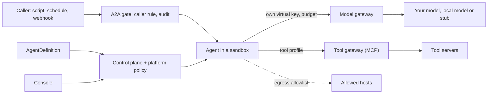
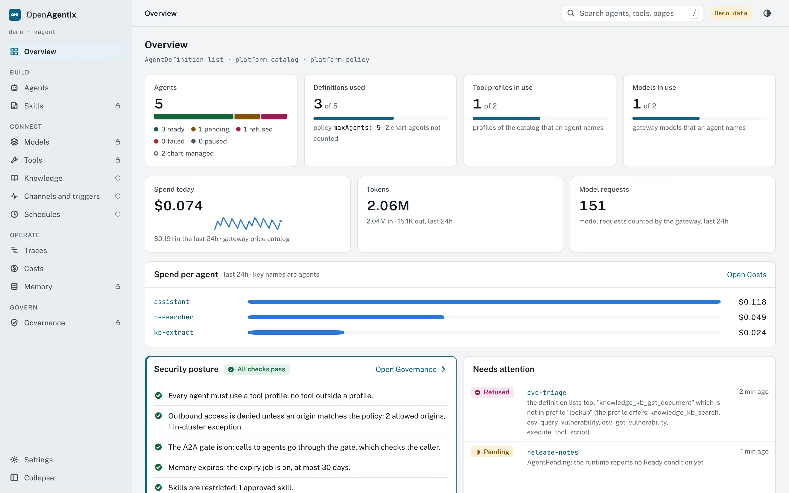

# OpenAgentix

OpenAgentix is an open-source (Apache-2.0), Kubernetes-native control plane for running AI agents under the rules your platform team sets.

**Who it is for.** Platform teams whose developers have started to run AI agents, and who need agent governance before those agents touch real tools and data. **The problem.** Each team wires its own stack: provider keys in agent pods, no cost per agent, tools and network wide open, no audit trail of who called which agent. **What you get in about 5 minutes.** One command, no model key and no chat token: a governed agent on a local kind cluster, with its own gateway key and token budget, one approved MCP tool, callers checked at an A2A gate, and a web console. **What is proven.** Each claim on this page links to [what works today, and what does not yet](docs/diary/what-works.md).

**What you get**

- **No provider keys in agent pods, and cost per agent.** Each agent gets its own key for a model gateway, with a token budget. The gateway records tokens and cost per agent and refuses calls when the budget is used up.
- **Least privilege for tools and network.** An agent sees only the MCP (Model Context Protocol) tools in the tool profile you approved. Egress control: its sandbox reaches only what its model and tools need, plus hosts you list.
- **Known callers and an audit trail.** A gate checks who calls an agent over the A2A protocol and which user they may speak for, and writes one audit line per request. Tool calls are audited too.
- **Agents as Kubernetes resources.** A short `AgentDefinition` is checked against a platform policy. If it breaks a rule, it is refused with a reason and nothing is created. Keep it in Git and apply it like any manifest.
- **Bring your own agent.** Besides agents described in an `AgentDefinition`, you can run your own container that speaks A2A 1.0, built with any framework, under the same key, budget, gate and tool profile (opt-in; proven in CI on kind, see the limits in [what works](docs/diary/what-works.md)).
- **One shared stack instead of one per team.** Runtime, model gateway, MCP gateway, telemetry and a web console come from one install. They are existing open-source projects behind adapters, on open standards (MCP, A2A, OpenTelemetry).



[](docs/diary/features/console.md)

*Console in demo mode.*

Built with Agent Substrate, kagent, agentgateway, MCP and ToolHive, A2A, OpenTelemetry, VictoriaMetrics, Jaeger, Gateway API, PostgreSQL with pgvector and Agent Kourier ([details](docs/diary/guide/built-with.md)).

**Try it** (needs `docker`, `kind`, `kubectl`, `helm`, `jq`, the Python `yq`, `openssl`, `curl`, `python3`; Docker with 4 CPU and 8 GB):

```sh
git clone https://github.com/openagentix/openagentix && cd openagentix
PROFILE=quickstart ./install.sh                     # no key needed: a scripted stub model answers
hack/ask.sh quickstart "Look up known vulnerabilities of lodash 4.17.20 (npm)"
```

The installer ends with a summary: how long it took, which model is active, and the commands to ask the agent and open the console. `hack/ask.sh` prints the answer and `(answered in Ns through the A2A gate)`. With the stub, the answer says it comes from the stub and names the tool it used. For real answers, run the install again with your key (`ANTHROPIC_API_KEY=sk-ant-... PROFILE=quickstart ./install.sh`) or any OpenAI-compatible endpoint. Details: [Try it in about 5 minutes](#try-it-in-about-5-minutes).

**Status and limits** (full table: [what works today, and what does not yet](docs/diary/what-works.md))

- Early project with one maintainer. Not production ready. Last release `v0.2.0`; the control plane, console, quick start and bring your own agent are on `main` and not yet in a release.
- Proven on one single-node kind cluster, and the keyless quick start in CI on hosted runners: first answer about 5 minutes after the start of `./install.sh` on kind (301 to 320 s, three runs, empty cache, stub model). The quick start and smoke test also passed on k3s (k3d) in CI, one node. A laptop was not timed.
- Not run yet: a managed cloud (GKE, EKS, AKS), OpenShift, several nodes, load. `CLUSTER_TYPE=remote` and the `platform: openshift` manifests are built and tested offline only ([Install on GKE, draft](docs/diary/guide/install-gke.md), [OpenShift](docs/diary/guide/openshift.md)).
- Agents run on kagent with Agent Substrate (gVisor sandboxes). Bring your own A2A agent (a digest-pinned container) is proven in CI on kind only, off by default.
- Release signing, SBOM and provenance are built but unproven until a real tag runs.
- Not built yet: human approval, one identity per agent for every call, budgets in money (budgets are in tokens), a Slack channel proven on a real workspace.
- Demo-grade parts: development databases, one replica of most services.

**Get involved:** [your first contribution in an hour](docs/diary/guide/first-contribution.md) · [good first issues](https://github.com/openagentix/openagentix/labels/good%20first%20issue) · [Discussions](https://github.com/openagentix/openagentix/discussions) · using or evaluating it? Add a row to [ADOPTERS.md](ADOPTERS.md) (evaluating counts), or tell us in [Show and tell](https://github.com/openagentix/openagentix/discussions/categories/show-and-tell).

**Read next:** [Why OpenAgentix](docs/diary/guide/why.md) · [Concepts](docs/diary/guide/concepts.md) · [Quick start](docs/diary/guide/quick-start.md) · [Built with](docs/diary/guide/built-with.md) · [Use cases](docs/diary/guide/use-cases.md) · [FAQ](docs/diary/guide/faq.md) · [API reference](docs/diary/reference/index.md) · [What works](docs/diary/what-works.md) · [Docs site](https://openagentix.github.io/openagentix/) · [Roadmap](docs/roadmap.md)

---

# Reference

Everything below is the detailed reference for each part: how it is packaged, every install option, and every feature with its commands, values and limits. Each feature also has a page in the [feature diary](docs/diary/index.md).

- Getting started: [Architecture](#architecture), [How it is packaged](#how-it-is-packaged), [Try it in about 5 minutes](#try-it-in-about-5-minutes), [Prerequisites](#prerequisites), [Full demo install](#full-demo-install)
- Features: [Knowledge base](#knowledge-base), [Memory](#memory), [Prompt caching](#prompt-caching), [Channels and triggers](#channels-and-triggers), [Schedules](#schedules), [Notifications](#notifications), [Observability](#observability), [Add an agent](#add-an-agent)
- Governance: [A2A gate](#a2a-gate-opt-in), [Tool profiles and egress per agent](#tool-profiles-and-egress-per-agent-opt-in), [Control plane and agent builder](#control-plane-and-agent-builder), [Console](#console), [Security](#security)
- Operations: [Tests](#tests), [Adopting an existing hand-applied install](#adopting-an-existing-hand-applied-install), [Known limitations](#known-limitations), [Repository layout](#repository-layout), [Community](#community), [License](#license)

## Architecture

This is the full demo with every optional part on. The quick start uses a smaller set (see below).

```
Telegram user
     |
     v
telegram-bridge (Go, long-polls Telegram, speaks A2A)        ns openagentix-gateway
     |  A2A SendMessage
     v
kagent controller --> Agent "assistant" in a gVisor sandbox  ns kagent
                          |                       |
                          | OpenAI API            | MCP (streamable HTTP)
                          | + per-agent           v
                          |   virtual key     ToolHive vMCP (code mode)   ns mcp-tools
                          v                       |-- fetch MCP server
                     agentgateway                 |-- OSV MCP server
                     (model-gateway)              `-- knowledge base (MCPServerEntry)
                     ns agentgateway-system           |
                       |            |                 v
                       v            | /v1/embeddings  kb (Go)  --> PostgreSQL + pgvector
              Anthropic             |  (own virtual    ns openagentix-knowledge
              (claude-haiku)        |   key "kb")         |
                                    +--------------> kb-embeddings (llama.cpp, bge-small, CPU)
```

Agents never hold a provider key. Each agent holds one gateway virtual key, so the gateway can budget and log usage per agent. Skills (Agent Skills format) are mounted into the sandbox from digest-pinned OCI images.

## How it is packaged

Upstream constraints make a single Helm chart impossible today: kagent and Substrate need fixed release names, a strict install order, and key material minted by `kubectl ate` before the charts start. The Gateway API CRDs ship in neither agentgateway chart. So there are two layers:

| Layer | What | Where |
|---|---|---|
| Installer | Creates the kind cluster (`hack/kind-config.yaml`), installs the upstream releases at pinned versions, creates Secrets from your environment, builds images, runs Helm | `install.sh`, `uninstall.sh` |
| Chart | Our own resources only, all driven by values | `charts/openagentix/` |

The chart owns: the Telegram bridge Deployment, the model gateway (Gateway, one AgentgatewayModel per entry in `gateway.models`, one AgentgatewayPolicy), the MCP layer (MCPGroup, MCPServers, VirtualMCPServer), the knowledge base (`knowledge` block: kb, PostgreSQL with pgvector, a CPU embedding server, an MCPServerEntry that makes the kb a backend of the vMCP, an `embed-default` gateway model, NetworkPolicies), and the kagent wiring (RemoteMCPServer, plus a ModelConfig, Harness, AgentTemplate and Agent for every entry in `agents`). Each block has an `enabled` flag. The chart never contains a secret value. It only references Secrets by name.

Pinned upstream versions: kagent and Agent Substrate 1.0.1, Gateway API CRDs 1.6.3, agentgateway v1.7.0, ToolHive 0.67.1.

## Try it in about 5 minutes

Bring any model key, or a local model, and get a governed agent on a laptop-size kind cluster. No chat app is needed, and no account other than your model provider's. (Slack is the first channel for organisations, planned for release 0.4; the Telegram bridge is an optional demo.)

You need `docker`, `kind`, `kubectl`, `helm`, `jq`, the Python `yq` (not mikefarah's) and `openssl`, and a Docker VM with 4 CPU and 8 GB or more (measured in CI: first answer 301 to 320 s on a hosted 4 vCPU / 16 GB runner with an empty cache, the node used about 2.4 GiB; a laptop was not timed).

```sh
ANTHROPIC_API_KEY=sk-ant-... PROFILE=quickstart ./install.sh      # or ./install.sh --quickstart
```

`PROFILE=minimal ./install.sh` (or `--minimal`) is the same without the console and the bundled observability: the gate, the gateway key and budget, the audit lines, the tool profile and the stub model stay. In CI it was not clearly faster than the quick start (the builds now run beside the other steps), but it uses about 100 to 220 MB less memory ([measurements](docs/diary/features/quick-start.md)).

Model, chosen for you in this order: a key in the environment (`ANTHROPIC_API_KEY`, `OPENAI_API_KEY`, `GOOGLE_API_KEY`), or any OpenAI-compatible endpoint (`MODEL_BASE_URL`, `MODEL_NAME`, and `MODEL_API_KEY` if it needs one); a local Ollama when you ask (`MODEL_PROVIDER=ollama MODEL_NAME=llama3.2`, optionally `OLLAMA_HOST`; Ollama must listen on all interfaces, and the cluster reaches the host at `host.docker.internal` on Docker Desktop or at the kind network gateway on Linux, which the installer looks up; this path is not tested yet); otherwise the stub. `MODEL_NAME` overrides the model name sent upstream. The installer's last lines say which model is active.

No key yet? You can still try the platform's controls in minutes: run `PROFILE=quickstart ./install.sh` with nothing set. A built-in **stub model** answers. It is a scripted stand-in, not a language model: it calls a tool for a vulnerability question and reports what the tool returned, and every answer says it is the stub. Use it to see the tool profile, the gate, the budget, the console and the refusals, not for answers. To switch later, run the same command with a key or endpoint above.

What you get: kagent and Agent Substrate (sandboxed agents), the model gateway (a virtual key and a token budget per agent), the tool gateway with one tool server (OSV) and one tool profile that offers one tool, the control plane and the console, the A2A gate, the bundled metrics store and Jaeger (content capture off), and one agent, `quickstart`, created from an `AgentDefinition` (`components/quickstart/agent.yaml`). Off: the Telegram bridge, channels, schedules, notify, the knowledge base and memory.

Ask the agent, with no chat app (the answer comes back through the A2A gate):

```sh
hack/ask.sh quickstart "Look up known vulnerabilities of lodash 4.17.20 (npm)"
```

Open the console (`kubectl port-forward -n openagentix-system svc/openagentix-console 8080:8080`, then http://127.0.0.1:8080; the sign-in token is in Secret `openagentix-system/console-token`, the installer prints the command). Remove everything: `kind delete cluster --name openagentix`.

Measured times and what they are made of: `docs/diary/features/quick-start.md`. The same install runs in CI without any key (`.github/workflows/e2e.yml`).

## Prerequisites

- Kubernetes 1.37 or newer. The installer creates a kind cluster with `kindest/node:v1.37.0`. The pod-certificate APIs that Substrate uses are only GA from 1.37.
- On your machine: `docker`, `kind` 0.33+, `kubectl` 1.37+, `helm` 3, `jq`, `yq` (the Python jq wrapper, not mikefarah's), `openssl`, `shasum`, and `curl` (the first install downloads the `kubectl-ate` plugin from the public Agent Substrate release and verifies its SHA-256; no GitHub login is needed).
- Docker needs about 7.5 GB of memory or more (tested with a 7.7 GiB VM). The full stack idles at roughly 2.3 GiB in the node; each agent sandbox adds more. The knowledge base adds about 0.2 GiB working set when idle (see "Knowledge base"); `knowledge.enabled=false` leaves it out.
- For the full demo below: an Anthropic API key, and a Telegram bot token from @BotFather (the installer asks for a token only when the Telegram bridge is on, and for a provider key only when a gateway model uses it).

## Full demo install

```sh
export ANTHROPIC_API_KEY=sk-ant-...
export TELEGRAM_BOT_TOKEN=123456:ABC...
export TELEGRAM_ALLOWED_CHAT_IDS=111111111       # required: the bridge refuses to start without it
./install.sh
```

A cold install from an empty cluster (images already in the local Docker cache) took about 10 minutes (604 s) on a 5 CPU / 7.7 GiB VM; allow longer when every image has to be pulled. With every demo values file (channels, schedules, notify, observability, knowledge graph, governance) a fresh install on 2026-11-25 took about 23 minutes on a 6 CPU / 8 GiB VM. If a required variable is missing the script says which one and changes nothing. Re-running is safe.

Useful switches: `CREATE_CLUSTER=0`, `SKIP_PREREQS=1`, `FORCE_PREREQS=1`, `SKIP_SKILL=1`, `SKIP_BRIDGE_IMAGE=1`, `SKIP_KB_IMAGE=1`, `SKIP_KB_INGEST=1`, `SKIP_NOTIFY_IMAGE=1`, `VALUES_FILE="my-values.yaml"`. They are documented at the top of `install.sh`.

Check it works from inside the cluster:

```sh
kubectl run a2a-test --rm -i --restart=Never -n openagentix-gateway --image=curlimages/curl:8.10.1 \
  --pod-running-timeout=90s --command -- curl -s -m 170 \
  -H 'Content-Type: application/json' -H 'A2A-Version: 1.0' \
  -d '{"jsonrpc":"2.0","id":"1","method":"SendMessage","params":{"message":{"messageId":"m1","role":"ROLE_USER","parts":[{"text":"Does lodash 4.17.20 on npm have known vulnerabilities? Give the count."}]}}}' \
  http://kagent-controller.kagent.svc.cluster.local:8083/agents/kagent/assistant
```

Expect `TASK_STATE_COMPLETED` and an answer that says 4. Then message your bot on Telegram.

Note: the controller's NetworkPolicy (`openagentix-kagent-controller`, on by default) admits only named callers on port 8083 (the bridge pod by its label `app=telegram-bridge`, Kourier, schedule pods, the A2A gate when it is on, and `networkPolicy.extraA2ACallers`). The test pod above is none of these, so by reading the chart the call should time out; this was not re-run for this note. Send a test from an admitted caller, list the test namespace in `networkPolicy.extraA2ACallers`, or use the quick start, where `hack/ask.sh` goes through the gate.

To remove OpenAgentix: `./uninstall.sh`. It removes only the `openagentix` Helm release. kind, kagent, Substrate, agentgateway, ToolHive, namespaces and all Secrets stay. `PURGE_SECRETS=1` also deletes the Secrets and the key ConfigMap that `install.sh` created (the knowledge base's database credentials stay); `PURGE_DATA=1` deletes the knowledge base volumes and database credentials.

## Knowledge base

The `knowledge` block (default on) deploys a small document store with hybrid search into the namespace `openagentix-knowledge`, and gives agents three read-only MCP tools for it. Nothing in it needs an external account: the embedding model runs in the cluster.

| Piece | What | Notes |
|---|---|---|
| `kb` | Go service from `services/kb` (image `openagentix/kb:dev`, built and loaded by `install.sh`) | MCP at `/mcp`, admin ingest API under `/v1` (bearer token) |
| `kb-postgres` | `pgvector/pgvector:pg17` (tag and digest pinned), StatefulSet, 2 Gi PVC | chunks, a `tsvector` index and a 384-dim HNSW vector index |
| `kb-embeddings` | llama.cpp server b10088 (digest pinned), model `BAAI/bge-small-en-v1.5` as GGUF (Q8_0, 384 dimensions) | OpenAI-compatible `/v1/embeddings`, CPU only, weights cached on a 1 Gi PVC |
| `embed-default` | an `AgentgatewayModel` on the model gateway that routes to `kb-embeddings` | the kb calls the gateway with its own virtual key (`user_id="kb"` in the gateway log); later consumers can share the endpoint |
| `knowledge` | an `MCPServerEntry` in the vMCP's group | no extra pods: the vMCP itself connects to the kb |

Agents that set `knowledge: true` (the demo `assistant` does) get the tools `knowledge_kb_search`, `knowledge_kb_get_document` and `knowledge_kb_list_collections` and a short addition to their system prompt: search the knowledge base for questions about OpenAgentix itself and cite document titles. The name is the entry name plus the vMCP prefix (`mcp.virtual.prefixFormat` with `{workload}` = `knowledge.mcp.entryName`) plus the kb's own tool name.

`install.sh` creates four Secrets in `openagentix-knowledge` (five with the knowledge graph on: see below) only when they are absent, so re-runs never rotate them: `kb-admin` (ingest token), `kb-postgres` (database password), `kb-database` (connection URL built from it) and `kb-virtual-key` (the kb's gateway key; its hash is added to `llm-api-keys`). It then ingests `components/knowledge/sample/` into the collection `openagentix`. Try it with the A2A command from the full demo install and the question "What is the OpenAgentix knowledge base canary code?". Expect `HERON-4412-KB-RETRIEVED` and a `knowledge_kb_search` call in the task's tool-call records.

**Ingest your own documents.** Put markdown files in a directory and run:

```sh
hack/kb-ingest.sh ./my-docs my-collection        # collection defaults to "openagentix"
```

Each file becomes one document: id from the path (`adr/0001-x.md` becomes `adr:0001-x`), title from the first `# ` heading, one idempotent `PUT` per file, so re-running replaces rather than duplicates. The script reads the token from the `kb-admin` Secret into a variable (never printed, not in argv) and talks to the kb through `kubectl port-forward`, which needs no NetworkPolicy entry. For an in-cluster job set `KB_URL` and `KB_ADMIN_TOKEN` and list the job's pods in `knowledge.kb.ingestFrom`. Agents see every collection; to restrict a search the agent passes `collection`.

**Knowledge graph (optional, off by default).** Vector search finds the passage that matches a question; it does not connect facts that sit in different documents. With `knowledge.kb.graph.enabled=true` the kb also extracts entities and relations from every ingested document with a gateway model (default `claude-haiku`, in the background, within an hourly token budget), stores them in its own PostgreSQL as plain tables, and adds three read-only tools next to the other three: `knowledge_kb_graph_search` (the entities a question names, and the chains of facts around them up to three hops), `knowledge_kb_graph_entity` and `knowledge_kb_graph_paths`. Every fact in an answer cites its `document_id`, chunk and quoted evidence, and the ids open with `kb_get_document`. Why this design and what was rejected: [ADR 0004](docs/decisions/0004-knowledge-graph.md).

```sh
VALUES_FILE=components/knowledge/graph-demo-values.yaml ./install.sh   # graph on; creates the extraction key kb-extract-key
hack/kb-graph-canary.sh                                                # ingest a 26-document fictional corpus and check a five-hop chain
hack/kb-graph-load.sh graph-canary org-catalogue components/knowledge/graph-sample/org-catalogue.yaml   # curated facts, no model call
```

- *Own key.* Extraction uses its own gateway virtual key (user id `kb-extract`, Secret `kb-extract-key`), so a big ingest cannot spend the embedding key's or an agent's tokens. `install.sh` creates it only when absent and never prints it; `PURGE_SECRETS=1 ./uninstall.sh` removes it.
- *Privacy.* The text of every ingested document is sent to the extraction model. Do not turn the graph on for documents you may not send there.
- *Untrusted.* Graph facts come from documents through a model: strict validation keeps only entities and quotes that literally occur in the text, but a document that states something false still produces a (cited) fact. Agents are told to treat it as reference data and to check the cited document.
- *Operator view.* `GET /v1/collections/<collection>/graph/stats` (admin token) shows entities, relations and job counts (pending, done, failed) and the last error code, never content, and the number of curated entities, relations and fact sets.
- *Curated facts.* An operator can load a hand-written catalogue (services, teams, owners, dependencies, escalation contacts) into a collection's graph with `hack/kb-graph-load.sh <collection> <factset-id> <file.yaml|json>` (YAML needs `yq`). It is one idempotent `PUT /v1/collections/<collection>/graph/factsets/<id>` that replaces that fact set (the same file twice changes nothing; facts removed from the file are removed), plus `GET`, a list and `DELETE`, with the document routes' admin token. No model is involved. The three graph tools return curated facts mixed with extracted ones and mark them (`curated: factset=... source=... | "note"`, no document id); a curated entity merges with an extracted one of the same canonical name and keeps its curated name and type; deleting or re-ingesting documents never removes it. Both ends of a relation must be declared in the same fact set. Sample: `components/knowledge/graph-sample/org-catalogue.yaml` (its README gives a question that needs one curated and two extracted facts). **Unit and integration tested. Proven on the kind demo cluster on 2026-11-23: the sample catalogue was loaded (19 entities, 12 relations) and the agent answered a question that needs two extracted facts and one curated fact, naming the fact set as the source of the curated one.**
- *Entity resolution.* One thing is one node: names are merged on their canonical form, which drops category words at either end (`Team Basalt` = `Basalt`, `cluster Teal` = `Teal`), whatever the type; distinct names (`Mira Okafor`, `Mira Lindqvist`; `Vane-2`, `Vane-3`) are never merged. The category-word list is English only, and two different things with the same proper name in one collection merge. Generic things (`the database`, `a dashboard`, `on-call engineer`) and events without a date are not stored. Prompt version `v2` carries this; **changing the prompt version re-extracts a document on its next ingest**, and the upgrade migration clears extracted graph rows once, so re-ingest your collections after upgrading ([ADR 0004](docs/decisions/0004-knowledge-graph.md)).
- *Status.* Unit and integration tests pass. The first run against a real model (26 documents, 42 359 tokens, 71 entities, 53 relations) extracted the graph but **failed the canary on retrieval** (duplicate nodes per thing, generic nodes, poor chain ranking); entity resolution, ranking and seeding were changed for it and **the canary has not yet passed against a real model after that change**. Token cost and latency come from that one run only. With `mcp.virtual.incomingAuth.toolAccess` set you must add the three tool names yourself.

**Swap the embedding model.**

- *Another local model:* set `knowledge.embeddings.model.hf` (a `<HuggingFace GGUF repo>:<quantisation>`), `.name`, `.dim` (at most 2000, the pgvector HNSW limit) and `.pooling` (`cls` for bge, often `mean` for others). Leave the image alone unless the model needs a newer llama.cpp.
- *A hosted endpoint:* set `knowledge.embeddings.enabled=false`, `knowledge.kb.embeddings.url` (an OpenAI-compatible base URL), `.model`, `.dim`, and `.apiKeySecret` (`{name, key}` of a Secret you create in `openagentix-knowledge`). The local server and the `embed-default` route are then not rendered.
- *No embeddings:* `knowledge.embeddings.enabled=false` alone gives lexical-only search.
- *Direct instead of through the gateway:* `knowledge.embeddings.viaGateway=false` (the kb calls the Service; NetworkPolicy then allows only the kb pod).

**Changing the model or its dimension means re-ingesting.** Vectors from different models are not comparable and the stored column has a fixed dimension. The kb refuses to start on a dimension mismatch; use a new `knowledge.kb.schema` (or drop the old one) and run `hack/kb-ingest.sh` again for every collection. Turning embeddings on for an existing database does not back-fill old chunks either. Changing `chunkMaxChars` needs a re-ingest too.

**Measured footprint** (kind, 1 arm64 node, 5 CPU / 7.7 GiB VM; working sets from the container runtime): idle, `kb` 6 MiB, `kb-embeddings` 110 MiB, `kb-postgres` 64 MiB. While ingesting 17 markdown files (160 KB, 25 s) `kb-embeddings` peaked at 155 MiB and used about 1.1 cores on average (2 threads, limit 2 CPU), `kb` 9 MiB, PostgreSQL 33 to 64 MiB. Requests: 100 m CPU, 304 MiB in total; limits: 384 MiB for the embedding server and for PostgreSQL, 192 MiB for the kb. The node's memory requests went from 3410 Mi to 3714 Mi.

## Memory

An agent with `memory.enabled: true` remembers facts across conversations. The demo `assistant` has it on. This is kagent's own long-term memory (Harness `spec.kagent.memory`); the chart wires it up and keeps its pieces behind the same gateway, virtual keys and NetworkPolicies as everything else.

**What is remembered.** Only what the model decides to save. kagent has no automatic "remember the whole conversation": it adds a `save_memory` tool, and a memory exists only after the model calls it with a short piece of text (a preference, a codename, a standing instruction). The chart appends a short paragraph to the system prompt of memory-enabled agents (`memory.agentPrompt`) that tells the model to save what is worth keeping across conversations, also when the user does not ask, and never to store secrets. Saving is a tool call, so it costs one more model call in that turn (the tool result goes back to the model). A variant that saves only when the user says "remember" was measured (first turn 2.7 s instead of 3.96 s) and is described in ADR 0005; change the paragraph in your values if you prefer it. Each saved text is embedded and stored as one row.

**When it is recalled.** Automatically, on every turn: kagent embeds the user's message, takes up to 5 stored memories of the same user and agent with cosine similarity of at least 0.3, and puts them into the model's context before it answers. The model also gets a `load_memory` tool for searching on its own. So a fact saved in conversation A shows up in a brand new conversation B (no `contextId`) when B's question is similar enough.

**For whom.** One memory space per agent AND per user: rows are keyed by the agent (`kagent/assistant`) and the session's user id, and the agent and user are taken from the stored session, never from the request. Another user of the same agent, or the same user on another agent, does not see them. Which user id a request has depends on kagent's auth mode. In the `insecure` mode this installation uses, kagent takes it from `?user_id=` or the `X-User-Id` header on the A2A request and otherwise uses the default admin user `admin@kagent.dev`. The Telegram bridge sends `X-User-Id: telegram:<chat id>` (prefix configurable with `bridge.userIdPrefix`), so **each Telegram chat has its own memory space**, and a group chat is one space shared by its members; the allowlist (`TELEGRAM_ALLOWED_CHAT_IDS`) still decides who may talk to the agent at all. Memory saved before this change was stored under the shared default user and is not visible to per-chat identities. Anything that can reach the controller's port 8083 can also claim any user id (the NetworkPolicy limits that to the bridge pod, `kagent` namespace and the egress proxy).

**Turn it on for an agent.**

```yaml
agents:
  - name: researcher
    # ...
    memory:
      enabled: true
      ttlDays: 30      # optional; kagent's default is 15
```

`install.sh` then (1) installs pgvector into kagent's PostgreSQL (`components/runtime/pgvector.sh`, idempotent, no data touched), (2) sets `config.database.vectorEnabled=true` on the kagent release with the one script that always applies `components/runtime/values/kagent.yaml` (`components/runtime/kagent-helm.sh`; fresh installs get both from `components/runtime/up.sh`), (3) creates the gateway key `memory-virtual-key` for the embedding ModelConfig, and (4) renders the shared pieces once: ModelConfig `gateway-embed-memory`, gateway model `embed-memory`, and the embedding server in namespace `openagentix-memory`. An agent without the `memory` block renders exactly as before, and if no agent opts in none of the shared pieces exist. `ttlDays` only sets `expires_at` on each row. In kagent 1.0.1 nothing calls the prune function (`PruneExpiredMemories`) and search ignores `expires_at`, so **memories do not actually expire** unless you turn on `memory.expiry` (see "Memory governance" below) or delete them yourself (see "Clear it").

**Why a second embedding model.** kagent stores memory as `vector(768)` and refuses any other size (a 384-dimension model fails with "embedding dimension 384 is less than required 768"; a larger vector is cut to 768 and re-normalised). The knowledge base's `bge-small-en-v1.5` has 384, so memory runs its own llama.cpp server with `bge-base-en-v1.5` (768, same publisher and pooling, 118 MB Q8_0). The chart fails the render if `memory.embeddings.model.dim` is not 768. The knowledge base is untouched, so nothing needs re-ingesting.

**One origin per credential.** kagent injects the gateway key for an agent's model at the sandbox's egress proxy and allows one key per destination origin. The chat ModelConfig already uses `model-gateway.agentgateway-system.svc.cluster.local` with the agent's key, so the embedding ModelConfig reaches the same gateway under a second DNS name (an `ExternalName` Service `model-gateway-memory`). Gateway logs show the embeddings as `user_id="memory"`.

**Look at it.** Memories are in `kagent.memory` of kagent's PostgreSQL (the admin password is in Secret `kagent/kagent-pg-admin`; `kubectl exec` into `kagent-pg-0` uses the local socket and needs none):

```sh
kubectl exec -n kagent kagent-pg-0 -- psql -U postgres -d kagent -c \
  "select agent_name, user_id, left(content,80) as content, extensions.vector_dims(embedding) as dims, expires_at, access_count from kagent.memory"
```

**Clear it.** kagent offers list and delete only over its internal gRPC API, so use SQL. One user on one agent: `delete from kagent.memory where agent_name='kagent/assistant' and user_id='<user>'`. Everything: `truncate kagent.memory`. Turning memory off for an agent (`enabled: false`) stops saving and recall but does not delete rows. With the A2A gate and `bridge.memoryCommands` on, a Telegram user can do the per-user delete in their own chat (below).

**Memory governance (opt-in, ADR 0006 round 3).** Three switches, all off by default; with all of them off every render is byte-identical to before. They need the gate demo file (`components/governance/demo-values.yaml`); `components/governance/memory-demo-values.yaml` turns all three on:

- `memory.expiry.enabled`: a nightly CronJob `memory-expiry` in the `kagent` namespace runs kagent's own two prune statements (`go/core/internal/database/memory.go` lines 125-139): expired rows read at least ten times get fifteen more days, the other expired rows are deleted. It uses psql from kagent's own database image and the existing Secret `kagent-postgres-readwrite` by reference, and logs counts only (`total_before expired extended deleted total_after`). A NetworkPolicy then admits only the controller and this job to kagent's PostgreSQL. kagent's search and list do not look at `expires_at`, so an expired memory is still recalled until the job has run. Run it once by hand with `kubectl create job -n kagent --from=cronjob/memory-expiry memory-expiry-manual`.
- `bridge.memoryCommands`: the Telegram bridge answers `/memories` (what is stored for this chat; at most 10 items) and `/forget`, then `/forget confirm` (delete it), through the gate to kagent's `MemoryService` `List` and `Delete`. The gate allows these two RPCs only for callers whose rule has `memory: true`, only for the user ids and agents of that rule, and sets the user id itself.
- `memory.expiry.secretScan` (and `secretScanDelete`): the expiry job counts, per pattern name, the memories that look like secrets (key headers, provider key prefixes, bearer tokens, JWTs); with `secretScanDelete` it deletes them. Report only by default.

```sh
VALUES_FILE="components/channels/demo-values.yaml components/schedules/demo-values.yaml components/notify/demo-values.yaml components/observability/demo-values.yaml components/knowledge/graph-demo-values.yaml components/governance/demo-values.yaml components/governance/profiles-demo-values.yaml components/governance/memory-demo-values.yaml" ./install.sh
```

The SQL is tested against a throw-away PostgreSQL that the test starts and stops itself (`charts/openagentix/tests/memory-expiry-integration.sh`, needs Docker). Details, limits and live evidence: `docs/diary/features/memory.md` and ADR 0006 "Round 3 results".

**Privacy.** Memory holds what users said, as plain text, in the database and as vectors, until someone deletes it (`ttlDays` is recorded but not enforced in kagent 1.0.1; `memory.expiry` enforces it). The text of every saved memory and of every user message (for recall) is sent to the embedding server in-cluster only; nothing leaves the cluster for embeddings. The model decides what to save, so it can store things you would rather it did not; the prompt tells it not to store secrets, which is advice, not a filter. The database is the development PostgreSQL (password auth, no TLS, no encryption at rest). A turn fails if the memory backend errors (the preload step has no fallback for a failing database), so keep pgvector enabled for as long as an agent has memory on.

**Footprint** (kind, 1 arm64 node): the embedding server idles at 74 MiB and was 133 MiB after a few calls (requests 192 MiB, limit 512 MiB, 1 GiB PVC for the model); kagent's PostgreSQL stayed at 60 to 61 MiB with pgvector on and a few rows; the `memory` table with two rows is 96 kB. The node's memory requests went from 3714 Mi to 3906 Mi.

## Prompt caching

The gateway adds Anthropic cache marks to every model call (`gateway.policy.promptCaching`, **on by default**, rendered as `spec.backend.ai.promptCaching` of the one AgentgatewayPolicy). Marks go on the tool list, the system prompt and the conversation; a client that sends its own marks wins. Measured on the demo `assistant` (about 8,000 prompt tokens per call): 6,635 tokens read from the cache on every call of a new conversation, 8,036 of 8,070 on the second call of a turn, and a cost per call 74% lower as the gateway's price catalog reports it. The call time did not change. Read cache numbers in the gateway's spans (`gen_ai.usage.cache_read.input_tokens`, `gen_ai.usage.cache_creation.input_tokens`) or metrics, not in kagent: its own usage shows 0 cached tokens. A cache entry lives 5 minutes, and the call that writes it costs 25% more than plain input tokens, so a rarely used agent can cost slightly more; set `gateway.policy.promptCaching.enabled=false` to turn it off. kagent places recalled memories in the system prompt after the static text, so when a memory is recalled only the tools and the static head are reused. The token budget per virtual key counts the full prompt, cached or not. Numbers and method: [ADR 0005](docs/decisions/0005-runtime-speed-kagent-vs-ax.md), "Tuning results".

## Channels and triggers

[Agent Kourier](https://github.com/agentkourier/agent-kourier) (0.6.0, pinned) connects chat platforms and signed webhooks to kagent agents. It is a small broker (one pod, SQLite on a 1Gi PVC, about 58 MB resident) that watches three custom resources: a **ChatConnection** (one Slack app or one webhook source, with its Secret), a **Binding** (connection channel -> agent, with triggers, limits and the user id the agent sees) and an **AgentBackend** (how to reach kagent, dialect `kagent-v1`). OpenAgentix renders all three from values; Kourier itself is installed by `install.sh`. It is **off by default**: with `channels.kourier.enabled: false` the chart renders nothing for it (byte-identical output to before).

**Enable it.** The one switch is the chart value `channels.kourier.enabled`, set in a values file you pass every run (Helm replaces release values on each run):

```sh
VALUES_FILE=components/channels/demo-values.yaml ./install.sh     # Kourier on, one demo webhook connection and binding to `assistant`
```

When the chart renders the block, `install.sh` (before the chart, so the CRDs exist): creates the Secret of each webhook connection if it is absent (random, never printed, kept on re-runs), checks that Slack Secrets exist, installs the `agent-kourier` Helm release in namespace `agent-kourier` (`components/channels/kourier.sh`; verifies the chart and the image digest with `cosign` when it is installed and says so when it skips that), then installs the chart. A re-run changes nothing (same chart version and values: no new revision, no pod restart). The chart also admits Kourier's pod to the kagent controller's port 8083 (a NetworkPolicy peer derived from the same switch, so a later install cannot drop it; `networkPolicy.extraA2ACallers` still works next to it). Kourier's own NetworkPolicy is on (`components/channels/kourier-values.yaml`): egress only to DNS, the API server, the kagent controller and port 443 outside the private ranges (Slack); ingress only the chat port from pods in its own namespace. The API server address is derived at install time: on kind (every node's `providerID` starts with `kind://`) the rule allows the `/24` of the API server's node address, because the node is a Docker container whose address changes when Docker restarts (`172.18.0.2` became `172.18.0.3`) and an exact `/32` then cut Kourier off until the next install; on any other cluster it allows the exact endpoint addresses (`/32`). `KOURIER_APISERVER_CIDRS` (comma or space separated CIDRs) overrides the detection. A cluster installed with the old `/32` rule gets the new one on the next `./install.sh`. Offline test of the derivation: `components/channels/tests/run.sh`. Without a values file that enables it, a run that finds Kourier installed prints a note and removes the connections and bindings from the release; `./uninstall.sh` removes the Kourier release (see below).

**Values.** Connections and bindings live in the top-level `channels` block (see `charts/openagentix/values.yaml` for all fields and the three patterns as comments). A webhook connection and a binding to `assistant`:

```yaml
channels:
  kourier: {enabled: true}
  connections:
    - name: orders-hook
      platform: webhook
      existingSecret: orders-hook-webhook          # install.sh generates it (key webhookSecret) when absent
      webhook:                                      # copied unchanged into the ChatConnection spec
        identity: orders-system
        verify: {scheme: hmac-sha256, header: X-Signature, prefix: "sha256="}
        channel: {from: [/channel]}
        actor: {from: [/user/login]}
        thread: {field: conversation, prefix: conv-}
        delivery: {header: X-Delivery-Id}
        fields:
          - {name: event, from: [/event], kind: id}
          - {name: conversation, from: [/conversation], kind: id}
          - {name: detail, from: [/detail]}
  bindings:
    - name: orders-assistant
      connection: orders-hook
      channel: orders
      agent: assistant                              # must be one of agents[].name, or the render fails
      triggers:                                     # copied unchanged
        - type: webhookEvent
          match: {event: '^order\.failed$'}
          promptTemplate: |
            Order {{ .Fields.conversation }} failed. Find out why and say what to do. The detail is in the untrusted data block.
          limits: {rateLimit: {maxRuns: 20, per: 1h, maxConcurrent: 2}, maxRunsPerDay: 100}
```

The Secret is only referenced: the chart renders no Secret values. The chart also renders a Role that lets Kourier's ServiceAccount `list` and `watch` exactly the Secrets your connections name. The `userId` of a binding is what kagent sees as the caller (default `kourier:<binding name>`).

**Three ways to map agents.**

- **A trigger per agent.** One webhook connection, one binding per agent. Each binding has its own `channel` value and its own `match`, so each event goes to the agent that owns it (`orders` to `assistant`, `deploys` to `ops`).
- **One bot, an agent per channel.** One Slack connection, one binding per Slack channel id, each naming another agent: `{name: eng, connection: team-slack, channel: C0ENG000001, agent: assistant}`, `{name: sec, connection: team-slack, channel: C0SEC000001, agent: security}`.
- **One bot per agent.** One Slack app, so one connection and one Secret, per agent, each with a binding to its agent (the bots can sit in the same channel).

**Define a webhook trigger for an agent.** Add a connection (how to verify the signature and where the channel, actor, conversation and fields are in the JSON body) and a binding with a `webhookEvent` trigger whose `match` is a regular expression over a field you declared, plus a `promptTemplate` (fields of kind `id` may be used in the template and thread key; `text` fields reach the agent only as untrusted data). Always set `limits`: excess events are dropped, not queued, and the sender is still told `200`.

**Test it locally.** The chat listener Service is ClusterIP only; nothing is exposed. Port-forward and send a signed event (the demo connection `demo-webhook`, header `X-Demo-Signature`; the secret is read from the cluster at signing time and never printed):

```sh
kubectl port-forward -n agent-kourier svc/agent-kourier-chat 8081:8081 &
BODY='{"event":"question.asked","channel":"demo","user":{"login":"alice"},"conversation":"c1","question":"Does lodash 4.17.20 have known vulnerabilities? How many?"}'
SIG=$(printf '%s' "$BODY" | openssl dgst -sha256 -hmac "$(kubectl get secret -n openagentix-channels demo-webhook -o jsonpath='{.data.webhookSecret}' | base64 -d)" -hex | awk '{print $NF}')
curl -s -o /dev/null -w '%{http_code}\n' -X POST http://127.0.0.1:8081/chat/webhook/openagentix-channels/demo-webhook \
  -H 'Content-Type: application/json' -H "X-Demo-Signature: sha256=$SIG" -H 'X-Demo-Delivery: d1' --data-binary "$BODY"
```

After a fresh install the binding can stay `Ready=False` (reason `AgentNotReady`) for a few minutes after the agent is Ready: Kourier re-checks the agent only periodically. A `200` means accepted; a wrong signature is `401`. The agent's answer is not returned (see limits): `kubectl logs -n agent-kourier deploy/agent-kourier` shows `session turn started` and `session turn ended outcome=completed`, and the text is in kagent's task store (`kagent.session_task` in the kagent PostgreSQL).

**Exposure.** The chat listener stays a ClusterIP Service on port 8081 and the chart creates no Ingress and no public endpoint. To receive real webhooks you would add an Ingress (or Gateway API route) in front of `agent-kourier-chat:8081` for the path `/chat/webhook/<namespace>/<connection>` only, terminate TLS there, and put the ingress controller's pods in `networkPolicy.chatFrom` (a values file passed with `KOURIER_VALUES_FILE`, replacing the default in `components/channels/kourier-values.yaml`) so the policy admits it; Kourier's chart has `chatListener.ingress` for the Ingress object. Webhook authenticity rests on the HMAC (or token) of the connection, so use a long random Secret.

**Limits (read before relying on it).**

- Upstream is experimental and 0.x with one maintainer; the webhook platform is the newest part. Pin and re-run the spike checks (`spikes/kourier/NOTES.md`) when you upgrade.
- A webhook has **no reply route**: the binding's `output` must be `none`, and the answer is visible only in kagent's store. The agent has to act through its own tools (see `docs/decisions/0002-schedules-and-trigger-delivery.md`); with the notify service one of those tools can post the result to a chat (see [Notifications](#notifications); the demo binding `demo-assistant-notify` does it for an event whose `deliver_to` field names a destination).
- **No direct messages**: Kourier serves channels and mentions, so Telegram (which is chat-by-DM) stays on our own bridge.
- **One memory scope per Binding.** Every conversation of a binding runs as the binding's fixed `userId`; kagent's long-term memory is keyed by agent and user id, so all of a binding's conversations share it. Give different teams different bindings.
- **Anyone in a bound Slack channel can use the agent** (and spend its budget); the channel is the access control.
- The kagent controller does not authenticate callers (insecure mode), so Kourier's `userId` is an unauthenticated claim and the NetworkPolicy peer is the only fence.
- A Kourier restart in the middle of a turn ends the turn recorded as `refused` on kagent 1.0.1 (it re-attaches with a call kagent answers `UNSUPPORTED_OPERATION`), even though the task completes. With a Slack reply route the user would see a failure notice instead of the answer.
- Rate limits drop the excess; the dedupe key is the body hash and lives in memory.

**Slack (UNTESTED).** The Slack path of this integration has not been run: the project had no Slack tokens. The values and RBAC follow Kourier's documentation and CRD schema only. When you have them:

1. Create a Slack app with Socket Mode on, a bot token (`xoxb-...`) and an app-level token (`xapp-...`, scope `connections:write`); subscribe the bot to `app_mention` and `message.channels`, and invite it to the channel. See Kourier's `docs/reference/platforms.md` for scopes.
2. Create the Secret yourself, in `channels.kourier.namespace` (default `openagentix-channels`), with exactly the keys `botToken` and `appToken` (HTTP mode needs `botToken` and `signingSecret` instead). Do not put the values in a file or in shell history you keep:

   ```sh
   kubectl create namespace openagentix-channels --dry-run=client -o yaml | kubectl apply -f -
   kubectl create secret generic team-slack-tokens -n openagentix-channels --from-literal=botToken="$SLACK_BOT_TOKEN" --from-literal=appToken="$SLACK_APP_TOKEN"
   ```
3. Add to your values file: a connection `{name: team-slack, platform: slack, existingSecret: team-slack-tokens, slack: {mode: socket}}` and a binding `{name: eng, connection: team-slack, channel: <Slack channel id>, agent: assistant, output: live, triggers: [{type: mention}]}`; run the installer with that file. `kubectl get bindings.agentkourier.dev -n openagentix-channels` shows `READY`.
4. Check what the spike could not: streaming cards, the restart caveat with a real reply path, thread-to-session mapping and the memory scope per channel.

**Uninstall.** `./uninstall.sh` removes the openagentix release and then the `agent-kourier` release. It leaves the namespaces `agent-kourier` and `openagentix-channels`, Kourier's PVC and CRDs and the generated webhook Secret. `PURGE_SECRETS=1` also deletes the webhook Secrets install.sh generated (never your Slack Secrets); `PURGE_DATA=1` also deletes Kourier's PVC and its three CRDs (the chart marks them `keep`; deleting them deletes any ChatConnection, Binding or AgentBackend still present).

## Schedules

Run an agent on a timetable, declared in values like everything else. Each entry of `schedules` renders a **CronJob** in the namespace `openagentix-schedules` (its own namespace, so the NetworkPolicies can name exactly these pods) whose pod runs `tools/a2a-call`: one A2A `SendMessage` to the agent with a caller identity, then exit `0` only if the task completed. Empty by default: with no schedules the chart renders nothing for this and its output is byte-identical to before. [ADR 0002](docs/decisions/0002-schedules-and-trigger-delivery.md) explains why kagent's own scheduler is not used (it sends no caller identity, so memory-enabled agents fail, and its runs hung on a cold agent).

```yaml
schedules:
  - name: daily-brief                 # DNS label, at most 40 characters, unique
    agent: assistant                  # must be an agents[].name, else the render fails
    schedule: "0 8 * * 1-5"           # 5-field cron, checked at render time (field count, ranges, names)
    timeZone: Europe/Berlin           # optional, IANA name
    prompt: |                         # configuration, NOT a secret (see below)
      Check the vulnerability database for lodash 4.17.20 and answer in two sentences.
    # optional: userId (default schedule:daily-brief), timeout (300s), suspend (false), concurrencyPolicy (Forbid),
    # historyLimits {successful: 3, failed: 3}, backoffLimit (0), startingDeadlineSeconds (300), ttlSecondsAfterFinished
    # (86400), resources. The defaults live in `scheduling.defaults` in values.yaml.
```

Pass the file to the installer like any values file; several can be combined (space-separated, applied in order; maps merge, **lists are replaced**, so keep all schedules in one file): `VALUES_FILE="components/channels/demo-values.yaml components/schedules/demo-values.yaml" ./install.sh`. `install.sh` builds and loads the `openagentix/a2a-call:dev` image only when the chart renders a CronJob (switch `SKIP_A2A_CALL_IMAGE=1`), and stamps a hash of `tools/a2a-call` on the pod template.

**User id and memory.** The pod sends `X-User-Id: <userId>`, default `schedule:<name>`. kagent keys sessions and long-term memory by it, so **one schedule is one memory scope**: every run of `daily-brief` sees what earlier runs saved with `save_memory`, and no other schedule, chat or binding does. Give two schedules the same `userId` to share a scope. Each run is a new conversation (a new kagent session owned by that user id); runs do not continue each other's session.

**Where results go.** By default nowhere but kagent's store. The job log has a one-line summary (state, task id, duration, length of the answer), never the answer text: answers can contain private data and job logs are widely readable. The answer is in kagent (the session of that user id, `kagent.session_task`, or the UI). To get it into a chat, enable the notify service (see [Notifications](#notifications)) and end the prompt with an instruction such as "deliver the result to owner-telegram": the agent then calls `delivery_notify_send` itself. `components/schedules/demo-values.yaml` does that for the suspended `demo-brief`.

**Do not put secrets in prompts.** The prompt is stored in a ConfigMap (`schedule-<name>`) that anyone who can read ConfigMaps in `openagentix-schedules` can read, and it is sent to the model provider. The chart renders no Secret values for schedules.

**Run one now, and see failures.**

```sh
kubectl create job -n openagentix-schedules --from=cronjob/demo-brief demo-brief-manual-1   # one real model call
kubectl logs -n openagentix-schedules job/demo-brief-manual-1       # {"state":"TASK_STATE_COMPLETED","taskId":...,"durationMs":9279,"answerChars":308,...}
kubectl get cronjob,job -n openagentix-schedules                    # LAST SCHEDULE, SUSPEND, Failed jobs
```

A failed run (failed task, input required, HTTP or JSON-RPC error, timeout) makes the pod exit `1` with `a2a-call: FAILED: <reason>` on stderr and the Job `Failed`. **`backoffLimit` is 0 on purpose**: by the time a call fails the agent may already have used tools or written memory, and a blind retry repeats the cost and the side effects; the next scheduled firing is the retry. `activeDeadlineSeconds` is the timeout plus 60 seconds, so a hung pod cannot outlive its schedule; `startingDeadlineSeconds` (300) skips a firing that could not start within five minutes instead of running it late; finished Jobs and their logs are removed after a day (`ttlSecondsAfterFinished`) and the last 3 successful and 3 failed are kept. Nothing alerts you: look at `kubectl get jobs -n openagentix-schedules` or scrape kube-state-metrics' job metrics.

**Cost.** Every firing is at least one model call and often several (tool calls, memory preload); a `* * * * *` schedule spends tokens every minute. Use `suspend: true` while testing (`kubectl patch cronjob <name> -n openagentix-schedules --type=merge -p '{"spec":{"suspend":true}}'` for a quick stop; the next install restores the values). The gateway's token budget per virtual key still applies. The demo schedule is suspended.

**Security.** The pods are non-root with a read-only root filesystem, no capabilities, seccomp `RuntimeDefault` and no service-account token. Two NetworkPolicies: the kagent controller's A2A port admits the namespace `openagentix-schedules` **and** the pod label `openagentix.io/component=schedule` (a pod in that namespace without the label times out), and an egress policy lets those pods reach only CoreDNS and the controller on 8083 (the knowledge base and the model gateway time out). Anyone who can create pods in `openagentix-schedules` with that label can call any agent, so keep that namespace's RBAC tight; with the A2A gate on this is still true, because such a pod can mount the projected token of any schedule ServiceAccount (the boundary is who may create pods there). `X-User-Id` is an unauthenticated claim on port 8083 like for every caller (see Security). Verified on kind: **kindnet enforces the egress policy for cluster destinations but not for destinations outside the cluster** (a labelled pod still reached example.com); on a CNI that enforces egress fully (Calico, Cilium) the pods also have no internet.

## Notifications

Agents started by a webhook or a schedule have no reply route. The **notify service** (`services/notify`, a small MCP server) gives them one without giving them the keys: an operator lists **named destinations** (a Telegram chat, a Slack channel, a signed webhook) and an agent can only say "send this text to `owner-telegram`". It never sees, and cannot choose, a chat id, channel id, URL or token. The service is one more backend of the vMCP, attached exactly like the knowledge base (an `MCPServerEntry` plus an `unauthenticated` `MCPExternalAuthConfig`, no extra pods for the entry). It is **off by default** (`notify.enabled: false`; the default render is byte-identical to before): enabling it adds a pod with internet egress and lets opted-in agents post messages, which should be a deliberate act.

```
trigger (schedule / webhook / chat) -> agent -> vMCP -> notify (checks, cleans text) -> Telegram | Slack | webhook
```

**What agents see.** The entry name is the tool prefix (`notify.mcp.entryName`, default `delivery`), so the tools are `delivery_notify_send` (arguments `destination`, `text`, optional `title` and `idempotency_key`) and `delivery_notify_list_destinations` (names, platform, description; never ids). An entry named `notify` would give `notify_notify_send`. The agent has the tools only when it opts in and the chart adds a short instruction to its system prompt (use the tool only when the task explicitly asks to deliver a result, name the destination exactly as given, keep it short, never include secrets):

```yaml
notify: {enabled: true}                  # top level: the service and its vMCP entry (needs mcp.enabled for the entry)
agents:
  - name: assistant
    ...
    notify: {enabled: true}              # per agent; agents without it render exactly as before
```

**Destinations live in a Secret, not in values.** The chart only references them: `notify.destinations.existingSecret` (default `notify-destinations`, key `destinations.yaml`, in `openagentix-notify`) is mounted at `/etc/notify/destinations.yaml`, and each token comes from an existing Secret through the `notify.tokens` list (`env`, `secret`, `key`; the env var name must match the `tokenEnv` of the destination). The chart renders no chat id, channel id, URL or token. To add a destination, edit the Secret and restart the pod (the file is read once at start):

```sh
kubectl get secret notify-destinations -n openagentix-notify -o jsonpath='{.data.destinations\.yaml}' | base64 -d > destinations.yaml   # holds chat ids: use a scratch dir, delete it afterwards
# add an entry (format: services/notify/README.md "Destinations file"), then:
kubectl create secret generic notify-destinations -n openagentix-notify --from-file=destinations.yaml --dry-run=client -o yaml | kubectl apply -f -
kubectl rollout restart deployment/notify -n openagentix-notify
```

**The installer and the owner's chat.** With `notify.enabled`, `install.sh` builds and loads `openagentix/notify:dev` (`SKIP_NOTIFY_IMAGE=1` to skip), stamps a hash of `services/notify` on the pod, and creates the two Secrets **only when absent**, from the environment, never printing them. If `NOTIFY_TELEGRAM_CHAT_ID` is set it writes one destination, `owner-telegram` ("The platform owner's Telegram chat"), and copies the bridge's bot token into `notify-credentials` in the notify namespace (a Secret cannot be mounted across namespaces). `NOTIFY_OWNER_TELEGRAM=1` does the same with the first id of `TELEGRAM_ALLOWED_CHAT_IDS`. **Without one of the two nothing is created**: installing never silently creates a way for agents to message someone, so a chat id that happens to be on the bridge allowlist is not used implicitly. Re-runs keep the Secrets and do not restart the pod; `PURGE_SECRETS=1 ./uninstall.sh` removes them. With no destination the service starts, refuses every call ("notifications are disabled") and reports not-ready, and the installer sets `notify.requireReady=false` so that `helm --wait` does not wait for it; set the same value yourself if you install with Helm alone and no destination yet.

```sh
TELEGRAM_ALLOWED_CHAT_IDS=<id> NOTIFY_TELEGRAM_CHAT_ID=<id> \
VALUES_FILE="components/channels/demo-values.yaml components/schedules/demo-values.yaml components/notify/demo-values.yaml" ./install.sh
```

The bot that sends is the bridge's bot. Sending (`sendMessage`) and the bridge's long polling (`getUpdates`) do not conflict: no 409 appeared in the bridge's log while messages were sent.

**Guardrails (in the service, covered by its unit tests).** Only configured names are accepted (an unknown name returns an error that lists the valid ones; nothing is sent). Every message starts with a line saying it comes from an automated agent. Text is cleaned (control, bidirectional and invisible characters removed; `@mentions`, `/commands`, `#hashtags` and links neutralised on Telegram, escaped on Slack), size-limited, and rate limited per destination and globally (defaults 6 per minute and 60 per hour per destination). `idempotency_key` makes a retry safe. The message text is never logged; logs carry the destination name, outcome, sizes and durations. Redirects and proxies are not followed. Details and the threat model: `services/notify/README.md`.

**Network.** The pod takes port 8080 only from the vMCP pods (namespace `mcp-tools`, labels `app=virtualmcpserver`, `toolhive-name=<mcp.virtual.name>`); a pod in `default` or a non-vMCP pod in `mcp-tools` times out (checked). Egress is DNS and TCP 443 to public addresses. NetworkPolicy matches addresses, not host names, so "api.telegram.org only" needs an FQDN-aware policy or an egress proxy.

**Limits (read before relying on it).**

- **This cluster's CNI (kindnet) does not enforce egress rules for destinations outside the cluster**, so the egress policy has no effect towards the internet here; Calico or Cilium enforce it.
- **Whoever can edit the destinations Secret decides where agents can post**, and whoever can read it learns the chat ids. Keep RBAC on `openagentix-notify` tight.
- The vMCP's Cedar policy is permit-all by default and kagent's identity is per session, not per agent: the per-agent opt-in limits which agents are *offered* the tools, not who can call the vMCP. `mcp.virtual.incomingAuth.toolAccess` can restrict the tool names per atespace.
- One replica by design: rate limits and idempotency keys live in the process and a restart forgets them. Callers are not told apart, so one agent can use up a destination's budget for the others.
- A prompt-injected agent can still send a misleading message to an allowed destination; the header tells the reader it was automated, the content is the agent's.
- Telegram bare domains, e-mail addresses and phone numbers are not touched and may still be tappable (see the service README). The project cannot see a Telegram client: "delivered" means Telegram's API accepted the message.

## Observability

Cost per agent, one trace per turn, tool-call counts and an audit log, from one switch. **Off by default** (`observability.enabled: false`: the default render is byte-identical to before). Design and evidence: [ADR 0003](docs/decisions/0003-observability.md).

**Turn it on.** With the bundled dev profile (VictoriaMetrics for metrics, Jaeger for traces, namespace `openagentix-observability`, in-memory traces, not for production):

```sh
VALUES_FILE="components/observability/demo-values.yaml" ./install.sh      # add the other values files you use: Helm replaces release values on every run
```

`install.sh` configures what the chart does not own from the same switch (the kagent controller and agent runtimes through `components/runtime/kagent-helm.sh`, Agent Kourier's OTLP env and scrape policy) and only when they differ from the wanted state, in either direction; a re-run changes nothing. **The first time it rolls the kagent controller and recompiles the agents, and on the 7.7 GiB demo node that roll caused a stall of about 20 minutes (see ADR 0003): do it when nobody is using the demo and expect to delete a crash-looping controller pod.** With your own stack instead:

```yaml
observability:
  enabled: true
  otlp: {endpoint: http://collector.monitoring.svc:4318, protocol: http/protobuf, contentFiltered: false}   # see "Privacy"
  metrics: {scrape: {namespace: monitoring}}      # PodMonitors, rendered only when the monitoring.coreos.com/v1 API exists
```

**Open the UIs** (nothing is exposed; the NetworkPolicy admits no UI traffic, a port-forward does not pass through it):

```sh
kubectl port-forward -n openagentix-observability svc/victoria-metrics 8428:8428    # http://127.0.0.1:8428/vmui (PromQL), /api/v1/query
kubectl port-forward -n openagentix-observability svc/jaeger 16686:16686            # http://127.0.0.1:16686
```

**Cost and tokens per agent.** `user_id` is the agent's gateway virtual-key name (`assistant`, `kb`, `memory`), never a person:

```
sum by (user_id)(increase(agentgateway_gen_ai_client_cost_usd_total[1h]))
sum by (user_id, gen_ai_token_type)(increase(agentgateway_gen_ai_client_token_usage_sum[1h]))
```

Cost is the gateway's own catalog price (claude-haiku-5-5: 0.10 USD per million input and 0.50 per million output tokens); it matches the `agw.ai.usage.cost.total` field of the access log. A model missing from the catalog has no cost. For a series younger than the window VictoriaMetrics counts the value of the first scrape as an increase, so the first hour after install reads high; tokens and later windows are exact. Tool calls: `toolhive_mcp_tool_calls_total{tool="..."}`; Substrate: `ate_*`.

**kb and notify metrics, and a local dashboard (round 2, built and tested offline, not yet run on the cluster).** With observability on, `kb` and `notify` serve Prometheus metrics on port 9090, a listener separate from their API (`KB_METRICS_ADDR`, `NOTIFY_METRICS_ADDR`), only the bundled VictoriaMetrics may reach it, and the PodMonitors and the scrape config follow the same target list (`when: knowledge`, `when: notify`). Counts and timings only, with labels from closed sets: no document text, query, message text, chat id, destination name or address (`openagentix_kb_*`: HTTP by route, MCP tools, searches by mode, embedder, ingest, graph jobs, model calls, tokens, pending and size gauges; `openagentix_notify_*`: sends by platform kind and outcome, rate-limit and size rejections, MCP tools). `knowledge.kb.metrics.collectionLabels` (default false) puts collection names on the graph gauges. No new pod: `hack/dashboard.sh` port-forwards the bundled VictoriaMetrics and serves one static page on `http://127.0.0.1:8765` (cost and tokens per agent, model requests and errors, tool calls, kb searches and latency, graph extraction, notify sends, target health, each with its PromQL); `hack/dashboard.sh --check [--url BASE]` runs its queries and exits non-zero on a query error. Needs `python3` and `curl`; tests: `hack/dashboard/tests/run.sh`.

**Follow one request.** The Telegram bridge logs one `turn` line per message with `trace_id` (and `context_id`); `tools/a2a-call` prints `traceId` and `contextId` in its summary; for a manual call send a header of your own (`-H 'traceparent: 00-<32 hex>-<16 hex>-01'`). Then:

```sh
hack/trace-turn.sh <traceId or contextId>     # read-only
#  model:  2 calls 3.2s  tokens in=30782 out=263  models=claude-haiku-5-5  cost=$0.00321
#  memory: 2 embedding calls 2.9s
#  tools:  osv_query_vulnerability 2.9s   (vMCP: osv_query_vulnerability 1.3s)
#  notify: not called
```

It reads Jaeger through a port-forward it stops itself, and without Jaeger falls back to the egress proxy's log joined on `ate.actor.name=session-<contextId>`. The full trace (controller, agent runtime in its sandbox, vMCP, model gateway) is in the Jaeger UI under the trace id. The vMCP audit records (tool name, outcome, `actor/kagent/session-<contextId>`, duration) are `AUDIT` lines in the log of the `tools` pod in `mcp-tools`.

**Privacy.** Content capture is off everywhere: kagent `captureContent`, the vMCP audit's `includeRequestData`/`includeResponseData`, and the gateway adds no prompt or completion to its spans. The single value `observability.capture.content` (default `false`) is the only way to turn content on, and it turns on all of those at once. `observability.baggage` (default `false`) would put agent and conversation ids into the `baggage` header sent to MCP servers and model providers. Metrics carry no user id; the bridge's logs carry a chat id only as a short salted hash. **Known leak:** the agent runtime and the vMCP write tool arguments and results into spans whatever the capture setting (`gcp.vertex.agent.tool_call_args`, `tool_response`, `mcp.tool.arguments`), and `user.id` carries `telegram:<chat id>`. The bundled Jaeger deletes them before storage. For **your own endpoint** the chart exports only the gateway's spans until you set `observability.otlp.contentFiltered: true`, which says that your collector deletes those attributes (copy the `attributes` processor from `templates/_helpers.tpl`, `oa.jaegerConfig`). More keys: `observability.bundled.traces.extraDropAttributes`.

**Footprint** (kind, 1 arm64 node): requests +144 Mi (VictoriaMetrics 96 Mi request, 256 Mi limit; Jaeger 48 Mi, 192 Mi); measured working set about an hour in: VictoriaMetrics 153 to 156 MB, Jaeger 27 to 34 MB. A 2 Gi volume holds 7 days of metrics. If the node is short of memory, drop Jaeger first: set `observability.bundled.enabled=false` and point `otlp.endpoint` at another backend, or `observability.tracing.enabled=false`.

**Limits.** Traces are in memory (2 000, gone on restart). OTLP from the sandboxes is proven over http/protobuf only. The PodMonitors are rendered and unit-tested but were not run (the demo cluster has no Prometheus operator). Kourier traces and the Telegram path were not exercised live. The kb and notify metrics and the local dashboard are built and tested offline, not yet run on the cluster. No alerts, no per-user view.

## Add an agent

Create a values file and pass it to the installer (`knowledge: true` on an agent adds the knowledge base tools and prompt; `memory: {enabled: true}` turns on long-term memory, see "Memory"):

```yaml
# my-values.yaml
agents:
  - name: assistant            # keep the existing one if you still want it
    # ...same fields as in charts/openagentix/values.yaml
  - name: researcher
    description: Looks things up
    model: claude-haiku        # a name from gateway.models
    systemPrompt: |
      You are a careful research assistant. Cite what you fetched.
    tools:
      - tools: [fetch_fetch, osv_query_vulnerability]   # server defaults to the vMCP RemoteMCPServer
    skills: [openagentix-canary]                         # names from the top-level `skills` map
```

```sh
VALUES_FILE=my-values.yaml ./install.sh
```

Helm replaces lists, so repeat any agent you want to keep. For each agent the installer creates the Secret `<name>-virtual-key` in `kagent` and adds its SHA-256 hash to the gateway's `llm-api-keys` ConfigMap, so gateway logs and metrics carry `user_id="<name>"`. The chart then renders a ModelConfig that points at that Secret, a Harness, an AgentTemplate and an Agent. A new agent takes one to two minutes to become Ready while its golden snapshot is built.

To add a model, add an entry to `gateway.models` (see the commented Gemini and failover examples in `values.yaml`) and create its provider Secret in `agentgateway-system` with the key name `Authorization`. To add an MCP server, add an entry to `mcp.servers`. Tool names are prefixed with the server name (`fetch_fetch`), and an agent's tool allowlist has to list them explicitly. To turn code mode off, set `mcp.virtual.codeMode.enabled=false`.

Skill references must be digest-pinned (`...@sha256:<64 hex>`); the render fails otherwise.

## Tests

The offline checks that CI runs are `make` targets (`make help` lists them): `make test` runs the Go tests, the chart tests and the shell suites with no Docker and no cluster. To run one piece by hand:

```sh
charts/openagentix/tests/run.sh      # shell assertions over `helm template`, needs helm, yq, jq
helm lint charts/openagentix
(cd tools/a2a-call && make test)     # the schedule caller: go vet, go test -race
(cd services/a2a-gate && make test)  # the A2A gate: go test -race, standard library only
(cd bridges/telegram && go test -race ./...)
charts/openagentix/tests/memory-expiry-integration.sh   # the memory expiry SQL against a throw-away PostgreSQL it starts and stops itself (needs Docker)
```

## Adopting an existing hand-applied install

If the cluster already holds hand-applied copies of the objects this chart renders, `install.sh` labels and annotates them for Helm (`app.kubernetes.io/managed-by=Helm`, `meta.helm.sh/release-*`), runs `helm upgrade --install`, then converges them with a server-side apply. Nothing is deleted or recreated. Helm alone would leave adopted custom resources unchanged. Objects the chart does not render (old stub models, test agents, a second policy) are left alone; remove them yourself.

## A2A gate (opt-in)

Off by default. With `governance.a2a.enabled: true` a small proxy (`services/a2a-gate`) stands in front of the kagent controller's A2A port, so a caller proves who it is and can no longer name any user it likes. The bridge and every schedule send a projected ServiceAccount token (one ServiceAccount per schedule); each Kourier binding sends its own static key. The chart derives a rule per caller: the agents it may call and the user ids it may assert (the bridge: the prefix `telegram:`; a schedule: exactly `schedule:<name>`; a Kourier binding: fixed). Everything except `POST /agents/<ns>/<name>` and the agent card gets 403, gRPC and the REST API included. The gate sets `X-User-Id` itself, removes `Authorization` and `?user_id=`, passes SSE through, and writes one JSON audit line per request (user id as a salted hash, never the message text). Port 8083 then admits only the gate, the Substrate egress proxy and the kagent UI pods. A caller whose rule says `memory: true` (the bridge, with `bridge.memoryCommands`) may also call `MemoryService` `List` and `Delete`, and nothing else of gRPC. A caller may use only the JSON-RPC methods in its rule (the chart sets what its own callers send; a method outside the list gets 403), and the gate caps its own memory use (header size, body read deadline, requests in flight, TokenReview limits).

```sh
VALUES_FILE="components/channels/demo-values.yaml components/schedules/demo-values.yaml components/governance/demo-values.yaml" ./install.sh
kubectl logs -n openagentix-gateway deploy/a2a-gate     # the audit lines
```

`install.sh` builds the image, creates the Kourier keys and their hashes (kept on re-runs, never printed) and applies the gate and the callers in one `helm upgrade`. `networkPolicy.extraA2ACallers` needs a matching `governance.a2a.callers` entry with the gate on, or the render fails. What it does not cover (one replica, no revocation, no protection from someone who can create pods in the callers' namespaces): `docs/diary/features/security.md` and ADR 0006 (`docs/decisions/0006-governance.md`).

## Tool profiles and egress per agent (opt-in)

Off by default. By default every agent can call every tool of the one vMCP, and `bash` or code mode can reach the ones the agent's list leaves out. A tool profile (`mcp.profiles`) renders one more vMCP on the same tool group that advertises only the tools you list, with its own OIDC audience and its own RemoteMCPServer. An agent with `toolProfile: <name>` takes its tools only from that server; a tool outside the profile is not found, in a direct call and in code mode, and the sandbox has no egress rule for the shared vMCP. `agents[].egress.allow` lists extra origins (`https://host[:port]`) for the agent's sandbox and renders a kagent `EgressPolicy`. The render fails for an unknown profile, a tool that is not in the profile, duplicate profile names and malformed origins.

```yaml
mcp:
  profiles:
    - name: lookup
      codeMode: true
      tools: {osv: [query_vulnerability, get_vulnerability], knowledge: [kb_search]}
agents:
  - name: profile-demo
    toolProfile: lookup
    tools: [{tools: [execute_tool_script, osv_query_vulnerability, osv_get_vulnerability, knowledge_kb_search]}]
    egress: {allow: ["https://api.osv.dev"]}
```

```sh
VALUES_FILE="components/channels/demo-values.yaml components/schedules/demo-values.yaml components/notify/demo-values.yaml components/observability/demo-values.yaml components/knowledge/graph-demo-values.yaml components/governance/demo-values.yaml components/governance/profiles-demo-values.yaml" ./install.sh
```

The demo file ships exactly one profile (the 6 CPU / 8 GB node carries one) and must come last, because it restates the `agents` list. Each profile costs one more vMCP pod: about 30 MB and a few millicores idle, 100m CPU and 128 MiB of requests. Cedar `toolAccess` applies to the shared vMCP only. `bash` stays on. Evidence and findings: ADR 0006, "Round 2 results".

## Control plane and agent builder

An agent can also be made from one small resource, `AgentDefinition` (`openagentix.io/v1alpha1`, short name `oad`). A controller (`services/control-plane`) turns it into the runtime agent, a gateway key and a status. A catalog says what exists and a policy says what is allowed. A definition that breaks the policy is refused with one sentence per rule, and nothing is created. An admission guard of 8 policies lets only the controller write the objects it owns. The controller never reads a Secret. It is off by default (`controlPlane.enabled`), and the default render does not change.

```sh
VALUES_FILE="components/channels/demo-values.yaml components/schedules/demo-values.yaml components/notify/demo-values.yaml components/observability/demo-values.yaml components/knowledge/graph-demo-values.yaml components/governance/demo-values.yaml components/governance/profiles-demo-values.yaml components/governance/memory-demo-values.yaml components/control-plane/demo-values.yaml components/console/demo-values.yaml" ./install.sh
kubectl apply -f components/control-plane/researcher.yaml
```

Proven on the kind demo cluster (2026-11-25): a definition became a Ready agent in 13 to 31 s, the agent answered with a tool from its tool profile, and the gateway recorded the call under the agent's own user. Not done yet: chart agents (`agents[]`) are not migrated to definitions; schedules, Kourier bindings and the Telegram bridge cannot point at built agents; nobody can call a built agent through the A2A gate until an operator adds a caller rule; suspend is a stop, not a pause; bring your own agent is planned for 0.3. Details: [Control plane](docs/diary/features/control-plane.md), `services/control-plane/README.md`, ADR 0007, 0012 and 0013.

## Bring your own agent

You can run your own agent image next to the built-in ones (ADR 0015, issue #43). It is off by default. Set `controlPlane.containerAgents.enabled=true`, add `container` to the policy's `allowedRuntimes`, and name the registries you trust in `controlPlane.policy.runtimes.container.images`. Then a definition can say `spec.runtime.type: container` and name an image pinned by digest. The image must speak A2A 1.0 (an agent card at `/.well-known/agent-card.json` and `SendMessage` at `POST /`). Samples are in `examples/agents/echo-a2a` (Go) and `examples/agents/echo-a2a-python` (Python, A2A SDK; its README has the steps).

```sh
kubectl apply -f examples/agents/echo-a2a/agent.yaml   # after you put your image digest in it
kubectl -n kagent get oad echo-go
```

To try it on the quick start (kind, no key): `QUICKSTART_BYO=1 PROFILE=quickstart ./install.sh`. It builds the sample image, loads it into kind, allows its (name-only) registry prefix `registry.local/oa/` for the quick start only, and applies the sample definition; then `hack/ask.sh echo-go "hello"`. A real cluster pushes the image to its own registry, lists that prefix in `controlPlane.policy.runtimes.container.images` and pins the digest the push prints.

What works: the platform runs the container itself in the locked-down namespace `openagentix-workloads` (Pod Security `restricted`, deny-by-default network rules, non-root, read-only root file system). The agent gets its own gateway key as `OPENAI_API_KEY` and its own budget. Callers reach it only through the A2A gate, which rewrites its agent card. The controller never reads the key.

Tools (ADR 0019, off by default): the operator opens a tool profile to container agents with `controlPlane.containerAgents.toolProfiles: [<profile>]`. A definition with that `toolProfile` then gets `OPENAGENTIX_MCP_URL` and a short-lived token for its own ServiceAccount (`OPENAGENTIX_MCP_TOKEN_FILE`, written by the kubelet, no Secret). It reaches a second tool server for that profile, which has the same tools and admits only the workload namespace. The quick start opens `lookup`; `hack/ask.sh echo-go /tools` then lists its tool (shown on kind in CI; on k3s the tool server could not read the cluster's signing keys, see What works). Any pod can get a token with that audience for its own ServiceAccount, so the server's rule on the workload namespace keeps other namespaces out, and two admission policies keep such tokens in the workload namespace to the controller's pods. A token stays valid until it expires (at most one hour), also after the agent is removed.

What is refused in this release (one sentence each in `status.violations`): `instructions`, `instructionsFrom`, `tools`, a `toolProfile` that is not opened to container agents, `egress.allow`, `memory`, `knowledge`, `notify` and `skills`; an image that is not pinned by digest or is outside the operator's registry list; a runtime the policy does not allow.

How it differs from the built-in runtime, honestly: a container agent is less isolated. It shares the node kernel (unless the operator sets a RuntimeClass), one long-lived process serves every conversation, it has one identity for all sessions, and its files do not survive a restart. Outbound traffic is limited by a NetworkPolicy only. kind's network plugin (kindnet) does not enforce that toward the internet, so on the quick start such an agent can reach the internet. The isolation of a container agent holds only on a cluster whose network plugin enforces NetworkPolicy, so use such a cluster for anything beyond the quick start. Its DNS lookups go to the cluster DNS (kube-dns) and can leave the cluster by default. The model named in the definition is a hint for a container agent: the gateway does not yet restrict which models its key can use. An egress allowlist comes in a later slice.

## Console

The console is a web page for the agent builder: an agents registry, a builder whose options follow the policy, a YAML view, pause and delete. Overview, Models, Tools, Skills, Memory and Governance show read-only data from the cluster; with the bundled observability on, the Overview and Costs pages show spend and tokens per agent and the Traces page shows recent turns. Areas without a data source say "not available yet". It is a small Go API with a bearer token and a strict Content-Security-Policy, plus a Svelte app in one image. It needs the control plane and is off by default (`console.enabled`). It has no ingress. The installer creates the token Secret `console-token`; open the console with a port-forward:

```sh
kubectl port-forward -n openagentix-system svc/openagentix-console 8080:8080    # then http://127.0.0.1:8080
```

Proven on the kind demo cluster: without a token the API answers 401; an agent created through the API became Ready in 25 s; the console's ServiceAccount cannot read Secrets. Not verified: the browser UI against the real cluster (only the API was used there; the UI was exercised in demo mode); the Playground does not exist yet. Details: [Console](docs/diary/features/console.md), `services/console/README.md`, `docs/console/UI-SPEC.md`.

## Security

What is protected, what is not. Checked on kind (kindnet enforces NetworkPolicy) with kagent 1.0.1, Substrate 1.0.1 and ToolHive 0.67.1.

**Protected**

- **Network, `mcp-tools` (chart, `networkPolicy.enabled`, default on).** MCP backends and their proxies accept connections only from their own namespace and from the ToolHive operator. The vMCP (port 4483) additionally accepts the Substrate egress proxy (`atenet-egress` in `ate-system`) and the kagent controller pod. A pod in `default` or in another namespace times out.
- **Network, kagent UI (closed by default).** The UI's nginx forwards `X-User-Id` and proxies the controller's whole API (memory, sessions, A2A over gRPC-Web), so an open UI was a relay around the gate. The policy `openagentix-kagent-ui` admits nobody; open the UI with `kubectl port-forward -n kagent svc/kagent-ui 8080:8080` (it still works under kindnet, because the kubelet connects inside the pod), or list peers in `networkPolicy.kagentUI.allowFrom`. **This changed the default render**, to close the hole. Verified on kind: a pod in `default`, `openagentix-gateway` or `kagent` timed out on the memory List call.
- **Network, kagent controller port 8083.** A2A, the REST API and the sandboxes' task-store gRPC share this port. It accepts the Telegram bridge pod (selected by pod label `app=telegram-bridge` in `openagentix-gateway`, not the whole namespace), the kagent UI pods (by label, since the review after round 1; the tools server and the worker pool do not call it), `atenet-egress` and, when `channels.kourier.enabled`, the Agent Kourier pod (namespace and pod labels). Other pods time out. Ports other than 8083 are left open, as before (the controller listens on no other).
- **Tool identity (chart, `mcp.virtual.incomingAuth.type: oidc`, default).** The vMCP rejects requests without a valid Substrate actor JWT (HTTP 401, also for a malformed token). The RemoteMCPServer asks Substrate for a token with the dedicated audience `openagentix-vmcp`, and the egress proxy adds it to every tool call. The vMCP verifies issuer, signature (explicit JWKS URL, TLS checked against the Substrate service CA, which `install.sh` copies into a ConfigMap), audience and expiry. No `insecure*` flag is set; `jwksAllowPrivateIP` is on because the IdP's ClusterIP is a private address.
- **Network, `openagentix-knowledge` (chart, same switch).** The kb pod accepts port 8080 only from the vMCP pod (selected by namespace and pod labels); the kb port carries both `/mcp` (no authentication, by design) and the admin API (bearer token), so the policy and the token together are the control. PostgreSQL accepts only the kb pod. The embedding server accepts only the model gateway proxy pod (the kb pod in direct mode). Checked with a pod in `default` (all three time out), another pod in the knowledge namespace (all three time out) and a non-vMCP pod in `mcp-tools` (kb times out). A request to `/v1/embeddings` on the gateway without a key or with a wrong key gets 401.
- **Memory governance (opt-in, ADR 0006 round 3).** With `memory.expiry` on, kagent's PostgreSQL (open to every pod before) admits only the controller and the nightly expiry job (`openagentix-kagent-pg`), and the job logs counts only. With `bridge.memoryCommands` on, the A2A gate lets the bridge (rule `memory: true`) call `MemoryService` `List` and `Delete` for the chat's own user id and its own agent, and refuses every other RPC, user id, agent and malformed frame. The gate trusts the bridge for which chat sent a command; in a group chat any member can forget the group's memories. Verified on kind (see ADR 0006 "Round 3 results").
- **Tool authorization (optional).** `mcp.virtual.incomingAuth.toolAccess` turns into Cedar `permit` rules keyed on the token's `atespace` claim and the tool name; with it set, a tool not listed is refused (and hidden from the agent's tool list). Verified: with `osv_query_vulnerability` left out, Cedar logged deny for it and allow for the others, and the agent answered through `osv_query_vulnerabilities_batch` instead.

**Not protected**

- **The kagent controller does not authenticate callers.** `server.auth.mode` is `insecure`. The opt-in A2A gate (above) puts authentication in front of it for the bridge, the schedules and Kourier; without it this still holds, and with it too for anything that can reach the controller by another way. Enabling `config.server.auth.serviceAccount.authority: kubernetes` was tried and does not help: requests with no token and with a garbage token were still answered (HTTP 200); only a valid Kubernetes token with the wrong audience was refused (401). Any pod the NetworkPolicy lets through can call any agent. The policy is the only control, and it allows the UI pods and all sandboxes (their traffic leaves through `atenet-egress`, which therefore cannot be told apart from one agent to the next).
- **No per-agent tool authorization.** kagent creates one Substrate actor per session (`actor/kagent/session-<uuid>`) in the atespace `kagent`, for every agent. Cedar can tell sessions and atespaces apart, not agents. The default Cedar policy is permit-all for any authenticated caller. Only the agent's tool allowlist in its AgentTemplate limits which tools an agent offers to its model. Whether code running in a sandbox (for example through the `bash` tool) could call the vMCP directly, with the token the egress proxy injects for that destination, was not tested; assume it can.
- Anything with an actor JWT can present it to the vMCP until it expires (up to `tokenExpirationSeconds`, 3600). There is no revocation.
- **Global tool discovery is off.** With `actorJwt` the RemoteMCPServer shows `Accepted` with reason `DiscoveryDisabled`; agents list the tools at run time inside their sandbox. Set `incomingAuth.type=anonymous` to get the controller-side discovery back.
- The `fetch` tool can still reach any URL the pod network allows (no egress policy on `mcp-tools`). The Telegram bridge pod and the `kagent`/`ate-system` namespaces are not restricted at all. The Substrate CA copied into `mcp-tools` is read once at install time; re-run `./install.sh` if the CA is rotated.
- The Telegram allowlist and the model gateway virtual keys are separate controls described above.

## Known limitations

These are the gaps found while building the components. Most are acceptable for a laptop demo and not for anything else.

- **Single node, dev databases.** Substrate uses a bundled dev PostgreSQL with mTLS. kagent uses a plain pgvector PostgreSQL with password auth and `sslmode=disable`. RustFS credentials are `rustfsadmin/rustfsadmin`. The identity CA and JWT keys are minted once by `kubectl ate` and live in Secrets.
- **Tool layer authorization is coarse.** The vMCP authenticates callers (see Security) but its Cedar policy is permit-all by default, and the identity Substrate gives an agent is per session, not per agent. See Security for the exact grain, and for the NetworkPolicy and `fetch` egress caveats.
- **Code mode** runs Starlark with no `json` module, so processing JSON tool output is awkward. Per-call authorization of inner tool calls is not verified.
- **Gateway budgets** are token-based and per proxy replica; there are no USD caps. Cross-replica limits need an external rate-limit service. Virtual keys are static, with no rotation or expiry. The gateway serves plain HTTP inside the cluster.
- **Provider key:** one Anthropic key is shared by every agent behind the gateway. Per-agent attribution is by virtual key only.
- **Telegram bridge** long-polls from a single replica (strategy Recreate). The bridge refuses to start without `TELEGRAM_ALLOWED_CHAT_IDS`; if you open it explicitly (`bridge.allowlist.enabled=false`), anyone who finds the bot can use your agent and your API budget.
- **Skills** need a registry the node can pull from over plain HTTP. On kind the installer runs its own `registry:2` container (`openagentix-registry`) on the `kind` docker network, pushes the skill there and passes the registry's current IP and the digest to Helm (the chart default is an unpullable placeholder). The registry survives cluster deletion, but its IP can change, so re-run `./install.sh` after recreating the cluster. Model-driven skill selection has only been exercised lightly.
- **Knowledge base.** One replica of each piece, no database backups, and the embedding model is downloaded from HuggingFace on first start (the node needs internet once; later starts use the PVC). The kb and its database have no egress policy. Ingest is by token; there is no per-collection authorization and the vMCP's permit-all Cedar policy applies to the kb tools like any other. The kb's lexical half ORs every query word, so common words add noise on a tiny corpus; the vector half still ranks well (checked with queries that share no word with the target chunk, see CHANGELOG). Tool names carry the entry name twice (`knowledge_kb_search`).
- **Sandbox DNS** does not apply search domains, so every in-cluster URL an agent uses must be a full `*.svc.cluster.local` name.
- **Agent changes roll slowly.** Editing a ModelConfig re-snapshots the agent (15 to 20 seconds); calls in that window still use the old configuration. Agents share one Substrate worker pool, so a busy agent can starve another.
- **Gemini** has not produced a real completion in this project (the test key had no credits). The Gemini and failover model entries are examples only.
- **A kagent-controller start-up race** (two restarts while Substrate's API came up) was seen once and not root-caused.
- **AX is not part of the install.** `spikes/ax` added Substrate values for Google AX. `install.sh` skips prerequisites that already exist, but `FORCE_PREREQS=1` (or a first install followed by an AX install) re-applies `components/runtime/values/substrate.yaml` and drops those additions. AX also does not provide a way to message a running task, so it is not used here.
- The full demo cold install was run twice from a deleted kind cluster on one machine (Docker image cache warm). A cold install with nothing cached is proven only for the quick start profile, in CI on a hosted runner (`.github/workflows/e2e.yml`).

## Repository layout

```
install.sh, uninstall.sh        installer and release-only uninstaller
charts/openagentix/             the Helm chart (values.yaml, templates/, tests/run.sh)
bridges/telegram/               Go Telegram -> A2A bridge, Dockerfile, deploy/ reference manifests
services/kb/                    Go knowledge base service (tests, Dockerfile, reference manifests in deploy/)
services/notify/                Go notify service: agents deliver a result to a named chat (tests, Dockerfile, reference manifests in deploy/)
services/control-plane/         Go controller for AgentDefinition (core, kagent, gateway and ToolHive adapters, admission guard tests)
services/console/               Go API of the web console, with the built app embedded
services/a2a-gate/              Go A2A gate: caller authentication, caller rules, audit lines
services/stub-model/            Go scripted stub model for the keyless quick start
console/                        SvelteKit single-page app of the console
components/control-plane/       demo values and an example AgentDefinition
components/quickstart/          the quick start profile (values.yaml), its AgentDefinition, model choice (model.sh) and offline tests
components/governance/          demo values for the A2A gate, tool profiles and memory governance
hack/ask.sh                     ask an agent one question through the A2A gate, no chat app
hack/ci/                        CI scripts, the quick start smoke test (smoke.sh) and the admission guard tests
components/console/             demo values for the console
components/knowledge/sample/    sample corpus install.sh ingests
hack/kb-ingest.sh               ingest a directory of markdown into a kb collection
hack/trace-turn.sh              follow one turn (contextId or trace id) through Jaeger or the egress log; read-only
components/model-gateway/       agentgateway install script, original manifests and NOTES
components/tools/               ToolHive install script, original manifests, example skill, verify/ clients, NOTES
components/agents/              the original hand-applied assistant agent (now rendered by the chart)
hack/kind-config.yaml           kind cluster config (node image pin) used by install.sh
components/channels/            Agent Kourier install script, its API server address derivation and offline tests, its values, a demo webhook values file
components/schedules/           a demo values file with one suspended schedule
components/notify/              a demo values file: notify on, `assistant` opted in
components/observability/       a demo values file: observability on with the bundled VictoriaMetrics + Jaeger
tools/a2a-call/                 Go A2A caller run by the schedule CronJobs (tests, Dockerfile)
docs/decisions/                 decision records (0001 runtime, 0002 schedules and trigger delivery: accepted, schedules implemented, 0003 observability: accepted for the MVP slice, 0004 to 0013 more; see the folder)
components/runtime/             kagent + Substrate bring-up (up.sh, pgvector.sh, kagent-helm.sh, values, manifests) and NOTES
components/bench/               kagent versus AX speed benchmark (harness in compare/, results)
```

Paths that start with `spikes/` in the changelog, the decision records and the diary point to exploratory spike code and notes (Agent Kourier, Google AX, early kagent samples). They are kept outside this public repository; what the installer needs from them now lives in `components/runtime/` and `components/bench/compare/`.

The `NOTES.md` files record versions, deviations from upstream docs, failures and evidence.

## Community

OpenAgentix is Apache-2.0 and open to contributions. It is a young project with one maintainer, and it wants more.

- [CONTRIBUTING.md](CONTRIBUTING.md): how to build, test and send a change (every commit is signed off, `git commit -s`). New here? [Your first contribution in an hour](docs/diary/guide/first-contribution.md) needs no Docker and no cluster.
- [CODE_OF_CONDUCT.md](CODE_OF_CONDUCT.md): the Contributor Covenant 2.1.
- [SECURITY.md](SECURITY.md): report a vulnerability privately through the repository's Security tab ("Report a vulnerability"), not in a public issue.
- [GOVERNANCE.md](GOVERNANCE.md) and [MAINTAINERS.md](MAINTAINERS.md): how decisions are made and how to become a maintainer.
- [docs/roadmap.md](docs/roadmap.md): what is planned. [ADOPTERS.md](ADOPTERS.md): who uses it (empty so far). [THIRD-PARTY.md](THIRD-PARTY.md): upstream components and their licences.
- Questions and ideas: GitHub Discussions.

## License

Apache License 2.0. See [LICENSE](LICENSE).
