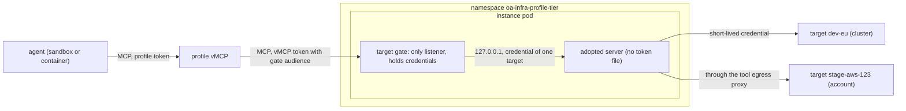

# ADR 0021: tools that act on infrastructure, behind MCP, with a scoped identity per target

Status: Proposed
Date: 2026-11-26
Issue: https://github.com/openagentix/openagentix/issues/141 (umbrella; requirement trail in the comments of #14)
Replaces: none. Extends ADR 0006 (tool profiles), ADR 0012 (`CredentialGrant`, `ApprovalRequest`, `Workspace`), ADR 0019 (projected tokens, Cedar rule) and the AgentAccess pattern of ADR 0016 (proposed, PR #121). Depends on ADR 0018 (signed images) and ADR 0020 (egress proxy, proposed, PR #135). Proposes one amendment to ADR 0012 (who creates an `ApprovalRequest` for a tool call). See "Relation to other records and issues".

An agent never runs `kubectl`, `helm`, `aws`, `gcloud` or `az` itself, and never holds their credentials. These tools run in a platform tool server behind MCP, in a namespace of their own, behind a platform **target gate** that is the only listener and holds the credentials. The tool server acts on named **targets** (a cluster or a cloud account), each with its own identity, scope and tier. A call always names its target. Credentials are short-lived and fetched for one target at a time by a pluggable credential provider. The permission boundary is the target's own RBAC or IAM; platform policy only narrows it. Read-only is the default, and a mutation needs an allowlist and, on production tiers, an approval bound to the exact call. Nothing here is built. Everything is *unverified* until the slices below are done. Not in release 0.3.

## The question

The owner asked: can we use CLI tools and make them work, or must we rely only on MCP? A `kubectl` tool needs a kubeconfig and RBAC. `helm`, `aws` and the other cloud CLIs need the same kind of thing. Later questions added: what happens when the cluster or account is remote, and when there are many of them.

Short answer: yes, CLI tools can be used, but only behind MCP, inside a platform tool server that holds the identity. MCP is the only door. The agent sends a structured request; the gate checks it, gets a short-lived credential for one target, has the tool run, filters the output and records what happened. Where a good MCP server already exists, we adopt it behind an adapter instead of wrapping the CLI.

## Context

### What exists today (read in this repository on 2026-11-26)

- Tool servers are ToolHive `MCPServer` objects in `mcp-tools`, all in one `MCPGroup` (`charts/openagentix/templates/mcp.yaml`, values `mcp.servers`). The shared vMCP aggregates every server of the group. A tool profile (`mcp.profiles`, ADR 0006 round 2) is one more vMCP on the **same group** with a tool filter, its own OIDC audience and its own RemoteMCPServer. A profile hides tools; it does not remove a backend from the shared vMCP's view (`docs/diary/features/security.md`).
- The NetworkPolicy `openagentix-mcp-tools-default` admits every pod of `mcp-tools` (and the ToolHive operator namespace) to every pod of `mcp-tools` (`charts/openagentix/templates/networkpolicy.yaml`). Backends have no incoming authentication of their own. Inside that namespace, the network is not a boundary between tool servers.
- For each `MCPServer`, ToolHive runs two workloads: a proxy runner and a separate MCP server backend (`replicas` and `backendReplicas` in the CRD reference; https://docs.stacklok.com/toolhive/reference/crds/mcpserver and https://docs.stacklok.com/toolhive/guides-k8s/run-mcp-k8s, read 2026-11-26). So "a component in the same pod as the server" is not something `MCPServer` gives by itself. Whether `podTemplateSpec` applies to the backend pod and allows an extra container is *unverified*. `MCPServer.spec.serviceAccount` names an existing ServiceAccount; `permissionProfile` "is not supported by the Kubernetes operator and has no effect". Our pinned version is v0.67.1; these facts are from the current docs and *must be read again in that version's source*.
- Built-in agents run in Agent Substrate sandboxes (gVisor). Egress is deny by default per actor; rules match host and port only (ADR 0006, F7). Every agent has a `bash` tool by default, and `bash` can call the agent's own profile vMCP with the session's token: the egress proxy replaces any `Authorization` header with the actor JWT (`docs/diary/features/security.md`, proven on kind). So anything a profile allows, a prompt-injected agent can call directly, without the agent loop. A control that lives in the agent loop is not a control.
- Container agents (ADR 0015, ADR 0019) reach a profile through a workload variant of the profile server that accepts a pod-bound projected ServiceAccount token with a per-profile audience, restricted by a Cedar rule on the namespace and the `pod` claim. ADR 0019 sets the issuer default `https://kubernetes.default.svc.cluster.local` and binds `system:service-account-issuer-discovery` to anonymous users so the keys can be fetched.
- The controller never reads Secrets. Its Roles are namespaced, with no ClusterRole and no wildcard (ADR 0007). Admission guard policies are key allowlists bound to the controller's identity. ADR 0016 checks a controller-written rules file field by field, not with one pattern over the whole value.
- ADR 0007 plans the kinds `ToolServer` and `ToolProfile` (replacing `mcp.servers` and `mcp.profiles`) and says a new server image is a supply-chain decision: digest required, operator approval. The admission guard already refuses `kagent-tool-server` as an agent's tool server.
- ADR 0012 reserves `CredentialGrant` (0.4: a subject that is an agent or a run, a source, an audience, scopes, a lifetime, injected at the egress proxy for one host), `ApprovalRequest` (0.4, "created by the controller when a run reaches a tool that needs approval"), scoped `PlatformPolicy` with tool rules allow, require approval, deny, most restrictive wins (0.5) and `Workspace` (0.5).
- ADR 0010: security is never an enterprise feature. Approval workflows with routing and escalation, and on-behalf-of-user brokers for many providers, are listed as enterprise; one approver is community.
- ADR 0020 (proposed): container agents reach named outside hosts only through a platform CONNECT proxy that never decrypts TLS, with an enforcement check of the network plugin.

### The market today (read 2026-11-26)

The full table with sources is in "Appendix: existing MCP servers". The facts that shape this decision:

- **Every serious server says RBAC or IAM is the real boundary.** containers/kubernetes-mcp-server: "Kubernetes RBAC on the identity this server authenticates as is the access control to rely on"; its `read_only` and `disable_destructive` "do not change the cluster permissions of the identity" ([configuration.md](https://raw.githubusercontent.com/containers/kubernetes-mcp-server/main/docs/configuration.md)). Azure/aks-mcp calls its access levels "a guardrail, not a security boundary".
- **A server's read-only mode is not a read-only identity.** It filters tools by their annotations. If RBAC allows reading Secrets, a read-only server still reads them. Some toolsets (Helm and others) are not covered by `denied_resources` (*read again per version*).
- **Read-only modes are off by default** in most servers (kubernetes-mcp-server, Flux159, aws-api-mcp-server, Azure MCP Server, kagent-tools). awslabs eks-mcp-server and Azure/aks-mcp default to read-only.
- **Several servers shell out** to `kubectl`, `helm`, `az` or `gcloud` (Flux159, kagent-tools, aks-mcp, gcloud-mcp). Flux159/mcp-server-kubernetes had a flag injection in its generic kubectl tool through which a `--server` value could send the server's bearer token to another host, fixed in 3.7.0 ([CVE-2026-47250, OSV](https://osv.dev/vulnerability/CVE-2026-47250)). Three further advisories are listed for it (CVE-2025-53355, CVE-2025-66404, CVE-2026-61459); their details were *not verified* in the primary advisories. kubernetes-mcp-server uses the Go client and does not shell out.
- **Token passthrough.** kubernetes-mcp-server's `cluster_auth_mode` is either passthrough (the default: "forward Authorization header when present, fall back to kubeconfig when absent") or kubeconfig. The MCP authorization specification (2025-11-25) says a server "MUST NOT pass through the token it received from the MCP client" ([spec](https://modelcontextprotocol.io/specification/2025-11-25/basic/authorization)).
- **Acting as the calling user** is done by token exchange (kubernetes-mcp-server `rfc8693`, `entra-obo`; ToolHive RFC 8693), by the caller's own identity at managed remote servers (AWS MCP Server, Google's managed GKE MCP), or by Kubernetes impersonation (giantswarm/mcp-kubernetes, from a package listing only).

### Kubernetes and cloud facts (read 2026-11-26)

- **Some "read" permissions are not read-only.** `GET` on `nodes/proxy` allows running commands in pods through the kubelet's WebSocket API, because the kubelet authorizes the handshake, which is a `GET` (disclosed January 2026; [Horizon3 write-up](https://horizon3.ai/attack-research/when-read-only-isnt-k8s-nodes-proxy-get-to-rce/), [H3-2026-0002](https://docs.horizon3.ai/knowledge_base/weaknesses/H3-2026-0002/)). Kubernetes treats it as intended; fine-grained kubelet authorization is GA in 1.36 ([Kubernetes blog](https://kubernetes.io/blog/2026/04/24/kubernetes-v1-36-fine-grained-kubelet-authorization-ga)). `GET` on `pods/proxy` and `services/proxy` reaches in-cluster HTTP endpoints. The built-in `view` ClusterRole aggregates rules that third-party CRD installers add to it. Pod specs and ConfigMaps can hold literal credential values.
- **Structured authentication configuration** (KEP-3331, `apiserver.config.k8s.io/v1`, `jwt` authenticators with CEL claim mappings, claim and user validation rules, reloaded without a restart) is stable in Kubernetes 1.34 ([KEP-3331](https://www.kubernetes.dev/resources/keps/3331/), [authentication docs](https://kubernetes.io/docs/reference/access-authn-authz/authentication/)). An external issuer must not conflict with the cluster's own `--service-account-issuer`. Managed clusters do not expose this file in the same form.
- **Constrained impersonation** (KEP-5284) is alpha in 1.35 and beta, on by default, in 1.36 ([KEP-5284](https://www.kubernetes.dev/resources/keps/5284/)). Classic impersonation needs the `impersonate` verb, which lets the holder act as every named user or group.
- **AWS federation needs a public issuer.** For `AssumeRoleWithWebIdentity`, IAM fetches the issuer's discovery document and keys from their public URLs; endpoints that are not reachable from the internet are a listed cause of federation errors, and "IAM doesn't support proxy configurations for OIDC federation" ([re:Post](https://repost.aws/knowledge-center/iam-oidc-idp-federation), [IAM guide](https://docs.aws.amazon.com/IAM/latest/UserGuide/id_roles_providers_create_oidc.html)). Self-managed clusters publish them, for example in a public bucket.
- **Google** Workload Identity Federation accepts an uploaded JWKS file (`--jwk-json-path`, at most 8 keys) for an issuer that is not publicly reachable ([Google docs](https://docs.cloud.google.com/iam/docs/workload-identity-federation-with-other-providers)).
- **Azure** federated identity credentials match the token's issuer and exact subject. Whether a private issuer can be used with uploaded keys was not found; *unverified*.
- **Argo CD Agent** is a hub-and-spoke design in which "the agent initiates the connection to the principal, and the control plane cannot initiate connections to agents" ([Argo CD Agent terminology](https://argocd-agent.readthedocs.io/latest/concepts/components-terminology/)).

## Options

### Where the CLI runs

| Option | What it gives | What it costs | Checked how |
|---|---|---|---|
| A. A platform tool server behind MCP holds the binary; a platform gate holds the identity | One door with authentication, policy, audit and output filtering. The credential never enters the agent. Same path for built-in and container agents | One more server and namespace per instance (memory not measured). Tools must be structured; free-form commands are refused | ADR 0006 and 0019 patterns; market facts above |
| B. A shell in the agent sandbox with a kubeconfig or cloud keys | Every CLI feature at once; no server to run | The credential is inside the component that reads untrusted text. `bash` already bypasses the agent loop. Any connection flag is open. No per-call policy, no reliable audit | ADR 0006 F5; diary security page |
| C. A sidecar per agent with the credential | Per-agent identity | The credential shares a pod and a trust domain with the agent; `exec` into the pod reaches both. Substrate sandboxes are not pod specs we write. One sidecar per agent costs more than one server per profile | ADR 0015 isolation list |
| D. A credential-injecting egress proxy: the agent runs the CLI, the proxy adds the credential | The agent never sees the key | Needs TLS interception (a CA trusted inside the agent) to add headers to HTTPS. ADR 0020 decided the proxy never decrypts. The agent still chooses every request. Not in 0.3 | ADR 0020 |
| E. Only MCP servers, no CLI anywhere | Simplest story | Some tasks (a cloud command with no structured server) would have no tool at all | Market table |

### How the gate sits in front of the server

| Option | What it gives | What it costs |
|---|---|---|
| G1. Gate as a separate pod in `mcp-tools` in front of a ToolHive backend | Uses ToolHive as is | The backend stays reachable from every pod of the namespace (shared NetworkPolicy, no backend authentication): the gate can be bypassed |
| G2. Gate as a sidecar of the ToolHive backend pod (`podTemplateSpec`) | Keeps ToolHive's lifecycle | Depends on `podTemplateSpec` reaching the backend pod (*unverified*); the ToolHive proxy runner still exists in front |
| G3. Our own Deployment per instance, in its own namespace: the gate container is the only listener, the adopted server listens on `127.0.0.1`; registered with the profile's vMCP as a remote backend | Nothing but the gate is reachable; one owner for the pod spec; the guard can pin it like ADR 0015 pins container agents | We own the Deployment; ToolHive's per-server features (its proxy, its audit for that backend) are not used for this hop |

### How a target is described

| Option | What it gives | What it costs |
|---|---|---|
| F. Fields on the tool profile (`profile.targets[]` with endpoint and credentials) | No new kind | A target is shared by several profiles with different rights; the endpoint, trust and tier would be copied into each. The person who edits a profile would also edit where it reaches. No place for status per target |
| G. Reuse `CredentialGrant` (ADR 0012, #14) | One kind for "a credential for outbound access" | A grant's subject is an agent or a run and its injection point is the egress proxy for one host. A target is a place (endpoint, tier, owner, reachability) used by a tool server, not by the agent |
| H. A new kind `ToolTarget` and a binding kind `TargetAccess` | Status per target, a disable switch, one reviewable list of who may reach what, deny by default | Two more kinds to build and keep |
| I. Chart values only | Nothing new to build | No status, no change without `helm upgrade`, against "every configurable thing is a resource" |

### Whose identity a call uses

| Option | What it gives | What it costs |
|---|---|---|
| J. The tool server's own identity, one per instance and target | Works for every caller (chat, schedule, container agent). The boundary is a role an operator can read | Every agent of a profile acts the same; the target's audit shows the profile, not the person |
| K. The calling user, by Kubernetes impersonation | Target RBAC per person | The tool server needs `impersonate`, which is the power of every user it may name. Our user id (`X-User-Id`) is information set by the gate from caller rules, not proof (ADR 0015); a chat id is not a cluster user. Constrained impersonation needs Kubernetes 1.36 |
| L. The calling user, by token exchange (RFC 8693, OBO) | Real per-person rights without `impersonate` | Needs a verified login and an identity provider each target trusts. Belongs to the identity adapter (#13) |

## Decision

Options A, G3, H and J, with E as the first choice inside A (adopt a structured server before wrapping a CLI). K and L are not built now; L is the planned path for acting on behalf of a user.

### 1. The position

- **MCP is the only door.** No agent, built-in or container, gets a kubeconfig, a cloud key, a cloud role or a CLI with credentials. The platform never mounts such a credential into a sandbox or an agent pod, and the admission guard refuses it.
- **CLIs run in a platform tool server**, not in the agent. The tool server is an adopted MCP server (preferred) or, only where none fits, a thin platform wrapper around the CLI. Either way the target gate is in front of it and is the only way in.
- **A shell is for compute only.** A sandbox shell (the existing `bash` of built-in agents, or the approved execution environments of #20) may be enabled for code execution and data work. It has no cluster or cloud credential, no route to a target, and goes through the egress controls (Substrate egress, ADR 0020). A `kubectl` binary in such a sandbox has nothing to authenticate with. Changing infrastructure goes through MCP tool servers with a scoped identity, not through a shell.

### 2. The shape of a tool server



- **One instance, one namespace.** Each instance (one profile, one tier group) runs as a platform Deployment in a namespace of its own (for example `oa-infra-<profile>-<tier>`). It is not an `MCPServer` in `mcp-tools` and is not part of any `MCPGroup` that the shared vMCP or another profile reads. It is registered with its profile's vMCP only (and that profile's workload variant from ADR 0019, if opened to container agents) as a remote backend.
- **The gate is the only listener.** The pod has two containers. The gate listens on the pod's port. The adopted server listens on `127.0.0.1` only (kubernetes-mcp-server listens on all addresses unless told otherwise, so its address is set explicitly and checked in the live proof). The pod's NetworkPolicy admits ingress only from the profile's vMCP pods, on the gate's port.
- **The gate authenticates its caller cryptographically, not by network.** It accepts only a token whose audience is the gate's own (`openagentix-gate-<instance>`) and whose subject is the profile vMCP's ServiceAccount: either a projected ServiceAccount token of the vMCP, sent by ToolHive's outgoing authentication, or a token obtained by ToolHive's outgoing RFC 8693 exchange. Which of the two ToolHive v0.67.1 can do is *unverified* and is the first thing slice 1 proves. If neither works, slice 1 stops; the network rule alone is not accepted as the boundary.
- **One instance serves one profile.** It may serve several targets of that profile. Targets of the `prod` tier get a dedicated instance with its own home identity (see "Isolation").
- **The gate's job:** require the target argument; check it against the grants; apply argument policy, rate caps and approval; obtain the credential for that one target; call the server; cap, clean and scan the output; write the audit line. If ToolHive's Cedar authorizer can see tool arguments (*unverified*), the target allowlist is also written there as a second layer.

### 3. How credentials reach the call

- **The gate holds the credentials, the server does not.** Projected tokens, broker tokens and fallback Secrets are mounted only in the gate container. The server container has no token file, no kubeconfig with a user, no cloud credential and `automountServiceAccountToken: false` at the pod level (the gate's tokens are explicit projected volumes mounted into the gate container only).
- **Kubernetes targets: the gate sets the credential per call.** The adopted server runs in its passthrough mode, reachable only from the gate on `127.0.0.1`, with a kubeconfig that lists the target clusters (endpoint and CA) but no users. For each call the gate removes the `Authorization` header it received from the vMCP and sets the target's own short-lived credential. Why the MCP rule against token passthrough is respected: that rule forbids forwarding the token the MCP client sent. Here the client's token ends at the gate. The gate is a client of the server in its own right and sends a credential issued to the instance for that target's audience, never a token that came from an agent or the vMCP. A test checks that no incoming token ever reaches the server.
- **Selecting the target in the server.** Whether kubernetes-mcp-server can select a cluster per call in passthrough mode is *unverified*. If it cannot, the instance runs one server process per Kubernetes target, each on its own loopback port, and the gate routes to it. Slice 1 has one target, so it is not blocked by this.
- **Cloud targets: one server process per target.** Cloud MCP servers read credentials per process (environment, profile, credential file). Per-call injection is not possible there. So each cloud target gets its own server process in the instance, with the credential of that one target only, written by the gate into a file the process reads (a short-lived credential, refreshed by the gate). For cloud targets the "no credential in the server container" rule is replaced by "one target's credential per process". Hard limit: 10 cloud targets per instance.
- **Token requests.** One projected volume per target audience does not scale: every new target changes the pod and restarts it, and only the kubelet may request tokens in these namespaces (as in ADR 0019). So the first slices cap an instance at **20 projected audiences**. If more are needed, the gate may be allowed a `TokenRequest` for its own ServiceAccount, limited by an admission policy that refuses any requested audience not in the instance's target list (*unverified* that a validating policy sees `spec.audiences` of the token subresource). This is decided in the registry slice.

### 4. Targets

A target is a cluster or a cloud account the platform may act on. It is a new kind, `ToolTarget` (`openagentix.io/v1alpha1`), written by operators only (like `PlatformPolicy`). The controller reads it and never creates the trust it describes: the remote side (RBAC, IAM role, trust policy) is set up by the target's owner.

The shape (illustrative, fields fixed in the slice that builds the kind):

```yaml
apiVersion: openagentix.io/v1alpha1
kind: ToolTarget
metadata:
  name: stage-eu-cluster          # DNS label, starts with its tier (see "Names shown to the model")
  labels: {openagentix.io/tier: "stage", team: payments}
spec:
  type: kubernetes                # kubernetes | aws | gcp | azure
  description: "Stage cluster of the payments team, eu region"
  owner: payments-platform        # a team name, not a person
  endpoint: {url: "https://stage-eu.example.internal:6443", caBundle: {configMap: stage-eu-ca, key: ca.crt}}
  credentials:                    # exactly one provider
    federation: {audience: "openagentix:stage-eu-cluster"}
  scope:                          # what the platform may ask for; the remote RBAC or IAM decides what it gets
    namespaces: [payments]
  disabled: false                 # the instant switch
status:
  observedGeneration: 1
  conditions: []                  # Accepted, Reachable, CredentialValid, RightsChecked, Ready
  credentialExpiresAt: ""
  controller: {}
```

- **Words in the spec.** `kubernetes`, `aws`, `gcp` and `azure` name the kind of place, not an upstream component of OpenAgentix. Broker products (for example Vault), adopted server names and images stay out of the spec; they live in the catalog's adapter-owned section, as `docs/api-conventions.md` requires.
- **One identity per target.** Each target has its own remote subject: its own audience for federated tokens, its own IAM role, its own Secret for the fallback. No credential is shared between targets, with the one stated exception of the AWS hub role (section 10). Two targets that resolve to the same remote role are refused where the controller can see it (same role ARN, same audience, same Secret).
- **Status, and who writes it.** Conditions follow `docs/api-conventions.md`. `Reachable` and `CredentialValid` come from the instance that serves the target (it has the route and the credential; the controller has neither). An instance may patch status only of the targets it serves: its Role on `tooltargets/status` is limited by resource name, rendered from its grants. `CredentialValid` is `True` only after a successful fetch, with `credentialExpiresAt`; `Unknown` when no instance has tried. `RightsChecked` is described in section 16. A target that has not been probed is not `Ready`.
- **Disable.** `spec.disabled: true` makes every gate that serves the target refuse it at the next rules reload (about a minute, *unverified*), and drops cached credentials for it. Deleting the `TargetAccess` has the same effect.
- **The home cluster** is a target too (`type: kubernetes`, `credentials.inCluster`), so there is no special case and no hidden default. Its scope may never include platform namespaces (`kube-system`, `kagent`, `ate-system`, `mcp-tools`, `openagentix-*`, every `oa-infra-*`, the ToolHive operator namespace, and the namespaces the chart lists as platform); the render and the controller refuse them.

### 5. Which profiles may use which targets

A second kind, `TargetAccess`, follows the deny-by-default binding of `AgentAccess` (ADR 0016, #3): one subject per object, a list of granted targets, one place to review.

```yaml
apiVersion: openagentix.io/v1alpha1
kind: TargetAccess
metadata: {name: k8s-ops-stage}
spec:
  profile: k8s-ops                # the subject: one tool profile
  targets:
    - name: stage-eu-cluster      # write grants name targets; selectors grant read only
    - selector: {matchLabels: {openagentix.io/tier: "dev", team: payments}}
  access: read                    # read | write
  fanOut: {enabled: true, maxTargets: 10}
status:
  conditions: []                  # Accepted, Ready, TargetsChanged
  effectiveTargets: []            # names after the selector is resolved
```

- **The chain is reviewable.** Agent to profile: the agent's definition (`toolProfile`) under `policy.allowedProfiles`. Profile to targets: `TargetAccess`. Target to remote rights: the target owner's RBAC or IAM. No other path exists. `kubectl get targetaccess` lists every grant.
- **Profile names.** Until the `ToolProfile` kind of ADR 0007 exists, `profile` names an entry of `mcp.profiles`, as ADR 0019's `toolProfiles` list does.
- **Selectors.** A selector without a tier label is refused. A selector grants read only; `access: write` requires targets by name. When the set behind a selector changes (a generated target appears), `TargetsChanged` is raised with the added and removed names, so the change is visible.
- **Who may write it:** an operator Role, rendered without bindings, like the `AgentAccess` roles. Whether target owners can grant their own targets is an open question tied to tenancy.
- **How rules reach the gate.** The controller resolves grants and writes them into a structured rules file per instance (one ConfigMap, fixed name per instance, controller may patch only that name). As in ADR 0016, an admission policy checks the file field by field: target names in the allowed pattern, `access` in its enum, tier values in their enum, sizes. The gate reloads it.
- **What the controller cannot change.** The rules file can only narrow what the pod spec allows. The chart sets, in the instance's Deployment, the tier floor (`prod` for a production instance) and mounts the credentials of exactly the instance's targets; the admission policy pins both literally. The gate refuses any grant for a target it holds no credential for, and with a `prod` floor it requires an approval for every mutation and applies the prod read limits, whatever the rules file says. A compromised controller can therefore remove access, or move it among targets the operator already gave the instance, but cannot add a target or waive the prod rules.

### 6. Calls: explicit target, no hidden context

- **Every call is stateless and names its target.** Each tool of an infrastructure profile has a required `target` argument whose JSON schema is an enum of the profile's effective targets. There is no "current context", no `use-context` tool and no default target. A call without a target is refused. The gate ignores any context, server, token or profile argument and sets them itself.
- **Refused before the tool runs.** A target outside the grants, a disabled target, or one whose credential cannot be fetched is refused by the gate. The server is not called.
- **Credentials per target.** Fetched for one target, used for that call, and cached at most for their own lifetime keyed by `(instance, target)`, never across targets. A mutating call always fetches fresh. When a target is disabled or removed, its cache entry is dropped.
- **Tiers drive defaults.** The label `openagentix.io/tier` is one of `prod`, `stage`, `dev` (quoted in YAML). Defaults, which an operator can tighten and, except for the first row, loosen per target:

| Tier | Access | Mutations | Rate cap (starting values, to be measured) | Instance |
|---|---|---|---|---|
| `prod` | read | only with an approval, every time; cannot be waived (pod-level floor) | 30 reads a minute, 5 mutations an hour per target | dedicated, own home identity |
| `stage` | read | with an approval by default; waivable per `TargetAccess` | 60 reads a minute, 30 mutations an hour | may share with `dev` |
| `dev` | read | allowed when `access: write` is granted | 120 reads a minute | may share with `stage` |

- **With `PlatformPolicy`.** When scoped policy with tool rules (allow, require approval, deny; ADR 0012, 0.5) exists, it is combined with the tier defaults and the grants, and the most restrictive rule wins. Neither can loosen the other.
- **Fan-out reads.** A read tool may take `targets` (a list, or a group selector already allowed by the grant) instead of one target, for questions like "list failing pods in every stage cluster". Rules: read only (a fan-out mutation is refused); at most `fanOut.maxTargets` (default 10, hard limit 50); at most 4 targets in parallel; a timeout per target (10 s); one result object per target with `ok`, `denied`, `error` or `timeout`; a total output cap across all targets. Partial failure is a normal answer: the result names the failed targets and never retries with another target's credential. One audit line per target and one for the fan-out.
- **Cross-target flows.** Reading A and writing B are two calls; the platform cannot see what the model carries between them. Two cases need the same explicit opt-in (`crossTarget: allow`, naming the source tiers, on the `TargetAccess` that grants the write):
  - data from a higher tier reaching a write on a lower tier (prod read, stage write);
  - text from a lower-trust target reaching a write on a higher tier (dev read, prod write), because content of a low-trust target (an annotation, a label, a description) can carry instructions. A fan-out read mixes many such sources.

  Recommendation: separate read profiles and write profiles, so one session does not hold both. Code mode (`execute_tool_script`) is off for infrastructure profiles, because it chains calls without the model's step in between. Output scanning reduces the chance that a secret read in A reaches B; it does not prevent it, and data that is not recognised as a secret can still move. That limit is stated, not solved.

### 7. Names shown to the model

- Target names are DNS labels (lower case ASCII letters, digits, `-`). No Unicode, so no homoglyphs.
- A target name starts with its tier (`prod-`, `stage-`, `dev-`), checked by admission, so the model, the approver and the audit reader see the tier in the name.
- The controller refuses a target whose name is within edit distance 1 of another target of a different tier.
- Tool descriptions list each allowed target as `name (tier, type, description)` from the registry. The description is operator text, limited to 200 characters, and is shown as data.
- A target name in tool output or in a user message has no power: the gate accepts only names in the grants. An approval request shows the target, tier and owner from the registry, never from the model's text.

### 8. Credential providers

A new adapter interface, `Credentials`, returns a short-lived credential for one target and one call. The core sees only the provider type and the target. Providers, in order of preference:

| Provider | How it works | Where it fits | Limits |
|---|---|---|---|
| a. `inCluster` | A projected ServiceAccount token of the instance's ServiceAccount, audience the API server, `expirationSeconds` 600 to 3600, refreshed by the kubelet, mounted in the gate container | The home cluster | Works only in the cluster that issued the token |
| b. `federation` | A projected token of the instance's ServiceAccount with the **target's own audience**, exchanged at the target: AWS `AssumeRoleWithWebIdentity` (the IRSA pattern), EKS Pod Identity when the instance runs on EKS, GKE Workload Identity or Workload Identity Federation, Azure federated credentials; or presented directly to a remote API server that trusts the home issuer | Remote clusters and cloud accounts | The target must be able to read the home issuer's keys (below). Set up on the target side |
| c. `broker` | A secret broker issues a dynamic credential per request: Vault dynamic AWS or Kubernetes secrets engines, or a cloud secret manager through External Secrets or the Secrets Store CSI driver. The gate authenticates to the broker with its own projected token | Where federation is not possible and a broker already exists | Another component to trust; through External Secrets the result lands in a Secret, which the kubelet mounts and the controller never reads |
| d. `secretRef` | A static credential (a remote kubeconfig with a bound token, a cloud key) in a Secret, mounted into the gate container by the kubelet | Last resort; laptops, air-gapped targets | Long-lived. Discouraged. Status says so (`CredentialValid` reason `StaticCredential`). Rotation is the owner's job: a new Secret version rolls the instance (fingerprint annotation, as ADR 0015 does for keys) |

Rules for every provider:

- The controller never reads a Secret, a token or a credential. It never writes a credential into a spec, a status, an event, an env value, an argument or a log.
- **The issuer must be readable by the target.** For AWS, IAM fetches the keys from the public URL, with no proxy support. On a cloud-managed home cluster the issuer is public already. On kind, k3s on a laptop, or a private cluster, it is not: the options are to publish the discovery document and keys in a public bucket (and set the API server's issuer and key URL to match, which changes every token the cluster issues), to upload the keys where the target allows it (Google, at most 8 keys, by hand on rotation), or to use a broker or a pull-model runner instead. The platform reports which applies; it does not publish keys by itself.
- **Who acted, in the target's audit.** The federated subject is the instance's ServiceAccount, so the target's audit names the instance and thus the profile, which is a verified fact. Where the target accepts a session name (AWS `RoleSessionName`), the gate sets it to the agent and run it was told about. That part is information, not proof, and must never be used in a policy condition (section 10). Strict per-agent attribution needs one instance per agent, or identity per agent (#13).
- **Fallbacks are off.** Cloud SDKs try a chain of sources (environment, files, instance metadata). Each server process is configured to use exactly the credential file the gate writes. A failure is an error, never a silent fall back to the node's role through the metadata endpoint. How to pin each SDK's chain is listed per provider in the slice that builds it (*unverified* for the Azure and Google SDKs).

### 9. Remote Kubernetes clusters

In order of preference:

1. **External OIDC trust.** The remote API server trusts the home cluster's ServiceAccount issuer through structured authentication configuration (stable in 1.34): the home issuer URL and its CA (`certificateAuthority`), audience `openagentix:<target>`, a claim validation rule that allows only the instance ServiceAccounts, a claim mapping to a user name such as `openagentix:<profile>` and a group `openagentix:tools`, and a user validation rule that refuses any mapped user name starting with `system:`. The remote RBAC binds that user or group. The token is presented directly; no exchange. This needs control over the remote API server's configuration and a route from it to the home issuer's key URL. The home issuer must be unique: it cannot be the default `https://kubernetes.default.svc.cluster.local` that every kind cluster shares, because the remote server's own issuer would conflict with it. Self-managed clusters can do this. On managed clusters, similar features exist in other forms (an OIDC identity provider association on EKS; an external identity provider page for AKS was found, status *unverified*; GKE *not checked*).
2. **Cloud identity, then cloud cluster auth (two hops).** For EKS, GKE and AKS: federation to the cloud (provider b), then the cloud's own cluster authentication (EKS access entries, GKE IAM, AKS with Entra ID), then the remote RBAC. Each hop is its own boundary and its own audit.
3. **Bound-token kubeconfig (fallback, provider d).** A token made in the remote cluster for a dedicated ServiceAccount there, stored in a Secret at home. Long-lived if made with a long duration; rotate with a job on the remote side.
4. **Pull-model runner (later).** For private API servers that nothing can reach: a small runner inside the target cluster, with its own in-cluster identity, connects outward to the home platform, like the Argo CD Agent hub and spoke design. The home side then needs an inbound endpoint, and the runner becomes the remote end of the target gate. New code with its own security review. Not designed here.

**Remote rights.** A remote Kubernetes target gets an explicit namespaced Role with listed resources (the platform ships the read template below), not the built-in `view`, which aggregates rules from third-party CRDs.

### 10. Remote cloud accounts and scale

- **One account, one target.** Each account (or project, or subscription) is a target with its own role.
- **Many accounts without hand-written entries.** A target generator creates `ToolTarget` objects from an inventory: for AWS Organizations, one standard role name in every member account, assumed from a hub role; for Google, projects under a folder; for Azure, subscriptions in a management group. Rules for generated targets:
  - The tier comes only from an operator-owned mapping (organizational unit path, folder id, management group), never from names, tags or labels that account owners control.
  - Generated names are cleaned to DNS labels, prefixed with the mapped tier, and run through the edit-distance rule.
  - Generated targets are reachable only through selector grants, so they are read-only until a `TargetAccess` names them for write.
  - The generator needs its own powerful credential (read access to the organization's inventory). It is an operator-run job with its own identity, not the controller and not an instance, and it creates targets only; it holds no target credential.
- **The AWS hub role is a shared piece, stated as such.** In the hub pattern, one projected token (audience `sts.amazonaws.com`) gives the instance the hub role, and the hub role can assume every member role of its pattern. So "own audience per target" does not hold there: a compromised instance reaches every account its hub can assume. Rules:
  - one hub role per instance, so a hub reaches only the accounts of that instance's tier group; prod has its own instance and hub;
  - the hub role has only `sts:AssumeRole` on the member role pattern;
  - member role trust policies pin the hub role ARN and an `ExternalId` or `SourceIdentity` per instance;
  - session names and session tags are information only and are never used in a policy condition (whether `sts:TagSession` is needed is *unverified*);
  - write roles are never reachable through a hub; a write target uses its own federation (its own audience) and is granted by name.
  The per-account credential is still per target and short-lived (role chaining limits a chained session to one hour).
- **Limits.** In the first versions: at most 20 projected audiences and 10 cloud server processes per instance (section 3); at most 1,000 targets per installation (starting value); the rate caps of the tier table per target; one STS call per target per credential lifetime at most.

### 11. Read-only by default

- **Three layers.** The remote role is read-only; the adopted server runs in its read-only mode; the profile's tool filter lists only read tools. The first layer is the boundary; the others reduce noise.
- **The read role is explicit.** The platform ships a namespaced Role template `openagentix-infra-read` that lists its resources: pods, services, endpoints, deployments, replicasets, statefulsets, daemonsets, jobs, cronjobs, ingresses, persistentvolumeclaims, with `get`, `list`, `watch`. ConfigMaps, events and pod logs are left out at first (they hold literal values, user data or injected text); an operator can add them per target. The chart binds it in the home cluster's listed namespaces; remote owners apply the same template.
- **Forbidden rights, for reads and writes alike.** No role used by an instance may grant, with any verb: `nodes/proxy`, `pods/proxy`, `services/proxy`, `pods/exec`, `pods/attach`, `pods/portforward`, `serviceaccounts/token`, `secrets`, `impersonate`, `bind`, `escalate`, or `*` in verbs, resources or API groups. The render refuses them in what the chart writes, and the rights check (section 16) looks for them in what the instance really has.
- **Defence in depth in the server.** kubernetes-mcp-server is configured with `read_only`, toolset `core` only, and `denied_resources` listing Secrets (and the proxy subresources where its schema allows). Toolsets that `denied_resources` does not cover are not enabled.
- **Output cleaning.** The gate removes `metadata.managedFields` and the `kubectl.kubernetes.io/last-applied-configuration` annotation, and shows environment variables by name only (`env[].value` and `valueFrom` targets are replaced by a marker) unless the operator turns values on for a target.

### 12. Mutations, arguments, no shell

- **Rule lists.** `access: write` in a `TargetAccess` needs a rule list of `(group, kind, verb)` entries, with namespaces, for Kubernetes; actions and resource patterns for clouds. The gate checks each call against it before the tool runs; the remote role must match it. Writes to platform namespaces are refused.
- **Inert kinds and deputy kinds.** The platform ships a short list of entries considered inert, for example `apps/deployments/scale` and `apps/statefulsets/scale` (`patch`), deleting a `batch/Job`, deleting a Pod (a restart), and a rollout restart, which the gate allows only as a patch that changes nothing but the restart annotation of the pod template. Any entry outside that list needs `escalationAcknowledged: true` with a reason in the `TargetAccess`, and always needs an approval on `prod`. The ADR names the kinds that must never be on the inert list, because a write to them acts with someone else's rights:
  - delivery and workflow controllers: Argo CD `Application`, Flux `Kustomization` and `HelmRelease`, Tekton and Argo Workflows objects, Crossplane claims and compositions, Cluster API objects;
  - secret movers and generators: `ExternalSecret`, `PushSecret`, Kyverno generate policies;
  - Pod creation, and any patch of a workload's ServiceAccount, image, command, arguments, volumes or security context (a pod can mount any Secret and use any ServiceAccount of its namespace);
  - the EKS `aws-auth` ConfigMap and other identity mappings;
  - Services of type `LoadBalancer` or `ExternalName`;
  - deleting or changing NetworkPolicies;
  - RBAC objects, admission webhooks and policies, CRDs, and anything cluster-scoped.
- **Argument policy.** Arguments are structured and typed. Rules (Cedar where ToolHive can see arguments, otherwise in the gate) match on target, namespace, kind, name pattern and verb. No free-form command argument is accepted.
- **No raw shell.** Tools that take a command line (`kubectl_generic`, a free `call_aws`, a `gcloud` passthrough, `exec_in_pod`) are refused in an infrastructure profile. A CLI wrapper, where one is written, builds `argv` from typed fields, never through a shell, puts `--` before user values, and sets every connection and identity flag (`--server`, `--token`, `--kubeconfig`, `--context`, `--as`, `--profile`, `--region` and similar) itself. A user value that starts with `-` is refused. Pipes, redirects and globbing do not exist because there is no shell.

### 13. Approval

Mutations that need approval use `ApprovalRequest` (ADR 0012, #12). The requirements for this record, to be written into #12 before the mutation slice:

- **Bound to the exact call.** The request carries a canonical hash of `(instance, target, tool, arguments, requester)`. It is single use and expires after 15 minutes (starting value). At execution the gate recomputes the hash and checks the decision again, and marks the request used with a `resourceVersion` precondition, so two calls cannot share one approval.
- **No waiting call.** A call that needs approval fails at once with a pending reference (`approval required: <request name>`). After the decision, the agent or a person resubmits the same call with that reference; the gate accepts it only if the arguments match the hash. This avoids holding a call open past vMCP and client timeouts.
- **What the approver sees.** The target, tier and owner from the registry; the tool and structured arguments with secrets masked; model-chosen strings escaped, with non-ASCII characters flagged; for Kubernetes, a server-side dry-run diff made by the gate with the target credential (bounded, secrets masked); for clouds, the structured arguments only, or a dry run where the API offers one. Where the gate can attribute calls to a session (only if the vMCP forwards the caller's subject, *unverified*), the request lists which targets' tool output entered that session.
- **Who may approve.** Only an identity that Kubernetes RBAC or the console's OIDC login verifies. Never through a chat channel: chat and `X-User-Id` values are not verified, and an approval through the channel a prompt injection came from would be self-approval. The requester cannot approve. The instance ServiceAccount may create requests and mark them used; it may never write the decision (admission guard).
- **Amendment to ADR 0012.** ADR 0012 says the controller creates an `ApprovalRequest`. For tool calls the gate is in the call path and the controller is not, so the gate creates it, under the guard above. This is proposed here and decided in #12.
- One approver is community; routing and escalation are the enterprise part (ADR 0010). Until `ApprovalRequest` exists, mutations are available only on `dev` targets with an explicit `access: write`.

### 14. Acting as the agent, not as the user

- **Now: the tool server's own identity** (option J), per instance and target. The calling user's id goes into the audit line as information.
- **Impersonation is not used.** The `impersonate` verb would make the tool server as strong as every user it may name, and the user id it would impersonate is not verified for most callers (chat ids, schedules). Constrained impersonation (beta in 1.36) narrows the verb but not the second problem.
- **Later: on behalf of a user by token exchange** (option L), in the identity adapter (#13). The call then has the intersection of the profile's grants and the user's own rights at the target, and the target sees the user. No token passthrough. Whether a Kubernetes on-behalf-of path is community (a security control) or part of the enterprise "brokers for many providers" row of ADR 0010 is an open question for the owner.
- **Delegation** (#23). A delegated run should keep the caller's narrower target set. The gate cannot enforce this today: it sees only the profile's token, not the chain of agents. It is therefore a requirement for the identity design (#13), not a claim of this record.

### 15. Isolation and multi-tenancy

- One instance serves one profile and holds one home ServiceAccount, in its own namespace. Instances never share a ServiceAccount, a Secret, a cache or a namespace.
- Production targets get a dedicated instance with its own home identity. A bug or a takeover in an instance then reaches only one tier, and the prod rate caps and approval cannot be starved by dev traffic. Cost: one more pod and namespace (memory *unverified*, about 30 to 60 MiB expected for a Go server). Recommended default; a single instance for all tiers is refused for `prod`.
- Inside one profile every agent acts the same. That is the limit of ADR 0019 as well.
- An instance namespace is sensitive. Whoever can create pods, exec into pods or create tokens there gets the instance's identity. Admission policies limit pods there to the platform's Deployment with the pinned images, and token requests for the instance ServiceAccount to the kubelet (or to the gate under the audience rule of section 3).
- **Egress of tool servers.** NetworkPolicy cannot name cloud hosts (`sts.amazonaws.com`, regional endpoints, EKS API names), so for cloud targets a NetworkPolicy alone would have to leave port 443 open. Instance egress therefore goes through a separate instance of the ADR 0020 egress proxy for tool servers, with the destinations derived from the instance's targets, and ADR 0020's enforcement check of the network plugin. The home API server is the only destination reached directly. Where the cluster does not enforce NetworkPolicy, status says so and the egress limit does not hold.

### 16. Rights check

- **Home cluster.** A separate checker (a CronJob in the platform namespace with its own ServiceAccount, allowed only to create `SubjectAccessReview` and to patch `tooltargets/status` by resource name) asks the API server, for each instance ServiceAccount, about every forbidden right of section 11, in every namespace of the target's scope and at cluster scope. Any `allowed` answer sets `RightsChecked=False` and the gate refuses the target. This catches someone binding more to the instance later. The controller does not do this, so it keeps its namespaced Roles.
- **Remote targets.** The instance runs a `SelfSubjectRulesReview` with the target credential, which needs no extra permission, and reports the result marked as self-reported (reason `SelfReported`). It is incomplete for some authorizers (webhooks), which the status says. Cloud targets report `Unknown`: IAM policies are not read by the platform.
- Every 10 minutes and at start.

### 17. Audit, output limits and secret scanning

- **One audit line per call and target**, written by the gate: time, profile, instance, target, tier, tool, verb, resource kind, namespace and name, outcome, duration, output size, number of redactions, approval reference, the caller subject and user id as received, trace id. Argument **values** are recorded in clear only for a fixed list of non-secret fields (target, namespace, kind, name, verb). Other values are recorded as a keyed HMAC with a per-installation key mounted into the gate (created by the installer, never logged), because a plain hash of a short value can be reversed by guessing. Never a credential, never content.
- **The target's own audit is the second record**: Kubernetes API audit logs (if the target owner enables them) show the mapped user; cloud audit logs show the role session. The gate sends a request id where the target accepts one (*unverified* for each target type).
- **Output limits.** At most 64 KiB per call and 256 KiB per fan-out by default, truncated with a marker.
- **Secret scanning before output returns to the model.** After the cleaning of section 11, the gate replaces high-confidence patterns (private key blocks, JWTs, cloud access key formats, kubeconfig `token:` and `client-key-data:` fields, `password=` style pairs) with a marker, also when they are base64 or hex encoded at one level. The count goes into the audit line. Output is marked as data in the tool result, like the kb and notify results today. Remaining exposure, stated: values split across fields, encoded twice, or in formats the scanner does not know can pass. Scanning reduces leaks; it does not prove there are none.

### 18. Build or adopt

- **Kubernetes: adopt containers/kubernetes-mcp-server** (Red Hat maintainers, Go client without shelling out, `read_only`, `disable_destructive`, toolsets, `denied_resources`). It runs behind the gate on `127.0.0.1` as described in section 3. Its licence (Apache-2.0 per its repository page), release cadence and version are *read again before pinning*. Flux159/mcp-server-kubernetes is not adopted (shells out, injection advisories). kagent-tools is not used for this (shells out, one read-only switch, the guard already refuses kagent's tool server).
- **Helm: not in the first slices.** Helm stores release state in Secrets of the release namespace, and those Secrets hold the release's full values, which often include credentials; even `helm list` needs read access to them. Helm's ConfigMap storage driver would put the same values in ConfigMaps, which a read role can see, so it is not an answer either. A Helm write applies arbitrary manifests; a kind allowlist cannot check that without rendering the chart and a server-side dry run of each object. Helm is decided later (open question 3).
- **Clouds: later, one at a time.** Candidates: awslabs `aws-api-mcp-server` with `READ_OPERATIONS_ONLY` and its deny list (its free `call_aws` is refused, so only if structured tools are enough; *unverified*), awslabs `eks-mcp-server` (read-only by default); Azure MCP Server (SDK, `--read-only`, workload identity through the Azure SDK). Google's local servers are preview or experimental. Google's and AWS's managed remote servers act as the caller's cloud identity and run outside the cluster, so they are a separate path through egress, not a tool server we run. Licences in the appendix are from repository pages and are *not verified* in the licence files.
- **Our own code is the target gate**, which every option needs, and a CLI wrapper only where no structured server fits. Images are pinned by digest and verified per ADR 0018. A new server image is an operator decision (ADR 0007).

### 19. Chart values, resources, guard

- **Off by default.** With no `ToolTarget`, no `TargetAccess` and no infrastructure profile, nothing renders and the default chart render is byte-identical. The chart tests check this.
- **Chart values** install the limits: whether infrastructure tools are enabled, the allowed server and gate images (digest and prefix), the instances with their namespace, tier floor and targets, the instance resource limits, the hard caps (audiences, cloud processes, fan-out, output). **Slice 1 renders everything from values** (one home target, one profile, one instance) in exactly the shape of the kinds, shown as chart-managed, the way `agents[]` is today. It does not need the kinds of ADR 0007 or of this record. The kinds come with the registry slice.
- **Who writes local RBAC.** The controller never creates RoleBindings: granting rights would need `bind` or `escalate`, which would make it as strong as a cluster administrator. In the home cluster, the chart (run by an operator) renders the instance namespace, ServiceAccount, the read Role and its RoleBindings in the listed namespaces. Remote RBAC and IAM are the target owner's.
- **Admission policies**, rendered only when the feature is on, and executed in tests (`make test-guard`, `make test-apiserver`):
  - key allowlists on `ToolTarget` and `TargetAccess`; the name and tier rule; write grants by name only;
  - the rules ConfigMap of each instance checked field by field;
  - instance pods: only the platform Deployment, only the allowed image digests rendered literally, the gate as the only container with a port, the server container without volumes that hold credentials, projected token sources only with the audiences of the instance's targets and only in the gate container, the tier floor env value pinned, no Secret volume except the `secretRef` targets of the instance;
  - `serviceaccounts/token` for instance ServiceAccounts only by the kubelet (or the gate under the audience rule);
  - no ClusterRoleBinding may name an instance ServiceAccount;
  - `ApprovalRequest`: the instance ServiceAccount may create and mark used, never decide;
  - no agent pod or sandbox template may mount a kubeconfig, a cloud credential or an instance token.

## Threat model

| Threat | Example | Mitigation | What remains |
|---|---|---|---|
| Gate bypass | Another pod reaches the adopted server directly | Own namespace per instance; the gate is the only listener; the server listens on `127.0.0.1`; the gate checks a token with its own audience; ingress only from the profile vMCP | A process inside the instance pod |
| Prompt injection to exfiltrate | A pod annotation asks the model to read a credential and send it on | Forbidden rights (no Secrets, no proxy subresources); env values hidden; output cleaning and scanning; instance egress only to target endpoints through the tool egress proxy | Data not recognised as secret can still be read and repeated |
| Prompt injection to escalate | The model is asked to create an RBAC binding or change a delivery object | Forbidden kinds; deputy kinds outside the inert list need acknowledgement and approval on prod; read-only default | An approver who approves without reading |
| "Read" rights that execute or reach further | `nodes/proxy`, `pods/proxy`, `services/proxy` | Forbidden for reads too; explicit read Role instead of `view`; rights check | Authorizers the check cannot see |
| Confused deputy across targets | Granted dev write, the model asks for the same call on prod | Target enum per profile; gate check before the tool runs; separate prod instance and identity; credentials keyed by target | A grant written too wide by an operator |
| Low-trust content driving a high-tier write | Text read from a dev target leads to a prod mutation request | Cross-target opt-in for both directions; separate read and write profiles; code mode off; approval with the source targets shown where known | The model can still be persuaded within one allowed profile |
| Credential reuse across profiles or targets | One role used by two targets | One identity per target and per instance; duplicates refused where visible; per-target audience | Duplicates the controller cannot see; the AWS hub (next row) |
| AWS hub reach | A compromised instance uses its hub role to assume every member role | One hub per instance and tier group; member trust pins hub ARN and `ExternalId` or `SourceIdentity`; no write roles through a hub | All read roles of that instance's group |
| Token audience and replay | A token taken from the gate used against another cluster or account | Audience per target, lifetime at most one hour, trust policies conditioned on `aud` and `sub` | Replay at the same target within the lifetime |
| Stolen federation trust | The home issuer's signing key is compromised | Trust policies name exact subjects; prod targets should trust a separate home cluster or issuer where possible | An issuer compromise reaches every target that trusts it |
| Overbroad trust policy | An IAM role trusting any subject of the issuer, or no `aud` condition | Documented trust policy templates with exact `sub` and `aud`; the generator writes them that way; status says `Unknown` for remote policy | Remote misconfiguration |
| Compromised controller | It edits the rules file to waive prod rules | Tier floor and credentials pinned in the pod spec by the chart and the guard; rules file checked field by field; the gate refuses targets it holds no credential for | It can remove or move access among the instance's targets |
| Inventory data controlled by account owners | A tag makes a prod account look like dev | Tier only from the operator's mapping; generated targets read only; `TargetsChanged` condition | A wrong operator mapping |
| Argument injection | A value that the CLI reads as a connection flag | Typed arguments, no free command, `--` before values, values starting with `-` refused, connection flags set by the wrapper | Bugs in the adopted server; pin and update |
| Output injection | Tool output contains instructions | Output marked as data, size caps, risky sources left out at first | Not solved in general |
| Metadata endpoint access from tool servers | A tool fetches the node's credentials from `169.254.169.254` | Instance egress only through the tool egress proxy with target destinations; IMDSv2 with hop limit 1 recommended on AWS nodes; SDK chains pinned. On GKE the metadata server is the Workload Identity path and is allowed only there | Clusters that do not enforce NetworkPolicy |
| Approval misuse | An approval reused for another call, or given through the injected chat | Hash-bound, single use, short expiry, re-checked; approvers only through RBAC or console OIDC; requester and instance cannot decide | Social engineering of a real approver |
| Supply chain of the tool image | A compromised server image runs with a cluster identity | Digest pinning, signature verification (ADR 0018), operator approval of each image, guard with the literal digest; the server holds no Kubernetes credential | A signed but vulnerable version; for cloud targets, one target's credential per process |
| Misuse inside an instance namespace | Someone with `pods/exec` there reads the gate's token | Admission policies on pods and token requests; document that exec rights there equal the instance's rights | Cluster administrators are trusted |
| Rights added later | A namespace admin binds more to the instance ServiceAccount | Rights check at start and every 10 minutes; target not Ready with forbidden rights | A 10 minute window; self-reported results for remote targets |

### Failure modes

| Failure | Behaviour |
|---|---|
| Gate cannot verify the vMCP's token | The call is refused (401); no fall back to the network rule |
| Target unreachable | The call fails with `unreachable`; `Reachable=False`; no retry with another target |
| Credential fetch fails or expires | The call fails with `credential`; `CredentialValid=False`; no fall back to another source |
| Rules file missing or malformed | The gate serves no target (fails closed) |
| Approval pending, expired, used or not matching | The call fails with the reason and the reference; nothing is changed |
| Fan-out partly fails | Partial result with the failed targets named |
| Rate cap reached | The call fails with `rate limited` and the time to wait |
| Rights check finds forbidden rights | Target not Ready; calls refused until fixed |
| Adopted server crashes | The gate answers `unavailable`; no other instance takes over its targets |

## Alternatives rejected

| Alternative | Why not |
|---|---|
| A shell in the agent sandbox with a kubeconfig | The credential sits in the component that reads untrusted text; `bash` bypasses the agent loop; every flag is open |
| A credential-injecting egress proxy | Needs TLS interception and a CA in the agent; ADR 0020 decided never to decrypt; the agent still chooses each request. Not in 0.3; may be revisited with `CredentialGrant` for plain API hosts |
| A sidecar per agent with the credential | Same pod, same trust domain; not possible for Substrate sandboxes; more pods than one server per profile |
| The gate as a separate pod in `mcp-tools` | The backend stays reachable from every pod there |
| A kubeconfig with every target's token in the server | The server would hold all targets' credentials at once, against "one target per call" |
| Fields on the tool profile for targets | Duplicated endpoints and trust, no status per target, the profile editor would decide where it reaches |
| Reusing `CredentialGrant` for targets | Different subject (a tool server, not an agent or a run) and a different injection point (the gate, not the egress proxy) |
| The controller writes RoleBindings or runs access reviews | Needs `bind`, `escalate` or cluster-wide review rights; it keeps namespaced Roles |
| The built-in `view` role | Aggregates third-party rules; not an explicit list |
| Kubernetes impersonation now | `impersonate` is too strong, and the user id is not verified |
| Forwarding the agent's token to the API server | Forbidden by the MCP authorization specification; the token is the agent's, with the wrong audience |
| Free-form command tools | Argument injection; no structured policy |
| Our own Kubernetes MCP server first | A maintained server exists; our code is limited to the gate |
| A hidden current context per session | Calls would depend on earlier calls; a target switch by injection would be invisible |
| An approval call that waits | Breaks on vMCP and client timeouts; a pending reference and a resubmit are simpler |

## Relation to other records and issues

| Item | Relation |
|---|---|
| ADR 0006 (tool profiles) | Extends: an infrastructure profile's backend lives in its own namespace, outside the shared group |
| ADR 0007 (`ToolServer`, `ToolProfile`) | `ToolTarget` and `TargetAccess` are added to its planned kinds. Slice 1 does not need any kind; the registry slice needs `ToolProfile` or names `mcp.profiles` entries until it exists |
| ADR 0010 (editions) | Follows: tier policy, approval by one approver, targets and audit are community; routing of approvals is enterprise; the on-behalf-of row is an open question |
| ADR 0012, #14 `CredentialGrant` | Overlaps in purpose, not in shape. A grant gives an agent or a run a credential at the egress proxy for one host. A target gives a tool server a place to act and a provider for its credential. The `Credentials` adapter is the one both use: grant sources and target providers are the same list. This record does not change the grant's shape |
| ADR 0012, #12 `ApprovalRequest` | Depends on: mutations on prod and stage need it. Proposes that the gate creates requests for tool calls, and the requirements of section 13 |
| ADR 0012, `PlatformPolicy` tool rules | Combined with tiers and grants; most restrictive wins |
| ADR 0012, #20 `Workspace` and execution environments | Sets a rule for it: an execution environment with a shell gets no cluster or cloud credential |
| #13 identity per agent | Depends on for strict per-agent attribution, on-behalf-of-user calls and the delegation rule |
| #23 delegation | Requirement passed to #13: a delegated run keeps the narrower target set |
| ADR 0016, #3 `AgentAccess` | `TargetAccess` reuses its pattern (one subject, deny by default, controller-written rules file checked field by field, reload) |
| ADR 0018 | Tool and gate images are signed and verified |
| ADR 0019 | Reuses projected tokens with their own audiences and the token request policy; container agents reach infrastructure profiles through the workload variant; the issuer default must change for federation (section "Slices") |
| ADR 0020 | A separate proxy instance and its enforcement check carry the tool servers' egress; the agent proxy never decrypts |

## Consequences

- Agents can inspect, and later change, clusters and cloud accounts without holding a credential, with one reviewable chain from agent to remote role.
- The CLI question has a clear answer: CLIs behind MCP, in a tool server, behind a gate that is the only way in. A shell in the agent stays for compute only.
- Harder or ruled out: an agent that runs `kubectl` itself with credentials; tools that take a free command; the `view` role; Helm until its question is answered; acting as the calling user until #13.
- Security impact: a new kind of power in the platform (acting on infrastructure). It is off by default at four levels (chart switch, no target, no grant, no profile). The controller gains read access to two new kinds and the right to write one rules file per instance; it gains no RBAC on targets and reads no Secret. New outbound paths: from instance pods to target endpoints only, through the tool egress proxy except for the home API server. New records: one audit line per call and target.
- Compatibility: none for existing users. The default render does not change. Existing profiles keep the shared group.
- Proof needed before this counts as done: chart tests (default render unchanged; an instance renders its namespace, Deployment, ServiceAccount, Role, RoleBindings, NetworkPolicy and vMCP registration), guard tests for each refusal, `make test-apiserver`, gate unit tests (missing target, unknown target, disabled target, a value starting with `-`, an incoming token that must never reach the server, fan-out caps and partial failure, approval hash mismatch and reuse, redaction with plain and encoded canary secrets that must not reach a log line, status or tool result), and a live proof per slice.

## Slices and test plan

Each slice is off by default, tested first, leaves the default render unchanged, and ends with a live proof, an independent review (security-relevant), a diary entry and a changelog line.

1. **Read-only Kubernetes, home cluster** (needs sections 2, 3 and 11 in place). kubernetes-mcp-server pinned by digest, on `127.0.0.1`, behind the gate, in its own namespace; registered with one profile vMCP; the gate authenticates the vMCP by token; instance ServiceAccount with the explicit read Role in one namespace; `inCluster` provider, token in the gate container only; `read_only`, toolset `core`, `denied_resources` with Secrets; the gate with the target argument (one target), audit line, output cleaning, cap and scan. All from chart values. Live proof on k3s with the stub model:
   - list pods in the granted namespace works; another namespace, a Secret and any mutation tool are refused; a call without a target is refused;
   - a direct call to the instance from another pod in the tools namespace, and from another pod in the instance namespace, is refused;
   - `nodes/proxy` and `services/proxy` requests are refused, and the rights check reports them if someone grants them;
   - the server container has no token file, and an incoming token never reaches it;
   - a canary secret, plain and base64 encoded, in a pod's env is not returned;
   - the instance token cannot be requested by another pod.
2. **Target registry.** `ToolTarget` and `TargetAccess` kinds, conditions, disable switch, the rights checker, name and tier rules, the field-checked rules file, the pinned tier floor.
3. **One federation path, proven live: Kubernetes to Kubernetes OIDC trust on two local clusters** (two kind or k3s clusters on one machine). Why this one first: no cloud account and no cost, so CI and contributors can run it; it tests the hard parts (per-target audience, issuer key access, claim mapping, remote RBAC as the boundary, replay refused). Requirements: the home cluster gets a unique issuer and key URL (two default kind clusters share `https://kubernetes.default.svc.cluster.local`, which the remote server would refuse as conflicting); this changes every token the home cluster issues, so ADR 0019's issuer value and key binding are set to the same unique issuer; the remote configuration has the home CA as `certificateAuthority`, a route to the home API server, and a user validation rule refusing `system:` names. Proofs: an instance token works at the remote cluster within the remote Role; a home ServiceAccount token that is not an instance is refused; a token with another target's audience is refused; the token is refused at the home API server. AWS federation is the second path, because it needs a public issuer.
4. **Fan-out reads** across a target group, with caps and partial results.
5. **Mutations with approval** (after section 13 is recorded in #12 and `ApprovalRequest` exists): rule lists, inert and deputy kinds, the hash-bound approval in the gate, the dry-run diff.
6. **Cloud federation**, AWS first (public issuer, one hub per instance, member trust pinned, target generator with the operator's tier mapping, the tool egress proxy), then Azure and Google.
7. **Credential-free sandbox shell** for compute (#20), with the guard rule that no credential can be mounted.
8. **Later:** broker provider, bound-token fallback, pull-model runner, on behalf of the user (#13), Helm.

## Not checked / open points

- Everything above is *unverified*: no part is built or run.
- *Unverified*: whether ToolHive v0.67.1 can send the vMCP's projected token or an exchanged token to a remote backend, and whether `podTemplateSpec` reaches the backend pod; whether ToolHive's Cedar authorizer sees tool arguments; whether the vMCP forwards the caller's subject.
- *Unverified*: kubernetes-mcp-server in passthrough mode on loopback behind the gate; whether it selects a cluster per call; its listen address setting; its memory; its exact version and release cadence.
- *Unverified*: whether a validating admission policy sees the requested audiences of a token request.
- *Unverified*: how each cloud SDK's credential chain is pinned to one file; whether Azure accepts a private issuer; whether `sts:TagSession` is needed.
- *Unverified*: the managed-cluster forms of external OIDC trust (EKS, AKS, GKE); GKE was not checked.
- *Unverified*: the rules reload delay, and whether a target's audit accepts a request id we set.
- Facts to read again before quoting: every row of the appendix (licences from repository pages), ToolHive's two-workload layout in v0.67.1, managed server status and dates.

### Open questions for the owner

1. Release: is the read-only Kubernetes slice wanted in 0.4, or earlier as an experiment behind a flag? (The trail on #14 says not in 0.3.)
2. Are unattended mutations ever allowed on `stage`, or does every stage mutation need an approval?
3. Helm: accept read access to release Secrets (which hold full values) for Helm tools, or leave Helm out? (The ConfigMap storage driver is not an option, see section 18.)
4. Who may write `TargetAccess`: operators only, or target owners for their own targets once tenancy exists?
5. Is a Kubernetes on-behalf-of-user path community (a security control) or part of the enterprise broker row of ADR 0010?
6. Should managed remote cloud servers (AWS, Google) be supported as a separate path through egress, even though they act as the caller's cloud identity outside the cluster?
7. Is the pull-model runner for private clusters wanted, and when? It is new inbound surface.
8. Should agents with an infrastructure profile have `bash` turned off? Today the switch is controller-wide (ADR 0006).
9. Is one instance per profile and tier group the right cost, or should every target of `prod` get its own instance?
10. The gate creates `ApprovalRequest` objects for tool calls (amendment to ADR 0012): agreed?

## Follow-up issues to create after acceptance

Not created yet. They are listed on the umbrella issue #141.

| Issue | Area | Depends on |
|---|---|---|
| Read-only Kubernetes tool server with a namespaced Role (home cluster, one target, gate as only listener, audit, output cleaning and scan) | tools | ADR acceptance only (chart values) |
| Target registry with status: `ToolTarget`, `TargetAccess`, conditions, disable switch, rights checker, tier floor | control-plane, tools | slice 1, ADR 0016 pattern |
| One federation path proven live: Kubernetes to Kubernetes OIDC trust on two local clusters, with a unique home issuer | tools, governance | slice 1, ADR 0019 issuer change |
| Fan-out reads across a target group | tools | registry |
| Sandbox shell without credentials for compute | runtime | #20 |
| Mutations with approval in the gate | tools, governance | #12 with section 13 recorded |
| Cloud federation, AWS first, with a target generator and the tool egress proxy | tools | registry, #14, ADR 0020 |

## Appendix: existing MCP servers

Read on 2026-11-26. Page summaries were made with a tool and some facts come from search results. Licences are as shown on repository pages, *not verified* in the licence files. Anything marked uncertain must be read again before it is quoted.

| Server | Maintainer, licence | Read-only mode (default) | Credentials | Acting as the user | CLI or client | Maturity |
|---|---|---|---|---|---|---|
| [containers/kubernetes-mcp-server](https://github.com/containers/kubernetes-mcp-server) ([configuration](https://raw.githubusercontent.com/containers/kubernetes-mcp-server/main/docs/configuration.md)) | Red Hat maintainers, Apache-2.0 | `read_only`, `disable_destructive` in TOML (off); toolsets, `enabled_tools`, `disabled_tools`, `denied_resources` | kubeconfig or in-cluster; `cluster_auth_mode` passthrough (default) or kubeconfig | OAuth in HTTP mode, token exchange (`rfc8693`, `keycloak-v1`, `entra-obo`); no impersonation found | Go client | About 2.3k stars; version uncertain; Keycloak guide says preview |
| [Flux159/mcp-server-kubernetes](https://github.com/Flux159/mcp-server-kubernetes) | Community, MIT | `ALLOW_ONLY_READONLY_TOOLS`, `ALLOW_ONLY_NON_DESTRUCTIVE_TOOLS` (off) | `~/.kube/config` current context | None found | Shells out to `kubectl`, `helm` | About 1.6k stars; [CVE-2026-47250](https://osv.dev/vulnerability/CVE-2026-47250) (token sent to another host through `--server`, fixed in 3.7.0); CVE-2025-53355, CVE-2025-66404, CVE-2026-61459 *not verified* |
| [kagent-dev/tools](https://github.com/kagent-dev/tools) | kagent project, Apache-2.0 | `--read-only` (off) | Pod ServiceAccount or `KUBECONFIG` | None | Shells out to `kubectl`, `helm`, `istioctl`, `cilium` | Small; Go port |
| [awslabs aws-api-mcp-server](https://github.com/awslabs/mcp/tree/main/src/aws-api-mcp-server) | AWS Labs, Apache-2.0 | `READ_OPERATIONS_ONLY`, `REQUIRE_MUTATION_CONSENT` (off); deny and consent lists | Profile or the default credential chain | None; README says single customer | Runs AWS CLI commands (`call_aws`) | README says superseded by the managed AWS MCP Server |
| [awslabs eks-mcp-server](https://github.com/awslabs/mcp/tree/main/src/eks-mcp-server) | AWS Labs, licence likely Apache-2.0 (uncertain) | Read-only by default; `--allow-write`, `--allow-sensitive-data-access` | IAM (profile, needs an access entry) or kubeconfig | Only through a user kubeconfig | Python client | Version not found |
| [AWS MCP Server (managed)](https://aws.amazon.com/about-aws/whats-new/2026/05/aws-mcp-server/) | AWS, managed | A read-only mode is mentioned (how to enable: not found) | SigV4 through a local proxy, or OAuth | The caller's IAM identity | Managed | GA 2026-05-06 (search result) |
| [Azure MCP Server](https://github.com/microsoft/mcp) | Microsoft, MIT | `--read-only` (off; from mirrors of a beta reference, uncertain) | Azure Identity (managed identity, workload identity, service principal, `az login`) | Entra for remote use; on-behalf-of not found | SDK | About 3.9k stars; GA 2.0; 3.0 release blog dated 2026-10-14 (search result) |
| [Azure/aks-mcp](https://github.com/Azure/aks-mcp) | Microsoft Azure, MIT | `--access-level readonly`, `readwrite`, `admin` (readonly); "a guardrail, not a security boundary" | `az` CLI: service principal, workload identity, managed identity, `az login` | None found | Shells out to `az`, `kubectl`, `helm` | stdio only; about 150 stars |
| [googleapis/gcloud-mcp](https://github.com/googleapis/gcloud-mcp) | Google ("not an officially supported Google product"), Apache-2.0 | None; built-in deny list of commands | Active gcloud account; impersonation of a service account suggested | No | Runs `gcloud` | Preview |
| [GoogleCloudPlatform/gke-mcp](https://github.com/GoogleCloudPlatform/gke-mcp) | Google Cloud, Apache-2.0 | None found | Not stated | Not found | Not stated | "Experimental, not for production use" |
| [Managed GKE MCP](https://docs.cloud.google.com/kubernetes-engine/docs/how-to/use-gke-mcp) | Google, managed | OAuth scope `container.read-only` or `container`; IAM deny on the read-only tool property | OAuth with IAM, no API keys | The caller's Google identity | Managed | Status on the page not stated |
| [giantswarm/mcp-kubernetes](https://pkg.go.dev/github.com/giantswarm/mcp-kubernetes) | Giant Swarm, licence not read | Not read | Admin credential with `impersonate` | `Impersonate-User` and `Impersonate-Group` (from a package listing) | Go client | Not assessed |
| [stacklok/toolhive](https://github.com/stacklok/toolhive) ([run in Kubernetes](https://docs.stacklok.com/toolhive/guides-k8s/run-mcp-k8s)) | Stacklok, Apache-2.0 | Not applicable (runner and gateway) | OIDC validation; token exchange with a client Secret | RFC 8693 exchange per server audience | Not applicable | In use here at v0.67.1 |

Other sources: [MCP authorization specification 2025-11-25](https://modelcontextprotocol.io/specification/2025-11-25/basic/authorization); [ToolHive MCPServer reference](https://docs.stacklok.com/toolhive/reference/crds/mcpserver); [KEP-3331](https://www.kubernetes.dev/resources/keps/3331/); [Kubernetes authentication](https://kubernetes.io/docs/reference/access-authn-authz/authentication/); [KEP-5284](https://www.kubernetes.dev/resources/keps/5284/); [Horizon3, nodes/proxy GET](https://horizon3.ai/attack-research/when-read-only-isnt-k8s-nodes-proxy-get-to-rce/); [Kubernetes 1.36 fine-grained kubelet authorization](https://kubernetes.io/blog/2026/04/24/kubernetes-v1-36-fine-grained-kubelet-authorization-ga); [AWS re:Post, OIDC federation errors](https://repost.aws/knowledge-center/iam-oidc-idp-federation); [AWS IAM, create an OIDC provider](https://docs.aws.amazon.com/IAM/latest/UserGuide/id_roles_providers_create_oidc.html); [Google Workload Identity Federation with other providers](https://docs.cloud.google.com/iam/docs/workload-identity-federation-with-other-providers); [Argo CD Agent terminology](https://argocd-agent.readthedocs.io/latest/concepts/components-terminology/); [AWS: IAM for managed MCP servers](https://aws.amazon.com/blogs/security/understanding-iam-for-managed-aws-mcp-servers).
