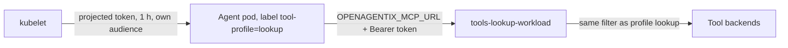

# Bring your own agent

## What it is for

Teams already have agents. This feature lets one of them run on OpenAgentix without being rebuilt from instructions. The decision and the options are in ADR 0015 (issue #43). This is slice 1: a container agent with model access only.

## How it works

- `spec.runtime.type: container` and `spec.runtime.container.image` (digest pinned, from an operator-approved registry) in an `AgentDefinition`.
- The control plane runs the image as a Deployment in the namespace `openagentix-workloads`. The namespace enforces Pod Security `restricted` and has a default-deny network policy.
- The key Secret is created in that namespace and mounted as `OPENAI_API_KEY`. The controller can create and delete Secrets there but never read them.
- The controller writes the list of container agents to a ConfigMap. The gate reads it and builds the upstream URL itself from a fixed template, so the list cannot point the gate at another host.
- An admission guard (allowlists on every field) limits what even a compromised controller can write.

## What is refused

`instructions`, `instructionsFrom`, `tools`, a `toolProfile` the operator has not opened to container agents (see below), `egress.allow`, `memory`, `knowledge`, `notify`, `skills`; images without a digest or outside the allowed registries; the runtime itself when `allowedRuntimes` does not list it (the default is `[builtin]`).

## Isolation, plainly

Less isolated than the built-in runtime: shared kernel unless a RuntimeClass is set, one process for all conversations, one identity per agent, no persistent files. On kind, outbound traffic to the internet is not enforced by the network plugin. On k3s (k3d, in CI) a deny-all egress policy did block a connection to the internet, and the sample agent passed the smoke test there ([Install on k3s](../guide/install-k3s.md)).

## What was run

In the `e2e` job (GitHub-hosted runner, one kind node, stub model, no key): `QUICKSTART_BYO=1 PROFILE=quickstart ./install.sh` builds the sample, loads it into kind, reads its digest from the node (`hack/kind-image-digest.sh`; kind keeps only the tag, so the script adds the `name@sha256` name on the node) and applies the definition. `hack/ci/smoke.sh` then checked: Ready 10 s after creation, isolation `container`, user 65532 with a read-only root and no token, the endpoint through the gate, an answer through the gate and the model gateway, the gateway user `kagent.echo-go`, and three refused definitions. The gate began to route to the new agent about 39 s after it was Ready (one run), because the route list reaches it through a ConfigMap volume; the check asks again for up to two minutes.

Not shown: whether kind's network plugin enforces the NetworkPolicy (so the egress port to the model gateway is not shown to be right), pulling from a registry, a real model.

## A Python sample (slice 4)

`examples/agents/echo-a2a-python` is the same sample in Python, built with the official A2A Python SDK (`a2a-sdk` 1.3.1). It reads the model from `OPENAI_BASE_URL`, `OPENAI_API_KEY` and `OPENAGENTIX_MODEL`, takes its port from `PORT`, runs as user 65532 and writes no files. The base image is pinned by digest and every package by hash. Its README has the build, load and deploy steps and the `AgentDefinition`.

What was run: 20 unit tests with a fake model, a contract test that sends a message through the agent to a built `services/stub-model`, and the agent started as a real server (`uvicorn`) with the card, `SendMessage`, an unknown method and a streaming call checked with `curl`. All on a laptop, with the `A2A-Version: 1.0` header. The SDK reads a request without that header as version 0.3, so a client must send it (the gate and `hack/ask.sh` do).

Not shown: the image build and a run on a cluster (see the README of the sample), whether LangGraph, Google ADK or CrewAI serve A2A 1.0 themselves.

## Tools through a tool profile (slice 3)

ADR 0019. The operator opens a profile to container agents by name: `controlPlane.containerAgents.toolProfiles: [lookup]`. The chart then renders a second tool server for that profile, `tools-lookup-workload`, with the same tools. It accepts only a Kubernetes ServiceAccount token with the audience `openagentix-vmcp-lookup-workload`, and its policy admits only tokens that the kubelet made for a pod of the workload namespace.

A definition with `toolProfile: lookup` gets, in its pod: `OPENAGENTIX_MCP_URL`, `OPENAGENTIX_MCP_TOKEN_FILE` (the kubelet writes and replaces the token; there is no Secret and the controller reads nothing), the label `openagentix.io/tool-profile: lookup`, and one more egress rule to that server. The agent gets every tool of the profile. `tools` stays refused, so make a narrower profile if you need fewer tools. The admission guard pins the label, the token (audience, path, at most one hour, read-only), the two variables and the egress rule to an opened profile.

Two admission policies cover the workload namespace for every user except the controller and the cluster's own controllers, a cluster admin included: no pod or pod template there may carry the tool-profile label or a projected ServiceAccount token, and only the kubelet may request a token there.

Limits, plainly: any pod in the cluster can ask for a token with this audience for its own ServiceAccount, so the namespace rule in the server's policy is what keeps other namespaces out. A token is not revoked when the agent is removed; it stays valid until it expires (at most one hour). Where NetworkPolicy is not enforced, a token that leaves the pod can be used from elsewhere until then; the network rule is a second layer only where the cluster enforces NetworkPolicy. All agents on one profile look the same to the server. One more pod per opened profile.

Try it in the quick start (`QUICKSTART_BYO=1`): the profile `lookup` is open and the sample has `toolProfile: lookup`. `hack/ask.sh echo-go /tools` answers `tools: osv_query_vulnerability`. This was shown on kind in the `e2e` job; on k3s the tool server could not fetch the cluster's signing keys. Details in [What works](../what-works.md).

What was run: see the row in [What works](../what-works.md).

## Not done yet

An egress allowlist (slice 5), enrolling a workload you run yourself, private registries.
