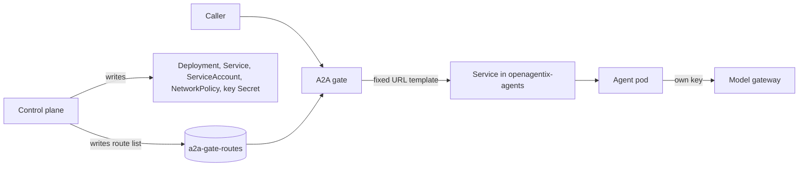

# Bring your own agent

## What it is for

Teams already have agents. This feature lets one of them run on OpenAgentix without being rebuilt from instructions. The decision and the options are in ADR 0015 (issue #43). This is slice 1: a container agent with model access only.

## How it works

- `spec.runtime.type: container` and `spec.runtime.container.image` (digest pinned, from an operator-approved registry) in an `AgentDefinition`.
- The control plane runs the image as a Deployment in the namespace `openagentix-agents`. The namespace enforces Pod Security `restricted` and has a default-deny network policy.
- The key Secret is created in that namespace and mounted as `OPENAI_API_KEY`. The controller can create and delete Secrets there but never read them.
- The controller writes the list of container agents to a ConfigMap. The gate reads it and builds the upstream URL itself from a fixed template, so the list cannot point the gate at another host.
- An admission guard (allowlists on every field) limits what even a compromised controller can write.

## What is refused

`instructions`, `instructionsFrom`, `tools`, `toolProfile`, `egress.allow`, `memory`, `knowledge`, `notify`, `skills`; images without a digest or outside the allowed registries; the runtime itself when `allowedRuntimes` does not list it (the default is `[builtin]`).

## Isolation, plainly

Less isolated than the built-in runtime: shared kernel unless a RuntimeClass is set, one process for all conversations, one identity per agent, no persistent files. On kind, outbound traffic to the internet is not enforced by the network plugin. Not verified: egress enforcement on k3s.

## Not done yet

Tools through a tool profile (slice 3), the conformance checker (slice 2), a Python sample (slice 4), an egress allowlist (slice 5), enrolling a workload you run yourself, private registries.
