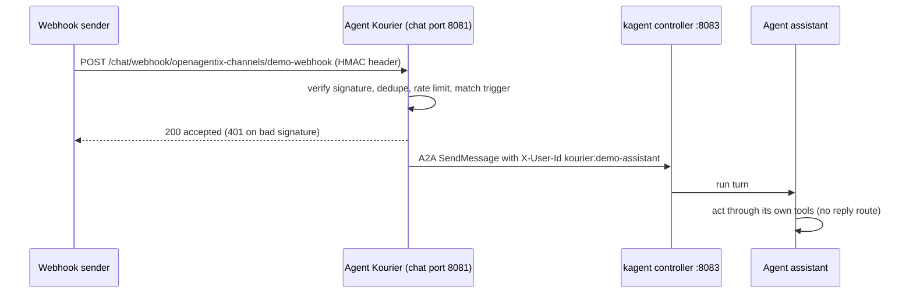

# Channels and triggers

## What it is for

People and systems start agents from outside the cluster. Two components do it. The **Telegram bridge** (`bridges/telegram`, Go) lets people chat with an agent from a phone. **Agent Kourier** 0.6.0 (pinned) turns signed webhooks, and in principle Slack channels, into agent turns. Kourier has no direct messages, so Telegram stays on our own bridge.

## How it works

The bridge long-polls Telegram `getUpdates`, so it needs no inbound connection. It keeps one A2A `contextId` per chat, sends `X-User-Id: telegram:<chat id>` and starts a W3C trace per message. Kourier watches three custom resources: `ChatConnection` (one source and its Secret), `Binding` (channel to agent, triggers, limits, user id) and `AgentBackend` (how to reach kagent, dialect `kagent-v1`).



Namespaces: `openagentix-gateway` (bridge), `agent-kourier` (broker, SQLite on a 1 Gi PVC), `openagentix-channels` (connections, bindings, Secrets). The chat listener is a ClusterIP Service; the chart creates no Ingress.

Three ways to map agents: one trigger per agent on one webhook connection, one Slack bot with a binding per channel id, or one bot per agent.

## How to enable and configure

Bridge keys (`bridge` block): `enabled`, `namespace: openagentix-gateway`, `agent: assistant`, `userIdPrefix`, `existingSecret: telegram-bridge`, `allowlist.enabled: true`. The bridge refuses to start without `TELEGRAM_ALLOWED_CHAT_IDS` (or `TELEGRAM_ALLOW_ALL=true`).

Kourier is off by default (`channels.kourier.enabled: false`). Switch it on with the demo values:

```sh
VALUES_FILE=components/channels/demo-values.yaml ./install.sh
```

```yaml
channels:
  kourier: {enabled: true}
  connections:
    - name: demo-webhook
      platform: webhook
      existingSecret: demo-webhook          # install.sh generates it when absent
      webhook:
        verify: {scheme: hmac-sha256, header: X-Demo-Signature, prefix: "sha256="}
  bindings:
    - name: demo-assistant
      connection: demo-webhook
      channel: demo
      agent: assistant                      # must be an agents[].name
      output: none
      triggers:
        - type: webhookEvent
          match: {event: '^question\.asked$'}
```

`install.sh` installs the `agent-kourier` release before the chart (`components/channels/kourier.sh`, cosign check when cosign exists). The chart renders a Role that lets Kourier read only the Secrets the connections name, and a NetworkPolicy peer for Kourier on the controller port.

Kourier's own NetworkPolicy lets it reach the API server. `kourier.sh` derives that address at install time. On kind the nodes are Docker containers and their addresses change when Docker restarts (`172.18.0.2` became `172.18.0.3` in one case), so a rule for one address left Kourier crash-looping until the installer was run again. Now, when every node's `providerID` starts with `kind://`, the rule allows the `/24` of the API server's address (Docker's pool gives a few nodes consecutive addresses; the rule only opens the API server port). On other clusters the exact endpoint addresses stay (`/32`). Set `KOURIER_APISERVER_CIDRS` to a comma or space separated list of CIDRs to override both. The derivation is a small function with offline tests (`components/channels/tests/run.sh`); the fix has not been run on a live cluster restart.

## How to try it

```sh
kubectl port-forward -n agent-kourier svc/agent-kourier-chat 8081:8081 &
BODY='{"event":"question.asked","channel":"demo","user":{"login":"alice"},"conversation":"c1","question":"Does lodash 4.17.20 have known vulnerabilities? How many?"}'
SIG=$(printf '%s' "$BODY" | openssl dgst -sha256 -hmac "$(kubectl get secret -n openagentix-channels demo-webhook -o jsonpath='{.data.webhookSecret}' | base64 -d)" -hex | awk '{print $NF}')
curl -s -o /dev/null -w '%{http_code}\n' -X POST http://127.0.0.1:8081/chat/webhook/openagentix-channels/demo-webhook \
  -H 'Content-Type: application/json' -H "X-Demo-Signature: sha256=$SIG" -H 'X-Demo-Delivery: d1' --data-binary "$BODY"
```

Expect 200. Then `kubectl logs -n agent-kourier deploy/agent-kourier` shows `session turn ended outcome=completed`. For Telegram, message your bot from a chat id on the allowlist.

## What was proven

- A signed webhook through the chart-managed connection ran a turn (`outcome=completed`), called `osv_query_vulnerability` and answered 4. A bad signature got 401. A second `install.sh` run changed nothing.
- Spike (`spikes/kourier/`): dedupe, threading, rate limits and two connections side by side.
- Bridge: per-chat user id verified against kagent 1.0.1 in `insecure` mode; unit tests `TestBridge_UserIDIsPerChat` and others.
- The Telegram path was not run live during the observability work (rule: no Telegram messages); its trace line is unit-tested only.

- Telegram bridge, cold start (issue #139): an agent answer of A2A -32004 is retried once and then shown as a "waking up" message, with the log outcome `agent_waking`. Unit-tested with a fake agent (answers -32004 then succeeds; keeps answering -32004; other errors; retry off; delay inside the turn deadline). Not run on a cluster. Settings: `RETRY_ON_WAKEUP`, `WAKEUP_RETRY_DELAY` (see `bridges/telegram/README.md`).

## Events from a sender that cannot speak A2A (ADR 0027, slice 7)

There are two doors for a system that starts an agent run without a person. Pick by what the sender can do.

| The sender can | Use | Why |
|---|---|---|
| Call the A2A gate with a Kubernetes identity and form an A2A message (a case system, a fleet service that you run in the cluster) | An **event caller** on the gate ([event callers](./event-triggers.md)) | The caller has its own ServiceAccount and no shared secret. The message is one short identifier, checked by the gate against a pattern, so free text stays in the system of record. The gate limits the rate and the open calls, and the audit line carries the event id |
| Only send its own JSON to a URL and sign it (Alertmanager, a code host, a monitoring product) | The **channels webhook** (this page) | It cannot form an A2A message. Agent Kourier checks the signature or token, takes named fields out of the JSON and puts them into a prompt template |

For an alert, for example Alertmanager telling the pod root-cause agent that a workload is down, the setup is a webhook connection with a token (or an HMAC), a binding that matches the alert, and a template that names the workload. Use the shape in "How to enable and configure" above: `platform: webhook`, a `verify` block, a binding with `agent` set to a chart agent, and a `webhookEvent` trigger whose `match` pins the alert name and status. Put only the fields you need into the template, and put them in the untrusted data block of the template, never in its instruction part. Set the binding's limits (`rateLimit.maxRuns` and `per`, `maxConcurrent`, `maxRunsPerDay`): they are the only limits this path has.

What is weaker than an event caller, and what to do about it:

- **Free text reaches the prompt.** An alert summary or annotation is text from a system you do not control, and the template puts it in front of the model, in the untrusted data block. That is weaker than an identifier checked by a pattern. Send the name of the workload and the alert, not the summary, and let the agent read the details through its tools.
- **One user id for the whole binding.** Every event of a binding runs as the binding's one fixed user id, so they share one memory scope. Give the agent no long-term memory.
- **Excess events are dropped, and the sender gets 200.** The binding's limits drop an event over the rate and do not queue it, and the sender cannot back off. An event caller answers 429 with `Retry-After`, and its sender retries.
- **The duplicate check is in memory.** A repeat of an alert after a restart of Kourier can start a second run. The work an event starts must be safe to repeat.
- **A chart agent only.** A binding names an agent of `agents[]`.
- **Kourier is 0.x with one maintainer**, and it sits on the path of every event.
- **No Ingress by default.** The chat listener is a ClusterIP Service. A sender outside the cluster needs an Ingress that you add, with TLS, and its pods listed in Kourier's `networkPolicy.chatFrom`.

This path was proven live once for a signed test webhook (see "What was proven"). It was not run for an alert from Alertmanager, and no use case in this repository wires it: the software organisation use case still has no alert trigger and no incident record (its README says so).

## Known limits

- Slack is UNTESTED: no Slack tokens were available. The values follow Kourier's docs and CRD schema only.
- A webhook has no reply route (`output: none`). The agent must deliver through a tool, see [notify](./notify.md).
- One memory scope per binding (the binding's fixed `userId`). Anyone in a bound Slack channel can use the agent and spend its budget.
- Kourier is 0.x with one maintainer. A Kourier restart mid-turn ends the turn recorded as `refused` on kagent 1.0.1, though the task completes.
- Excess events are dropped, not queued, and the sender still gets 200. The dedupe key lives in memory.
- Bridge: one replica, polling offset in memory (an update can be answered twice after a restart), conversations forgotten on restart.
- Real webhooks need an Ingress you add yourself, with TLS, and the ingress pods listed in Kourier's `networkPolicy.chatFrom`.
- Bridge: the cold start itself is unchanged (a sandbox restore took about 60 s, mostly unpacking the image). The retry waits 20 s once; a restore longer than that still ends with the "waking up" message and the user sends the message again.
- Teams and other platforms: not built.
