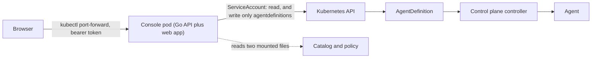
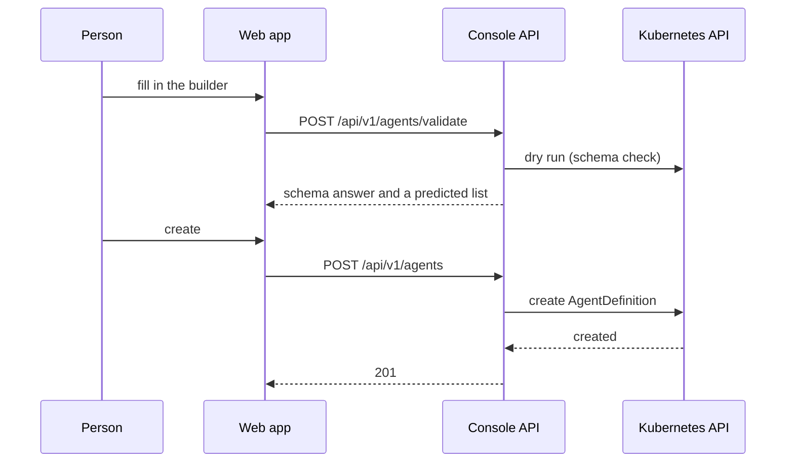
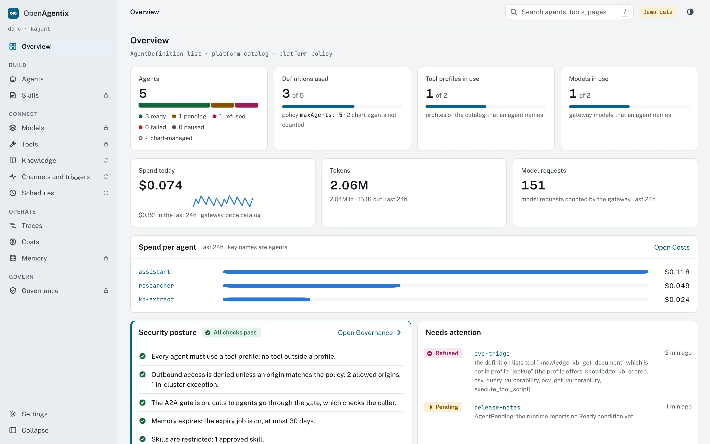
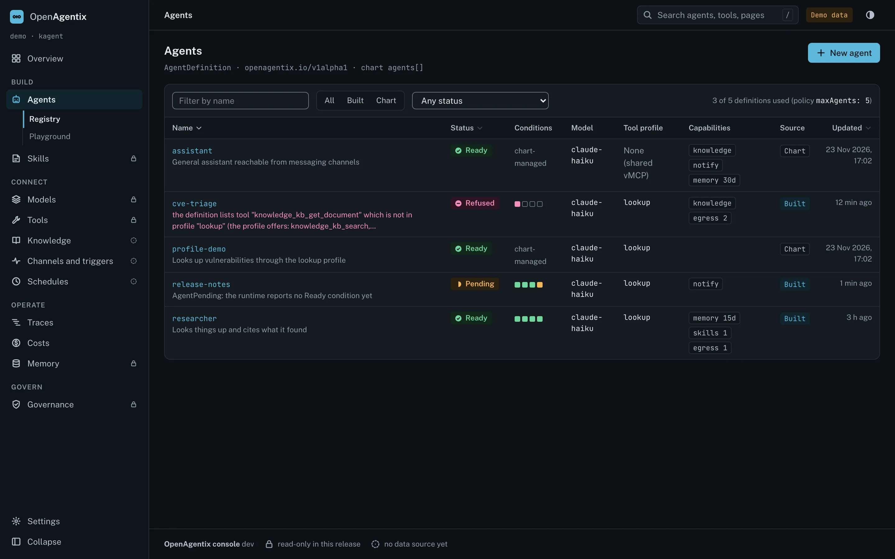
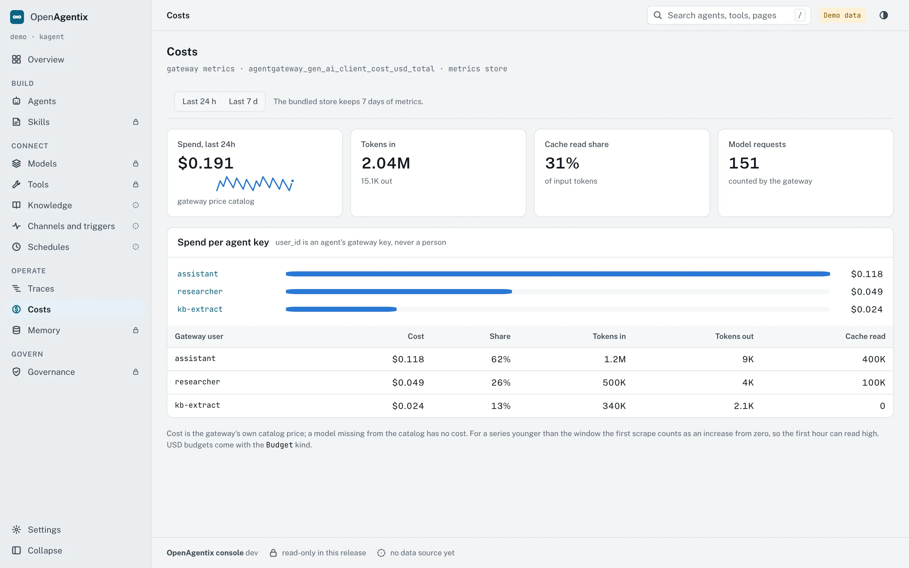
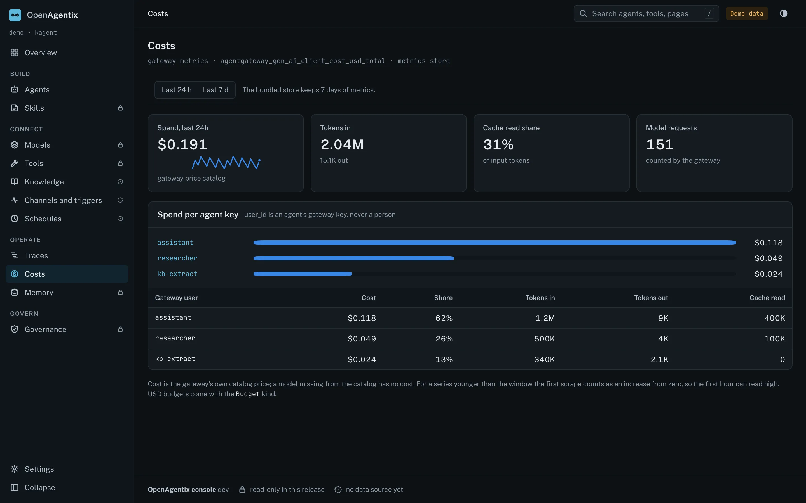
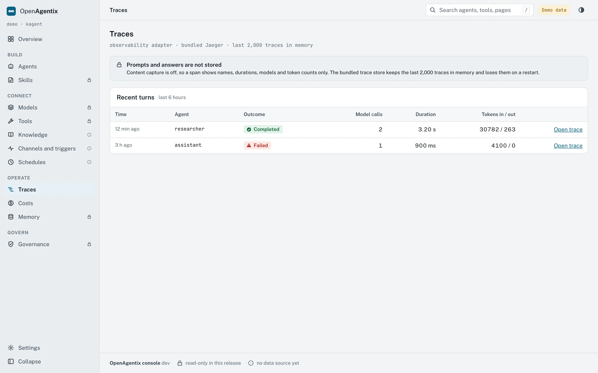
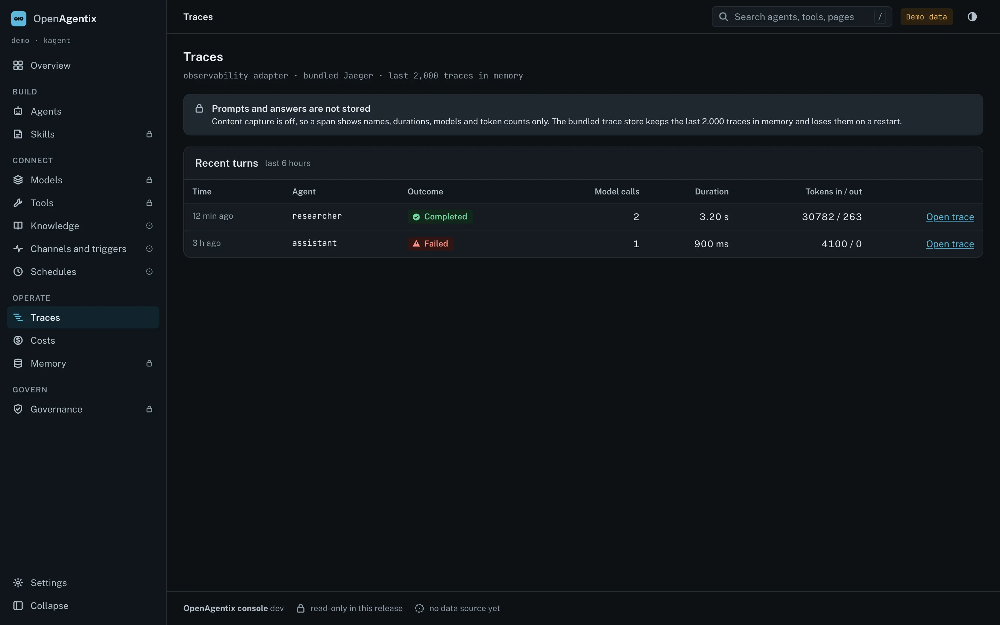
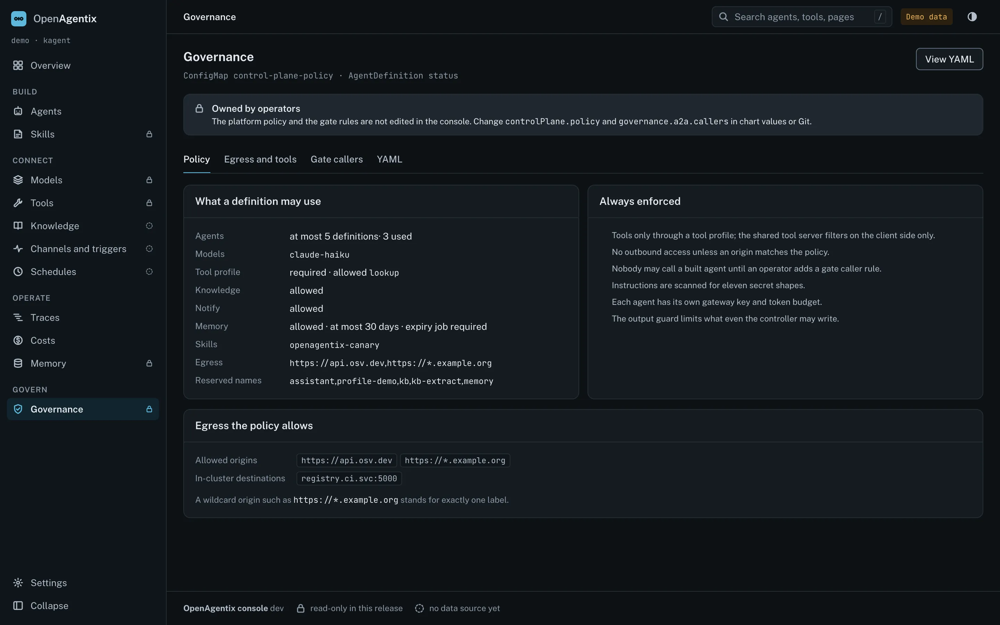

# Console

## What it is for

The console is a web page where a person builds and manages agents without writing YAML. It is slice 3 of ADR 0007. It works on `AgentDefinition` resources, so the same agents can be made with `kubectl`.

It needs the control plane. It is off by default (`console.enabled`).

## How it works

Two parts, one image:

- `services/console`: a small Go API. It has fixed routes, a bearer token and a strict Content-Security-Policy. It does not proxy requests to the cluster. It uses only the standard library.
- `console/`: a SvelteKit single-page app, built into the Go binary. It has a shell, an agents registry, an agent builder whose options follow the platform policy, a YAML view, pause and delete. Overview, Models, Tools, Skills, Memory and Governance show read-only data from the cluster. With the bundled observability on, Overview and Costs show spend and tokens per agent and Traces shows recent turns. Areas without a data source (Knowledge, Channels and triggers, Schedules, Playground) say "not available yet".

The design contract is `docs/console/UI-SPEC.md`. The approved mockup is `docs/console/mockup.html`.





The "predicted" list in the validate answer is a small rule set written for the console. It is a guess. The controller's `status.violations` are the real answer.

### Routes

The API has these routes only: `GET /healthz`, `GET /api/v1/session`, `GET /api/v1/platform`, `GET`, `POST` on `/api/v1/agents`, `POST /api/v1/agents/validate`, and `GET`, `PUT`, `DELETE` on `/api/v1/agents/{name}`. Chart agents are listed as read-only.

### Protection

- The login is a bearer token from a mounted Secret. The real mode refuses a token shorter than 32 characters.
- A Host allowlist closes DNS rebinding. Failed sign-ins are throttled.
- Errors written by the Kubernetes API server are never sent to the browser. The console maps them to its own short sentences.
- There is no ingress. The network policy admits nobody. Reach the console with `kubectl port-forward`.
- Every user acts as one operator identity, `console`. There are extension points for authentication, authorization and audit. They are not filled in yet.
- The ServiceAccount can read what it shows and can write only `agentdefinitions`. `console.viewer: true` makes a read-only console.

## Screenshots

All from the console in demo mode, which holds fake data only. They are made by `console/scripts/capture-screenshots.mjs`.

### Overview




*Console in demo mode.*

### Agents registry




*Console in demo mode.*

### Agent builder


*Console in demo mode.*

### Costs




*Console in demo mode.*

### Traces




*Console in demo mode.*

### Governance




*Console in demo mode.*

## How to enable

Add `components/console/demo-values.yaml` after `components/control-plane/demo-values.yaml` (see [Control plane](./control-plane.md)). The installer builds the image, loads it into kind and creates the token Secret `console-token` (48 random characters, only when absent, never printed).

```sh
kubectl port-forward -n openagentix-system svc/openagentix-console 8080:8080
# then open http://127.0.0.1:8080
```

## What was proven

On the kind demo cluster, 2026-11-25:

- The installer deployed the console.
- Without a token the API answered 401.
- With the token it listed the two chart agents and the built one.
- An agent created through the console API became Ready in 25 s. Delete through the API removed it.
- The console's ServiceAccount could not read Secrets and could not write kagent resources. Its log had no "forbidden".

Tests: Go tests with `-race`, 116 component tests including accessibility checks, and 15 Playwright flows. The Playwright flows run in a demo mode with an in-memory backend.

The second review of the control plane ran after the console was built. Its console findings were fixed (token strength, Host allowlist, no upstream error text in answers).

## Known limits

- The browser UI was not driven against the real cluster. In the live run only the API was used. The UI was exercised in demo mode.
- The Playground (a chat with the agent inside the console) does not exist yet.
- Chart agents are read-only. Areas without a data source show "not available yet".
- One shared operator identity. No login by user, no per-user audit yet.
- Reachable only through a port-forward. Serving it over TLS behind an ingress is not done or tested.
- One kind node, one namespace.

Sources: `services/console/README.md`, `docs/console/UI-SPEC.md`, `docs/decisions/0007-control-plane-and-agent-builder.md`.
