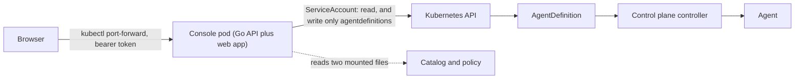
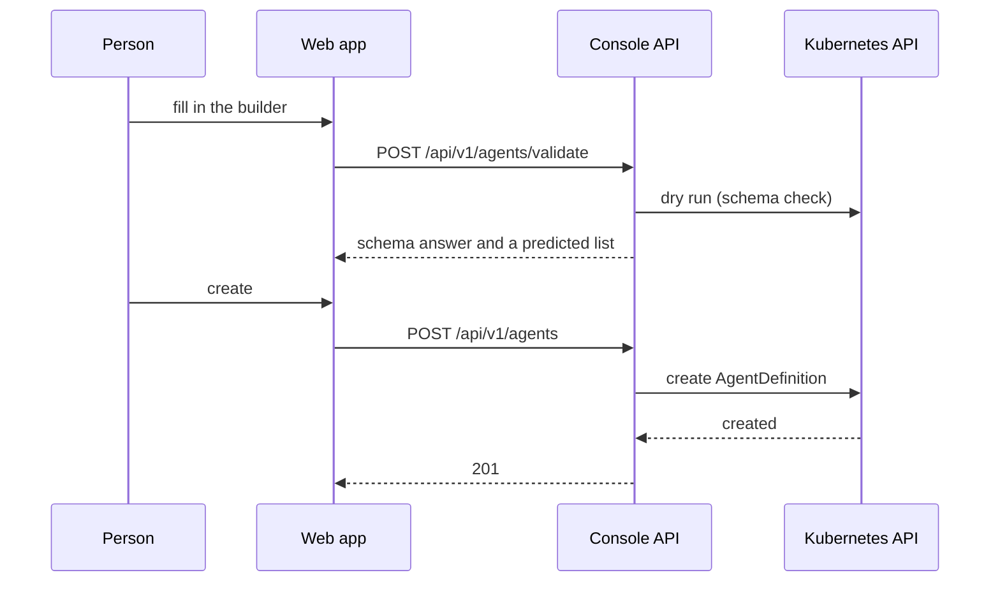
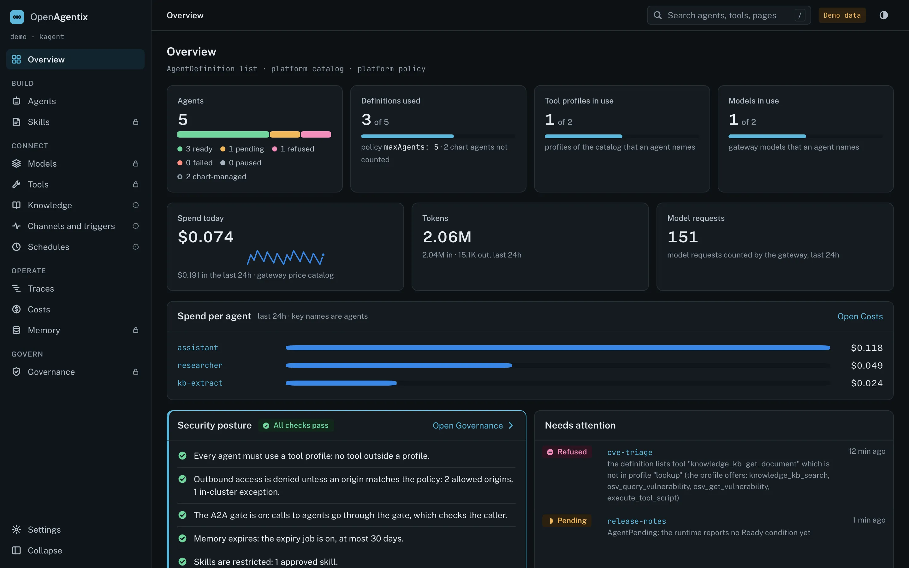
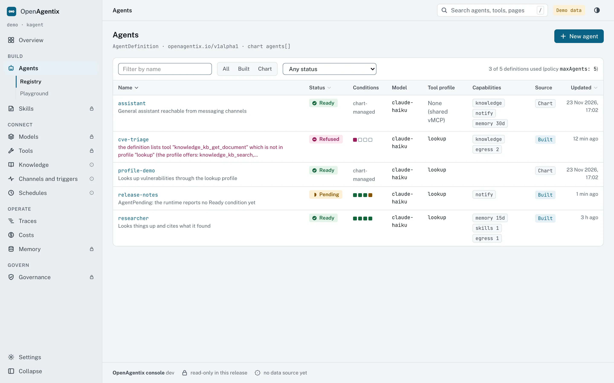
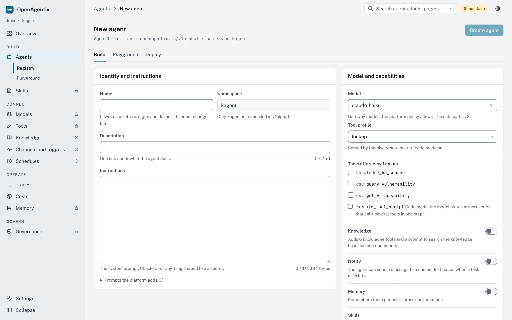
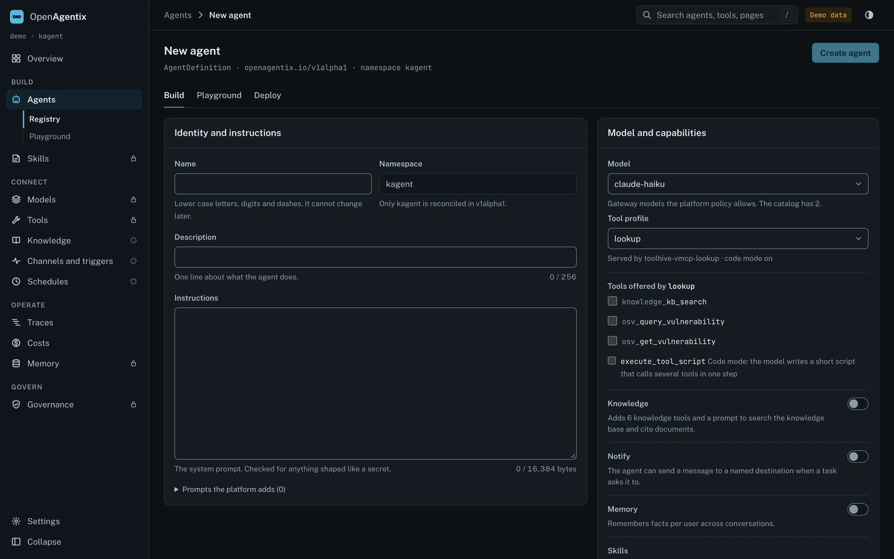
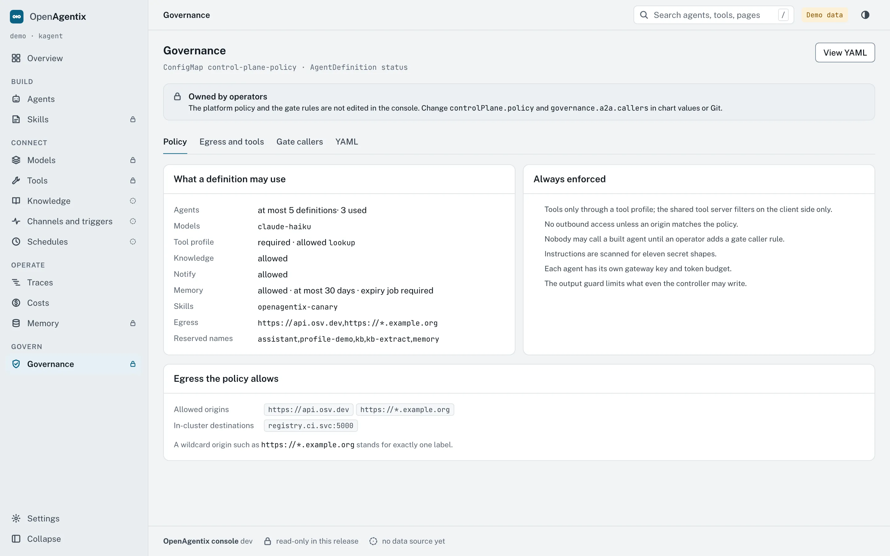

# Console

## What it is for

The console is a web page where a person builds and manages agents without writing YAML. It is slice 3 of ADR 0007. It works on `AgentDefinition` resources, so the same agents can be made with `kubectl`.

It needs the control plane. It is off by default (`console.enabled`).

## How it works

Two parts, one image:

- `services/console`: a small Go API. It has fixed routes, a bearer token and a strict Content-Security-Policy. It does not proxy requests to the cluster. It uses only the standard library.
- `console/`: a SvelteKit single-page app, built into the Go binary. It has a shell, an agents registry, an agent builder whose options follow the platform policy, a YAML view, pause and delete. Overview, Models, Tools, Skills, Memory, Governance, Schedules and Access show read-only data from the cluster. With the bundled observability on, Overview and Costs show spend and tokens per agent and Traces shows recent turns. Areas without a data source (Knowledge, Channels and triggers, Playground) say "not available yet".

The design contract is `docs/console/UI-SPEC.md`. The approved mockup is `docs/console/mockup.html`.





The "predicted" list in the validate answer is a small rule set written for the console. It is a guess. The controller's `status.violations` are the real answer.

### Routes

The API has these routes only: `GET /healthz`, `GET /api/v1/session`, `GET /api/v1/platform`, `GET /api/v1/metrics/summary`, `GET /api/v1/traces`, `GET /api/v1/traces/{traceId}`, `GET`, `POST` on `/api/v1/agents`, `POST /api/v1/agents/validate`, and `GET`, `PUT`, `DELETE` on `/api/v1/agents/{name}`. Chart agents are listed as read-only.

### Protection

- The login is a bearer token from a mounted Secret. The real mode refuses a token shorter than 32 characters.
- A Host allowlist closes DNS rebinding. Failed sign-ins are throttled.
- Errors written by the Kubernetes API server are never sent to the browser. The console maps them to its own short sentences.
- There is no ingress. The network policy (on by default, `networkPolicy.enabled`) admits no ingress. Reach the console with `kubectl port-forward`.
- Every user acts as one operator identity, `console`. There are extension points for authentication, authorization and audit. Only the built-in ones exist: a bearer token, one role (read only with `console.viewer: true`) and one JSON audit line for each write on standard output.
- The ServiceAccount can read what it shows and can write only `agentdefinitions`. `console.viewer: true` makes a read-only console.

## Screenshots

All from the console in demo mode, which holds fake data only. They are made by `console/scripts/capture-screenshots.mjs`.

### Overview




*Console in demo mode.*

### Agents registry




*Console in demo mode.*

### Agent builder




*Console in demo mode.*

### Bring your own agent

Open **New agent**, then **Bring your own agent** (`/agents/new/container`). The link shows only when the platform has container agents installed (`controlPlane.containerAgents.enabled`) and the policy lists `container` in `allowedRuntimes`. If one of those is missing, the page says which.

The form asks for:

- **Image.** A digest, not a tag: `registry/path@sha256:<64 hex digits>`, under a registry prefix the policy allows (`controlPlane.policy.runtimes.container.images`). The hint shows an example built from the first allowed prefix. A tag, a tag next to a digest, a short digest and a registry that is not allowed each get their own plain sentence.
- **Port**, 1024 to 65535, and up to 32 **environment variables**. A name that is not upper case, starts with `OPENAGENTIX_`, `OPENAI_`, `OTEL_` or `KUBERNETES_`, or is set twice is refused. A value shaped like a secret is refused, and the message names the kind of secret and never repeats the value.
- **Model** from the allowed models, and an optional **tool profile** from the profiles that are both allowed and opened to container agents.

There is no instructions field, and no field for memory, knowledge, notify, skills or egress, because the controller refuses them for a container agent. Resource limits are not in the form (the policy defaults apply).

The form checks the draft in the browser with the same rules as the admission policy and the controller. When it has no problem it calls the validate route, which runs the Kubernetes dry run and the console's prediction rules. **Create stays off until that check passes.** The create route runs the prediction rules again for a container definition and answers 422 before it writes anything, so a script cannot skip the check either. The controller still decides after the create. A container agent opens in the builder read-only, with its image, port and variable names, so a save cannot drop the image.

The page shows the isolation facts of ADR 0015 before you create: a container agent is less isolated than a built-in one, and where the network plugin does not enforce network policy it can reach any host.

### Costs


*Console in demo mode.*

### Traces


*Console in demo mode.*

### Governance




*Console in demo mode.*

### Schedules and Access (read-only)

Two pages show what governs an agent today. They read what the chart defines now. They do not use the `Schedule` and `AgentAccess` kinds of the proposed ADRs 0016 and 0017, which do not exist yet.

- **Schedules** lists the schedules of `schedules` in chart values. The console lists the CronJobs that carry the label `openagentix.io/schedule` in the schedules namespace. Each row has the agent, the cron expression in words (for the common shapes only, other expressions are shown as they are), the time zone, the state (active or suspended) and the last start. A click opens a detail view with the overlap policy, the call timeout, the last start and last success, and the creation time. It does not read the prompt, the token or the user id of a schedule. It does not read Jobs, so it cannot say whether the last run worked.
- **Access** lists the callers of the A2A gate, read from the ConfigMap `a2a-gate-rules`: caller name, whether the chart derived it or `governance.a2a.callers` set it, the ServiceAccount, whether it uses a key, its agents and methods, and the kind of user id rule (exact, prefix or fixed). A user id value, a key and a key hash are never read, because a user id can name a person. The Governance page keeps the platform policy and links to Access from its "Gate callers" tab.

Both pages say in plain words when there is nothing to show: no schedule is defined, the gate is off, or the rules file is missing. An unreadable answer shows an error sentence; the Kubernetes text goes to the console log only.

The chart gives the console two small extra Roles, and only when there is something to read. With `schedules` set it adds a Role in the schedules namespace that may `list` CronJobs. With the gate on it adds a Role in the gate namespace that may `get` the one ConfigMap `a2a-gate-rules`. Neither names a Secret. The console gets the namespaces from `CONSOLE_SCHEDULES_NAMESPACE` and `CONSOLE_GATE_NAMESPACE`. With the console off, the chart renders as before.

## How to enable

Add `components/console/demo-values.yaml` after `components/control-plane/demo-values.yaml` (see [Control plane](./control-plane.md)). The installer builds the image, loads it into kind and creates the token Secret `console-token` (48 random characters, only when absent, never printed).

```sh
kubectl port-forward -n openagentix-system svc/openagentix-console 8080:8080
# then open http://127.0.0.1:8080
```

## What was proven

On the kind demo cluster, 2026-11-25:

- The installer deployed the console.
- Without a token the API answered 401.
- With the token it listed the two chart agents and the built one.
- An agent created through the console API became Ready in 25 s. Delete through the API removed it.
- The console's ServiceAccount could not read Secrets and could not write kagent resources. Its log had no "forbidden".

Tests: Go tests with `-race`, 116 component tests including accessibility checks, and 15 Playwright flows. The Playwright flows run in a demo mode with an in-memory backend.

Bring your own agent (issue #107) was tested only offline and in demo mode, on 2026-11-26: Go tests of the container rules (`internal/predict`), of the platform summary (no workload URL or audience in it), of the create route refusing a bad container definition before any write, and of the YAML of a container agent; 219 vitest tests in total, among them 23 for the draft and its rules and 15 for the form (with an accessibility check); and a Playwright flow in demo mode that types a tag (refused in plain English), another registry (refused, allowed one named), a secret-shaped value (refused, not echoed), then a good digest, waits for the check to pass, creates the agent and sees it Pending as a container agent. 23 Playwright flows passed. It has not been run against a cluster with container agents on.

The Schedules and Access pages (issue #5) were tested only offline, on 2026-11-26: Go tests of the CronJob and ConfigMap readers against a fake Kubernetes API (no secret, prompt or user id in the answer), route and auth tests, 181 vitest tests in total with accessibility checks, 22 Playwright flows in demo mode (one new, for these two pages), and chart render tests for the two extra Roles. They were not run against a cluster, so the Roles and the real CronJob and ConfigMap shapes are not proven live.

The second review of the control plane ran after the console was built. Its console findings were fixed (token strength, Host allowlist, no upstream error text in answers).

## Known limits

- The browser UI was not driven against the real cluster. In the live run only the API was used. The UI was exercised in demo mode.
- The Playground (a chat with the agent inside the console) does not exist yet.
- A container agent can be created in the builder but not edited there: it opens read-only. To change its image, port or variables create a new agent, or edit the definition with kubectl. The form has no resource limits, and a private registry is not supported (ADR 0015). The builder's rules are a copy of the controller's; the controller stays the authority.
- Chart agents are read-only. Areas without a data source show "not available yet".
- Schedules shows the CronJob's own times, not the result of single runs. Access shows the kind of user id rule, never its value. Neither reads `Schedule` or `AgentAccess` resources, which do not exist yet.
- One shared operator identity. No login by user, no per-user audit yet.
- Reachable only through a port-forward. Serving it over TLS behind an ingress is not done or tested.
- One kind node, one namespace.

Sources: `services/console/README.md`, `docs/console/UI-SPEC.md`, `docs/decisions/0007-control-plane-and-agent-builder.md`.
