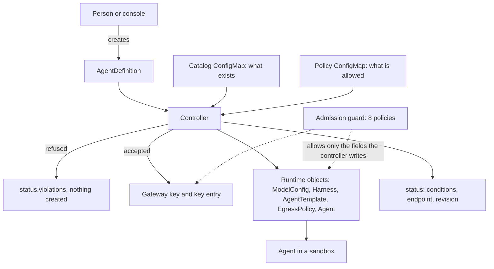

# Control plane

## What it is for

Before this, an agent existed only as an entry in the chart values. To add one, an operator edited a values file and ran Helm.

The control plane lets a person describe an agent in one small resource, `AgentDefinition`. A controller then builds everything the agent needs. The platform team keeps control through a catalog (what exists) and a policy (what is allowed).

It is slice 1 of ADR 0007. The platform contract for products built on top is ADR 0012. It is off by default (`controlPlane.enabled`). With it off, the default chart render is the same as before.

## How it works

The resource: `AgentDefinition`, group `openagentix.io/v1alpha1`, short name `oad`. There is no field for a model config, image, tool server, namespace, caller, gateway user or budget. A definition says only what the agent should do: model, instructions, tool profile and tools, knowledge, notify, memory, skills, egress and `suspend`.

The controller is `services/control-plane`. It is written in Go with the standard library only. It has a core and adapters: one for the kagent runtime, one for the model gateway keys (agentgateway) and one for the tool profiles (ToolHive).



For each definition the controller:

1. adds a finalizer;
2. checks the definition against the catalog and the policy. A refusal sets `Accepted=False` and writes one sentence per broken rule into `status.violations`. Nothing else is written;
3. checks that no foreign object has the name it needs. If one has, it stops and says so (`NameConflict`);
4. makes a gateway key. The key is made in memory, stored in a Secret that carries the definition's UID in its name, and registered at the gateway under the user `<namespace>.<name>`, for example `kagent.researcher`;
5. applies the runtime objects with server-side apply;
6. removes owned objects that are no longer wanted;
7. writes the status.

On delete it removes the owned objects, then the key entry, then the finalizer.

The status has a public part that products may read (`conditions`, `endpoint`, `revision`, `effectiveTools`, `effectiveEgress`, `violations`) and a private part, `status.controller`, that may change without notice. The rules are in `docs/api-conventions.md`.

### Safety

- The controller uses namespaced Roles only. It never reads a Secret.
- The admission guard is a set of 8 ValidatingAdmissionPolicies. It is an allowlist: it lets through only the fields the controller writes. A request by anyone else to change these objects is denied.
- A ResourceQuota limits the number of definition objects (`controlPlane.maxDefinitions`, default 50).
- The policy sets `maxAgents`, the allowed models, tool profiles and egress, and whether knowledge or notify may be used. `suspendAll: true` stops every definition.

### Suspend

`spec.suspend: true` is a stop. The runtime agent is removed, running conversations end, and the gateway key entry is removed. The status shows `Ready=False` with reason `Suspended`. Resume brings back the same key.

## How to enable

```sh
VALUES_FILE="components/channels/demo-values.yaml components/schedules/demo-values.yaml components/notify/demo-values.yaml components/observability/demo-values.yaml components/knowledge/graph-demo-values.yaml components/governance/demo-values.yaml components/governance/profiles-demo-values.yaml components/governance/memory-demo-values.yaml components/control-plane/demo-values.yaml" ./install.sh
```

The control plane file needs the tool profile `lookup` from `components/governance/profiles-demo-values.yaml`. Without it the render fails, because a policy may only name profiles that exist.

## How to try it

```sh
kubectl apply -f components/control-plane/researcher.yaml
kubectl get oad -n kagent -w
```

`kubectl get oad` shows the conditions. When `Ready` is `True`, the agent is up. To remove it, delete the definition. Everything it made goes with it.

Without a caller rule at the A2A gate, nobody can call a built agent from outside the cluster. The controller does not write gate rules, so an operator adds one.

## What was proven

On the kind demo cluster, 2026-11-25:

- A definition became a Ready agent in 13 to 31 s.
- The agent answered a question using a tool from its tool profile in 9.4 s. The model gateway recorded the call under the agent's own gateway user, `kagent.researcher`.
- A definition with a tool outside its profile and an in-cluster egress host was refused with two violation sentences. Nothing was created.
- The key registration survived a second installer run.
- Deleting the definition removed every object and the key entry.
- The guard denied: impersonating the controller, deleting a foreign Secret, deleting a chart agent, creating a stray Secret, and writing an egress policy that injects a Secret.
- The controller could not read Secrets.
- Suspend removed the runtime agent and the key entry. Resume restored the same key and `Ready` in about 12 s.
- The quota object counted definitions.

Reviews and tests:

- Two independent reviews. First: no critical, 7 important, 12 minor. Second: 1 critical, 6 important, 17 minor. All were fixed test-first.
- The critical finding: the first guard checked egress hosts, but not a field of an egress policy that injects a Secret into outbound requests. The guard was rewritten as an allowlist.
- In CI the guard is run with the Kubernetes admission code (406 cases) and against a real API server (71 checks).
- A bug found only by a live upgrade: the API server refuses a CRD schema that describes `metadata`. It was fixed, and an API-server test covers it.
- One mistake while testing, not a product defect: an installer run with `SKIP_SKILL=1` deployed a placeholder skill digest, and the chart agent `assistant` stopped being Ready until the installer ran again without it. Issue 9 tracks failing early.

## Known limits

- Proven on one kind node and one namespace only.
- Chart agents (`agents[]`) are not migrated to definitions.
- Schedules, Kourier bindings and the Telegram bridge cannot point at built agents yet.
- Nobody can call a built agent through the A2A gate until an operator adds a caller rule.
- Suspend is a stop, not a pause.
- Memory for built agents needs a chart agent with memory, so that the memory stack is installed.
- The quota was counted, but enforcement at the limit was not tried.
- The controller does not read Secrets, so a key Secret deleted by hand is not noticed until the definition or its key entry changes.
- Bring your own agent (an agent built with another framework, speaking A2A) is planned for release 0.3 (ADR 0013). It is not built.
- The end-to-end install in CI does not work yet.

Sources: `services/control-plane/README.md`, `docs/decisions/0007-control-plane-and-agent-builder.md`, `docs/decisions/0012-platform-primitives-for-agentic-delivery.md`, `docs/decisions/0013-focus-and-runtime-neutrality.md`.
