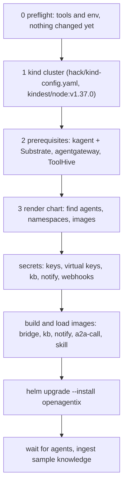

# Install

## What it is for

The goal in the original product brief is a single-command deploy with Helm. Upstream constraints make one chart impossible today: kagent and Substrate need fixed release names, a strict install order, and key material minted by `kubectl ate` before the charts start, and the Gateway API CRDs ship in neither agentgateway chart. So there are two layers.

| Layer | What | Where |
|---|---|---|
| Installer | Creates the kind cluster (or a k3s cluster with `CLUSTER_TYPE=k3d`), installs pinned upstream releases, creates Secrets from your environment, builds images, runs Helm | `install.sh`, `uninstall.sh` |
| Chart | Our own resources only, driven by values, no secret values | `charts/openagentix/` |

## How it works



Pinned upstream versions: kagent and Agent Substrate 1.0.1, Gateway API CRDs 1.6.3, agentgateway v1.7.0, ToolHive 0.67.1, Agent Kourier 0.6.0. The release is `openagentix` in namespace `openagentix-system`. The script is idempotent. If a required variable is missing it says which one and changes nothing.

## How to enable and configure

Required environment: `ANTHROPIC_API_KEY`, `TELEGRAM_BOT_TOKEN`, and `TELEGRAM_ALLOWED_CHAT_IDS` (the bridge refuses to start without it). Prerequisites on your machine: `docker`, `kind` 0.33+, `kubectl` 1.37+, `helm` 3, `jq`, `yq` (the Python wrapper), `openssl`, `shasum`, `curl`. Kubernetes 1.37 or newer is needed.

```sh
export ANTHROPIC_API_KEY=<your key>
export TELEGRAM_BOT_TOKEN=<your bot token>
export TELEGRAM_ALLOWED_CHAT_IDS=<your chat id>
./install.sh
```

Switches (documented at the top of `install.sh`): `CREATE_CLUSTER=0`, `SKIP_PREREQS=1`, `FORCE_PREREQS=1`, `SKIP_SKILL=1`, `SKIP_BRIDGE_IMAGE=1`, `SKIP_KB_IMAGE=1`, `SKIP_KB_INGEST=1`, `SKIP_NOTIFY_IMAGE=1`, `SKIP_A2A_CALL_IMAGE=1`, `KOURIER_VALUES_FILE`, `AGENT_WAIT`, and `VALUES_FILE="a.yaml b.yaml"`.

Values files are applied in order. Maps merge; lists such as `agents[]` and `schedules[]` are replaced. Helm replaces the release values on every run, so pass the same files each time.

| Demo values file | What it turns on |
|---|---|
| `components/channels/demo-values.yaml` | Kourier, one webhook connection, bindings `demo-assistant` and `demo-assistant-notify` |
| `components/schedules/demo-values.yaml` | one suspended schedule `demo-brief` |
| `components/notify/demo-values.yaml` | notify on; repeats the `assistant` agent with `notify` enabled |
| `components/observability/demo-values.yaml` | observability with the bundled VictoriaMetrics and Jaeger |

Full demo:

```sh
TELEGRAM_ALLOWED_CHAT_IDS=<your chat id> NOTIFY_TELEGRAM_CHAT_ID=<your chat id> \
VALUES_FILE="components/channels/demo-values.yaml components/schedules/demo-values.yaml components/notify/demo-values.yaml components/observability/demo-values.yaml" ./install.sh
```

Default-on blocks: `networkPolicy`, `bridge`, `gateway`, `mcp`, `knowledge`, `kagent`. Default-off: `channels.kourier`, `schedules`, `notify`, `observability`. With a block off, the render is byte-identical to before it existed.

## How to try it

Use the A2A command on the [runtime page](./runtime.md). Expect `TASK_STATE_COMPLETED` and an answer that says 4. Then message your bot on Telegram. Run the chart tests with `charts/openagentix/tests/run.sh` and `helm lint charts/openagentix`.

Uninstall: `./uninstall.sh` removes only the `openagentix` release and then the `agent-kourier` release. kind, kagent, Substrate, agentgateway, ToolHive, namespaces and Secrets stay. `PURGE_SECRETS=1` also deletes the Secrets and the key ConfigMap that `install.sh` created, plus generated webhook Secrets and the notify Secrets. `PURGE_DATA=1` deletes the knowledge base volumes and credentials, the memory model cache, the VictoriaMetrics volume, and Kourier's PVC and CRDs. Telemetry settings on the kagent controller and Kourier are not reverted by uninstall; re-run `./install.sh` without the observability values.

## What was proven

- Cold install from a deleted kind cluster, twice, on one machine with a warm Docker image cache: 604 s on a 5 CPU, 7.7 GiB VM.
- The quick start, with the sample container agent, installed on k3s (k3d, v1.37.2) on a hosted runner in 5 min 51 s and passed 28 smoke checks. See [Install on k3s](../guide/install-k3s.md) for the commands, the differences from kind and the limits.
- **OpenShift: manifests render and follow restricted-v2; not run on OpenShift.** `platform: openshift` leaves the fixed user and group ids and `fsGroup` out of every pod, points DNS egress at `openshift-dns` port 5353 and can add a console Route. Render tests check this; the default render is byte-identical. No OpenShift cluster was used. Container agents are refused there and the sandbox runtime (gVisor, node sysctls) is expected not to work. See [OpenShift](../guide/openshift.md).
- A second `install.sh` run changes nothing (checked for Kourier, notify and the base install).
- A hand-applied install can be adopted by Helm without recreating objects (README "Adopting an existing hand-applied install").

## Known limits and the demo environment

- **The demo runs on one kind node inside a Rancher Desktop VM with 6 CPU and 8 GB. Platform controllers can lose leader election and restart while images are built or controllers roll.** This was seen as a start-up race of the kagent controller, and as crash loops of `ate-idp-server` and the controller during the 20-minute stall in ADR 0003, which needed pods deleted by hand. Do heavy steps when nobody uses the demo. Earlier notes give 5 CPU and about 7.7 GiB (README, ADR 0001) or Docker Desktop 5 CPU and 8 GB (kagent spike); the 6 CPU and 8 GB figure is newer.
- Docker needs about 7.5 GB or more. The full stack idles at about 2.3 GiB in the node, and each agent sandbox adds more. Node memory requests grew from 3410 Mi to 4146 Mi as the knowledge base, memory, notify and observability were added.
- A machine with nothing cached has not been tried. Allow longer when every image must be pulled.
- The skill registry container `openagentix-registry` survives cluster deletion but its IP can change: re-run `./install.sh` after recreating the cluster.
- `FORCE_PREREQS=1` re-applies `components/runtime/values/substrate.yaml` and drops Substrate additions made by `spikes/ax`.
- The first observability enable rolls the kagent controller; see [observability](./observability.md).
- Single node, dev databases. Not a production install.

## Clusters where it was tested

Only what was run. "CI" means a GitHub-hosted `ubuntu-24.04` amd64 runner with nothing cached.

| Cluster | How | What ran | Result | Limits |
|---|---|---|---|---|
| kind 1.37 (`kindest/node:v1.37.0`), one node | CI (`e2e` job) and the maintainer's VM | quick start with the stub, the sample container agent, the smoke test; the full demo on the VM | first answer 301 to 320 s in CI; smoke test passed | one node; kindnet does not enforce egress to the internet |
| k3s v1.37.2 through k3d 5.9.0, one node | CI (`e2e-k3s` job) | quick start and the sample container agent (`QUICKSTART_BYO=1`), the smoke test | 5 min 51 s to both agents Ready; 28 smoke checks passed | one node in Docker; container agent tools through a profile do not work on k3s |
| GKE Standard 1.37.2-gke.1606000, one Spot `c3-standard-4`, Dataplane V2 | by hand, once, on 2026-11-26 | quick start with the stub (`CLUSTER_TYPE=remote`), images built in Cloud Build and given in a values file (manual workaround), one manual StorageClass patch; smoke test, NetworkPolicy test, demo | install 625 s; 13 smoke checks passed; ingress and egress enforced | no container agent, no real model, about 21 minutes, the model gateway got a public IP; see [Install on GKE](../guide/install-gke.md) |

Not run: EKS, AKS, OpenShift, more than one node.

## Managed cloud: known gaps, and what the GKE run showed

The Status column says which rows have a change that is built and tested offline (fake tools, no cluster); "open" means nothing was changed yet. Rows marked **GKE run** were exercised on the one GKE cluster of 2026-11-26 ([Install on GKE](../guide/install-gke.md)); the other rows were not exercised there. This table comes from reading the code and the upstream charts on 2026-11-26 for [issue 31](https://github.com/openagentix/openagentix/issues/31). The cloud named is GKE Standard. The runbook as it was run, the sources and the proposed installer changes (numbered "item N" below) are on [Install on GKE](../guide/install-gke.md). Line numbers are those of commit `17c19fb`.

| # | Where | What assumes kind or k3d | What a GKE cluster needs instead | Blocks the quick start | Status |
|---|---|---|---|---|---|
| 1 | `hack/cluster.sh:19-25`, `install.sh:80-85`, `install.sh:102`, `install.sh:106` | `CLUSTER_TYPE` is `kind` or `k3d`; preflight needs that binary and `docker`; "cluster exists" asks kind or k3d | A `remote` type that uses an existing context (`KUBE_CONTEXT`) and asks the API server (item 1) | yes | **Built, offline only:** `CLUSTER_TYPE=remote` with `KUBE_CONTEXT` (issue #161); not run on a cluster. **GKE run:** worked; `KUBE_CONTEXT` named the GKE context and the install finished with exit 0. |
| 2 | `hack/cluster.sh:33-49`, `hack/kind-config.yaml:6`, `install.sh:260-268`, `components/runtime/up.sh:41` | The installer creates the cluster (`kindest/node:v1.37.0` or `rancher/k3s:v1.37.2-k3s1`) | The cluster is made with `gcloud` beforehand: Standard (Substrate does not support Autopilot), zonal, 1.37 or newer, `c3-standard-4` (E2 is refused), `COS_CONTAINERD`, Dataplane V2, node auto-upgrade off | yes | open. **GKE run:** made with `gcloud` beforehand: zonal, `rapid` channel (gave `1.37.2-gke.1606000`), one Spot `c3-standard-4`, `COS_CONTAINERD`, Dataplane V2. Auto-upgrade was not turned off. |
| 3 | `install.sh:183`, `install.sh:202`, `hack/cluster.sh:50-55` | Images are built for the local machine's architecture and copied into the node (`kind load`, `k3d image import`) | Build for `linux/amd64` (C3 nodes), push to Artifact Registry, set each `*.image.repository`; the node service account needs `roles/artifactregistry.reader`, so no `imagePullSecrets` are needed in the same project (item 2) | yes | open. **GKE run, manual workaround:** the four images were built for `linux/amd64` in Cloud Build, pushed to Artifact Registry and skipped by the installer (`SKIP_*_IMAGE=1`). The installer's registry mode is still open (issue #162). |
| 4 | `charts/openagentix/values.yaml:115`, `:164`, `:215`, `:306`, `:431`, `:478`, `:509`, `:611` | `openagentix/<name>:dev` with `IfNotPresent`: the image exists only on the node | A registry repository and tag passed by the installer; `IfNotPresent` is fine once the image is in a registry | yes (with 3) | open. **GKE run:** a values file set the four repositories and tag `gke1`; the node pulled them from Artifact Registry with `IfNotPresent`. |
| 5 | `install.sh:270-271`, `components/runtime/up.sh:44-45` | `docker exec <node> sysctl -w net.ipv4.conf.all.proxy_arp=1` (and `proxy_ndp`), which stops the install (`set -e`) when there is no node container | `proxy_arp` is not in GKE's node system configuration list. If it is needed, a privileged DaemonSet sets it (item 3). `components/runtime/NOTES.md` says it was never proven necessary; the first run must find out | yes | **Built, offline only:** remote skips the `docker exec`; `NODE_SETTINGS=daemonset` applies `components/runtime/node-settings.yaml` (issue #163); not run on a cluster. **GKE run:** `NODE_SETTINGS=daemonset` rolled out. Whether GKE needs it was not tested (no run without it). |
| 6 | `components/runtime/up.sh:70-79` | The API authentication file always has `certificateAuthorityFile` and `discoveryTokenFile` (in-cluster issuer). Line 76 says they must be left out on GKE-style external issuers | Write them only for an in-cluster issuer (item 4) | yes | **Built, offline only:** `components/runtime/auth-config.sh` (issue #164); not run on a cluster. **GKE run:** the quick start agent became Ready and answered with the file written for an external issuer; the file on the cluster was not inspected. |
| 7 | upstream `substrate-atelet` 1.0.1 (`templates/atelet.yaml`) | atelet runs as root with host paths `/var/lib/ate`, `/dev`, `/var/lib/kubelet/plugins` and `device-plugins`, priority `system-cluster-critical`. On k3d `/var/lib/ate` needed a Docker volume (`hack/cluster.sh:41-47`) | GKE Standard admits it in a namespace without Pod Security labels. Autopilot refuses it without a `WorkloadAllowlist`. Overlay whiteouts (`mknod c 0 0`) in `/var/lib/ate` on a COS node: *unverified* | no on Standard; yes on Autopilot | open. **GKE run:** atelet ran on the COS node in GKE Standard; the agent's sandbox started (Ready, answered). |
| 8 | upstream `substrate` 1.0.1 (`templates/sandboxconfig-gvisor.yaml`), `components/runtime/values/substrate-atelet.yaml` | Substrate downloads and runs its own gVisor in its worker pods | Nothing to install. GKE Sandbox (`--sandbox type=gvisor`, RuntimeClass `gvisor`) is a separate thing, only an option for container agents through `controlPlane.containerAgents.runtimeClassName`. Workers on a GKE Sandbox pool: *unverified*, do not try first | no | open |
| 9 | `components/runtime/NOTES.md:51`, `install.sh:523` | `ClusterTrustBundle` and `PodCertificateRequest` served as `certificates.k8s.io/v1` on kind 1.37 | Google's Substrate installer turns on the **beta** APIs on GKE 1.37. Check `kubectl api-resources --api-group=certificates.k8s.io` and, if missing, enable them at cluster creation (item 8) | yes, if missing | **Built, offline only:** `hack/preflight.sh` fails when `clustertrustbundles` or `podcertificaterequests` is not served at `v1` or `v1beta1` (issue #168); not run on a cluster. **GKE run:** the preflight check passed with no extra cluster flag; the version served was not written down. |
| 10 | `components/model-gateway/NOTES.md:19` (the `Gateway` in `charts/openagentix/templates/gateway.yaml:4-11`) | The `model-gateway` Service is type `LoadBalancer` and stays `<pending>` on kind | On GKE this would create an external load balancer with a public IP in front of the model gateway, a firewall rule and an hourly charge. Set the Service to `ClusterIP` (item 5) | yes (safety and cost) | open. **GKE run: confirmed.** The `model-gateway` Service got a public load balancer IP. Still open (issue #165, ADR 0023 in PR #173). |
| 11 | `components/channels/apiserver-cidrs.sh:39-41`, `install.sh:623-653`, `charts/openagentix/values.yaml:526` | kind nodes get a `/24` of the API server address; ports `443` and `6443` | Any non-kind provider (`gce://`) already gets the exact `/32` of the `kubernetes` EndpointSlice and port 443 is listed. Whether a Dataplane V2 `ipBlock` matches the GKE control plane address: *unverified*; the smoke test's console and control plane checks show it | maybe | open. **GKE run:** the console API and the control plane reached the API server through the chart's policies (smoke checks passed). |
| 12 | `charts/openagentix/values.yaml:378`, `:397`, `:662`, `:761`; `components/runtime/manifests/kagent-postgres.yaml:36-40`; `components/runtime/manifests/substrate-postgres/kustomization.yaml:16` | `storageClassName: ""` in values leaves the field out, so the default StorageClass is used (kind's `standard`, k3s's `local-path`) | GKE's default StorageClass (expected `standard-rwo`, `pd-balanced`; *unverified*). Volumes become billable disks that can outlive the cluster: delete PVCs before the cluster (see the teardown) | no | **Built, offline only:** `hack/preflight.sh` fails when no StorageClass is marked default (issue #168); not run on a cluster. **GKE run:** the cluster had 10 StorageClasses and **none marked default**. The preflight FAIL was correct (its message said "10 classs", a plural bug, fixed in PR #185). Workaround in the run: mark `standard-rwo` default by hand. Since then `SET_DEFAULT_STORAGECLASS=<name>` does it (PR #185, offline tests only). |
| 13 | `install.sh:753`, `install.sh:843`, `hack/ask.sh:25` | Console and A2A gate are reached with `kubectl port-forward`; no Ingress, no LoadBalancer | The same on GKE: port-forward goes through the API server and the kubelet. Keep it that way | no | open. **GKE run:** `smoke.sh` reached the console and the gate through `kubectl port-forward`. |
| 14 | `components/model-gateway/install.sh:30-34` | Gateway API CRDs v1.6.3 are applied when absent; k3s brings its own | GKE may install Gateway API CRDs itself (with `--gateway-api=standard`, or by default on newer versions; *unverified*). The script then keeps GKE's bundle, whatever its version. Record the bundle before the install (item 8) | maybe | **Built, offline only:** `hack/preflight.sh` reads the bundle version of the Gateway API CRDs and warns below 1.6.3 (issue #168); not run on a cluster. **GKE run:** the preflight check passed; whether GKE had its own CRDs was not written down. |
| 15 | `charts/openagentix/values.yaml:14`, `CLAUDE.md` pitfalls | NetworkPolicy: kindnet does not enforce egress to the internet; k3s does | Dataplane V2 always enforces NetworkPolicy. Check with `hack/ci/netpol-test.sh`. The chart's DNS rules select `k8s-app: kube-dns` in `kube-system`, which GKE's kube-dns pods are expected to carry; with NodeLocal DNSCache on, DNS goes to a node-local address instead (*unverified*), so keep it off for the first run | no, if enforced | **Partly, offline only:** `hack/preflight.sh` names the dataplane it finds (for example `anetd`) and always warns to run `hack/ci/netpol-test.sh`; it never claims enforcement (issue #168). **GKE run:** `hack/ci/netpol-test.sh` showed ingress and egress to the internet **enforced** (Dataplane V2). |
| 16 | `charts/openagentix/values.yaml:554-561` | The workload tool server trusts kind's issuer `https://kubernetes.default.svc.cluster.local` and fetches keys anonymously from the API server | GKE's issuer is a `container.googleapis.com` URL; read it from `/.well-known/openid-configuration` and set it (item 7). Anonymous key fetch on GKE: *unverified* (it failed on k3s) | only with `QUICKSTART_BYO=1` | **Built, offline only:** `install.sh` reads the issuer (`hack/sa-issuer.sh`) and passes it when the chart default is rendered and the cluster's differs (issue #167). Anonymous key fetch on GKE still *unverified*; with `remote`, `QUICKSTART_BYO=1` is still refused |
| 17 | `install.sh:253-256`, `install.sh:807`, `hack/kind-image-digest.sh`, `components/quickstart/byo-values.yaml:9`, `:17` | The sample container agent is a local image named `registry.local/oa/...`; its digest is read from the node with `ctr`; `IfNotPresent` | Push to the registry, take the digest from the push, allow the registry prefix, keep `Always` (item 6) | only with `QUICKSTART_BYO=1` | open |
| 18 | `hack/cluster.sh:56-61` | `cluster_ctr` runs `ctr` in the node container (and the k3s socket path) | No node shell on GKE. Nothing in the quick start needs it once item 6 is done | only with `QUICKSTART_BYO=1` | **Built, offline only:** `cluster_ctr` and `cluster_node` stop with "no node shell on a remote cluster" (issue #161) |
| 19 | `install.sh:656-684`, `install.sh:91`, `components/tools/install.sh:7`, `:33-37` | The example skill is pushed with `crane` to a `registry:2` container on the kind Docker network over plain HTTP | Push the skill to Artifact Registry, or `SKIP_SKILL=1` (item 11). The quick start does not use it | no | **Partly, offline only:** remote refuses the example skill unless `SKIP_SKILL=1` (no push; issue #171). **GKE run:** `SKIP_SKILL=1` was used. |
| 20 | `install.sh:130-133` | A local Ollama is reached at `host.docker.internal` or the Docker network gateway | Not reachable from GKE. Use the stub or a provider key, or set `MODEL_BASE_URL` (item 10) | no | **Built, offline only:** refused on remote without `MODEL_BASE_URL` (issue #170) |
| 21 | `uninstall.sh:26`, `install.sh:850`, `components/model-gateway/install.sh:14`, `components/tools/install.sh:7` | Context names `kind-openagentix` or `$CLUSTER_TYPE-$CLUSTER`; "remove everything" deletes the kind cluster | Use `KUBE_CONTEXT` (`gke_<project>_<zone>_<cluster>`); removal is the GKE teardown, with checks for disks and load balancers (item 9) | no (install.sh exports `KUBE_CONTEXT` to the component scripts) | **Built, offline only:** `uninstall.sh` uses `KUBE_CONTEXT`, names it on every call and deletes no cluster (issue #169); the GKE teardown stays manual |
| 22 | `charts/openagentix/templates/control-plane-guard*.yaml`, `hack/ci/guardtest` | ValidatingAdmissionPolicy guards, proven on kind's API server (`make test-apiserver`) | GA since 1.30 and served on GKE. Behaviour of our policies on GKE 1.37: *unverified*; the smoke test's refused-definition checks show it | no | **Partly, offline only:** `hack/preflight.sh` fails when `validatingadmissionpolicies` is not served at `admissionregistration.k8s.io/v1` (issue #168); the behaviour of our policies on GKE is still *unverified*. **GKE run:** the smoke test's policy refusal passed; the admission guard itself was not tested separately on GKE. |
| 23 | the bundled databases and RustFS (`components/runtime/up.sh:86-106`) | Dev databases and snapshot storage in the cluster, fixed dev credentials for RustFS | Fine for a test. A production GKE install would use Cloud SQL and GCS with Workload Identity, as Google's Substrate installer does. Not part of this work | no | open |

Not checked at all: Pod Security labels on GKE system namespaces (the preflight reads the labels of the namespaces the installer uses, but only offline), CPU quota of a new project, the exact GKE patch version a new cluster gets, and the memory a C3 node has free for sandboxes after GKE's own system pods.
