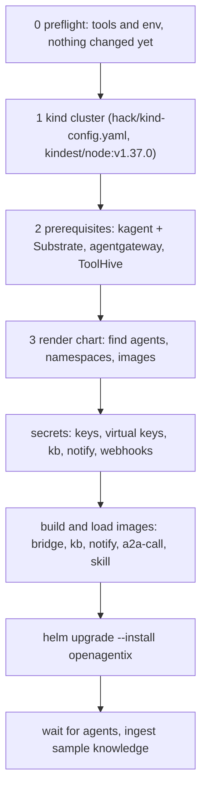

# Install

## What it is for

The goal in the original product brief is a single-command deploy with Helm. Upstream constraints make one chart impossible today: kagent and Substrate need fixed release names, a strict install order, and key material minted by `kubectl ate` before the charts start, and the Gateway API CRDs ship in neither agentgateway chart. So there are two layers.

| Layer | What | Where |
|---|---|---|
| Installer | Creates the kind cluster (or a k3s cluster with `CLUSTER_TYPE=k3d`), installs pinned upstream releases, creates Secrets from your environment, builds images, runs Helm | `install.sh`, `uninstall.sh` |
| Chart | Our own resources only, driven by values, no secret values | `charts/openagentix/` |

## How it works



Pinned upstream versions: kagent and Agent Substrate 1.0.1, Gateway API CRDs 1.6.3, agentgateway v1.7.0, ToolHive 0.67.1, Agent Kourier 0.6.0. The release is `openagentix` in namespace `openagentix-system`. The script is idempotent. If a required variable is missing it says which one and changes nothing.

## How to enable and configure

Required environment: `ANTHROPIC_API_KEY`, `TELEGRAM_BOT_TOKEN`, and `TELEGRAM_ALLOWED_CHAT_IDS` (the bridge refuses to start without it). Prerequisites on your machine: `docker`, `kind` 0.33+, `kubectl` 1.37+, `helm` 3, `jq`, `yq` (the Python wrapper), `openssl`, `shasum`, `curl`. Kubernetes 1.37 or newer is needed.

```sh
export ANTHROPIC_API_KEY=<your key>
export TELEGRAM_BOT_TOKEN=<your bot token>
export TELEGRAM_ALLOWED_CHAT_IDS=<your chat id>
./install.sh
```

Switches (documented at the top of `install.sh`): `CREATE_CLUSTER=0`, `SKIP_PREREQS=1`, `FORCE_PREREQS=1`, `SKIP_SKILL=1`, `SKIP_BRIDGE_IMAGE=1`, `SKIP_KB_IMAGE=1`, `SKIP_KB_INGEST=1`, `SKIP_NOTIFY_IMAGE=1`, `SKIP_A2A_CALL_IMAGE=1`, `KOURIER_VALUES_FILE`, `AGENT_WAIT`, and `VALUES_FILE="a.yaml b.yaml"`.

Values files are applied in order. Maps merge; lists such as `agents[]` and `schedules[]` are replaced. Helm replaces the release values on every run, so pass the same files each time.

| Demo values file | What it turns on |
|---|---|
| `components/channels/demo-values.yaml` | Kourier, one webhook connection, bindings `demo-assistant` and `demo-assistant-notify` |
| `components/schedules/demo-values.yaml` | one suspended schedule `demo-brief` |
| `components/notify/demo-values.yaml` | notify on; repeats the `assistant` agent with `notify` enabled |
| `components/observability/demo-values.yaml` | observability with the bundled VictoriaMetrics and Jaeger |

Full demo:

```sh
TELEGRAM_ALLOWED_CHAT_IDS=<your chat id> NOTIFY_TELEGRAM_CHAT_ID=<your chat id> \
VALUES_FILE="components/channels/demo-values.yaml components/schedules/demo-values.yaml components/notify/demo-values.yaml components/observability/demo-values.yaml" ./install.sh
```

Default-on blocks: `networkPolicy`, `bridge`, `gateway`, `mcp`, `knowledge`, `kagent`. Default-off: `channels.kourier`, `schedules`, `notify`, `observability`. With a block off, the render is byte-identical to before it existed.

## How to try it

Use the A2A command on the [runtime page](./runtime.md). Expect `TASK_STATE_COMPLETED` and an answer that says 4. Then message your bot on Telegram. Run the chart tests with `charts/openagentix/tests/run.sh` and `helm lint charts/openagentix`.

Uninstall: `./uninstall.sh` removes only the `openagentix` release and then the `agent-kourier` release. kind, kagent, Substrate, agentgateway, ToolHive, namespaces and Secrets stay. `PURGE_SECRETS=1` also deletes the Secrets and the key ConfigMap that `install.sh` created, plus generated webhook Secrets and the notify Secrets. `PURGE_DATA=1` deletes the knowledge base volumes and credentials, the memory model cache, the VictoriaMetrics volume, and Kourier's PVC and CRDs. Telemetry settings on the kagent controller and Kourier are not reverted by uninstall; re-run `./install.sh` without the observability values.

## What was proven

- Cold install from a deleted kind cluster, twice, on one machine with a warm Docker image cache: 604 s on a 5 CPU, 7.7 GiB VM.
- The quick start, with the sample container agent, installed on k3s (k3d, v1.37.2) on a hosted runner in 5 min 51 s and passed 28 smoke checks. See [Install on k3s](../guide/install-k3s.md) for the commands, the differences from kind and the limits.
- **OpenShift: manifests render and follow restricted-v2; not run on OpenShift.** `platform: openshift` leaves the fixed user and group ids and `fsGroup` out of every pod, points DNS egress at `openshift-dns` port 5353 and can add a console Route. Render tests check this; the default render is byte-identical. No OpenShift cluster was used. Container agents are refused there and the sandbox runtime (gVisor, node sysctls) is expected not to work. See [OpenShift](../guide/openshift.md).
- A second `install.sh` run changes nothing (checked for Kourier, notify and the base install).
- A hand-applied install can be adopted by Helm without recreating objects (README "Adopting an existing hand-applied install").

## Known limits and the demo environment

- **The demo runs on one kind node inside a Rancher Desktop VM with 6 CPU and 8 GB. Platform controllers can lose leader election and restart while images are built or controllers roll.** This was seen as a start-up race of the kagent controller, and as crash loops of `ate-idp-server` and the controller during the 20-minute stall in ADR 0003, which needed pods deleted by hand. Do heavy steps when nobody uses the demo. Earlier notes give 5 CPU and about 7.7 GiB (README, ADR 0001) or Docker Desktop 5 CPU and 8 GB (kagent spike); the 6 CPU and 8 GB figure is newer.
- Docker needs about 7.5 GB or more. The full stack idles at about 2.3 GiB in the node, and each agent sandbox adds more. Node memory requests grew from 3410 Mi to 4146 Mi as the knowledge base, memory, notify and observability were added.
- A machine with nothing cached has not been tried. Allow longer when every image must be pulled.
- The skill registry container `openagentix-registry` survives cluster deletion but its IP can change: re-run `./install.sh` after recreating the cluster.
- `FORCE_PREREQS=1` re-applies `components/runtime/values/substrate.yaml` and drops Substrate additions made by `spikes/ax`.
- The first observability enable rolls the kagent controller; see [observability](./observability.md).
- Single node, dev databases. Not a production install.
