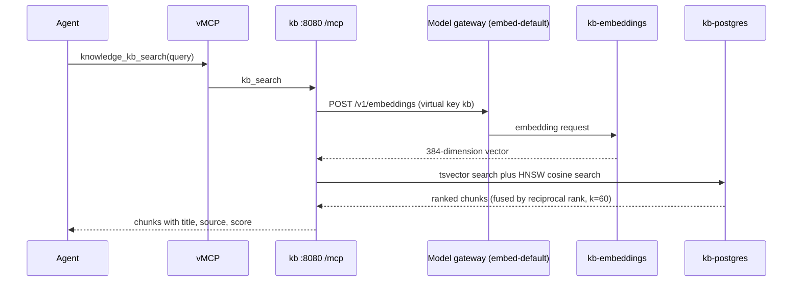

# Knowledge base

## What it is for

Agents need to answer questions from your documents. The knowledge base (`services/kb`, one Go binary) ingests markdown through a token-protected API, splits it into chunks, embeds the chunks on CPU and searches them with lexical and vector ranking combined. Nothing needs an external account: the embedding model runs in the cluster.

## How it works

Namespace `openagentix-knowledge`. Pods: `kb`, `kb-postgres` (`pgvector/pgvector:pg17`, StatefulSet, 2 Gi PVC) and `kb-embeddings` (llama.cpp `server-b10088`, model `bge-small-en-v1.5` GGUF Q8_0, 384 dimensions, 1 Gi PVC for the weights). The kb is one more backend of the vMCP through an `MCPServerEntry` named `knowledge`, so no extra pods are needed for the entry.



- MCP tools in the service: `kb_search` (`query`, `collection`, `top_k`), `kb_get_document` (`document_id`, `collection`), `kb_list_collections`. All are read-only. Agents see `knowledge_kb_search`, `knowledge_kb_get_document` and `knowledge_kb_list_collections`.
- Search results start with a notice that the text is untrusted retrieved data.
- If the query embedding takes longer than `queryEmbedTimeout` (3 s), search falls back to lexical only.
- Admin API: `PUT /v1/collections/<collection>/documents/<id>` (idempotent upsert), `DELETE`, `GET /v1/collections`, with `Authorization: Bearer` and the token from the Secret `kb-admin`. With no token configured the API answers 403.
- Stores: `memory` (dev, tests) and `postgres`. Both pass one conformance suite.

## How to enable and configure

The block is on by default.

```yaml
knowledge:
  enabled: true
  kb:
    chunkMaxChars: 600
    chunkOverlap: 100
    queryEmbedTimeout: 3s
  embeddings:
    enabled: true
    viaGateway: true
    gatewayModel: embed-default
    model: {hf: "CompendiumLabs/bge-small-en-v1.5-gguf:Q8_0", name: bge-small-en-v1.5, dim: 384, pooling: cls}
agents:
  - name: assistant
    knowledge: true
```

`install.sh` creates the Secrets `kb-admin`, `kb-postgres`, `kb-database` and `kb-virtual-key` only when absent, and ingests `components/knowledge/sample/` into the collection `openagentix`. To use a hosted embedder, set `knowledge.embeddings.enabled=false` and `knowledge.kb.embeddings.url`, `.model`, `.dim`, `.apiKeySecret`. Changing the model or its dimension means re-ingesting.

## How to try it

```sh
hack/kb-ingest.sh ./my-docs my-collection        # collection defaults to "openagentix"
```

Then use the A2A command from the [runtime page](./runtime.md) with the question "What is the OpenAgentix knowledge base canary code?". Expect `HERON-4412-KB-RETRIEVED` and a `knowledge_kb_search` call in the task records. The document id comes from the path (`adr/0001-x.md` becomes `adr:0001-x`) and the title from the first heading.

## What was proven

- Semantic hits for queries that share no word with the chunk (full-text match count 0). A paraphrase about a hijacked worker leaking a "language engine supplier passphrase" returned the credentials chunk of the security document first; a roster paraphrase returned the Telegram allowlist chunk first; a third paraphrase ranked a neighbouring chunk first. Margins are small (0.613 against 0.612).
- Footprint (kind): idle `kb` 6 MiB, `kb-embeddings` 110 MiB, `kb-postgres` 64 MiB. Ingesting 17 files (160 KB) took 25 s.
- NetworkPolicy: the kb takes 8080 only from the vMCP pod; PostgreSQL only from the kb; the embedding server only from the gateway proxy. A pod in `default` timed out on all three.
- Hugging Face text-embeddings-inference has no arm64 CPU image, so llama.cpp is used.

## Known limits

- One replica of each piece, no database backups, and the model is downloaded from Hugging Face on first start.
- No egress policy on the kb and its database; the vMCP permit-all Cedar policy applies to the kb tools. With `knowledge.access.mode` empty (the default) there is no per-collection authorization: every caller reads every collection. See the next section.
- The lexical half ORs every query word, so common words add noise on a tiny corpus.
- Turning embeddings on for an existing database does not back-fill old chunks.

## Isolation per tool group (ADR 0030, off by default)

By default nothing separates the collections: every tool group reads every one, and the only fence is what a prompt says. ADR 0030 adds an opt-in check, made by the knowledge base itself.

- **Values.** `knowledge.access.mode` is `""` (default, no check), `report` or `enforce`. `knowledge.access.sharedGroupCollections` lists what the shared tool group reads (definitions and every profile without a group of its own). `mcp.profiles[].knowledgeCollections` lists what the profiles of a group of their own read; profiles on one group must agree, because the knowledge base tells groups apart, not profiles.
- **Who is a caller.** One caller per tool group that holds a knowledge base entry. `install.sh` makes one random value per group (never printed) and writes it to two Secrets: `kb-callers` in the knowledge namespace (mounted as files, one per group) and `kb-caller-<group>` in the tools namespace. Each knowledge base entry sends its group's value with `headerForward`. The chart renders only references.
- **What the knowledge base does.** It decides the caller on every request from that request's own `Authorization` header, never from the MCP session. In `enforce` a call without a known value gets 401, before any MCP handling. `kb_list_collections` lists only the caller's collections. `kb_search` and the graph tools with no collection read only those. A collection outside the list answers byte for byte like a collection that does not exist, so its name is not confirmed. The filter is inside the store query, so `top_k` is filled from allowed rows. `report` logs `caller` and, when `enforce` would have refused or filtered the call, `outside_list: true`, and refuses nothing. A value is read from its file on every request: a rotated value needs no restart of the knowledge base.
- **Writes** stay with the admin token. A tool group's value does not write.
- **Turning it on.** `report`, read the log, then `enforce`, with the same values file on every run (Helm replaces values). `install.sh` refuses a run that would turn `enforce` off unless `ALLOW_KB_ACCESS_OFF=1`. With the mode empty and profiles on two or more groups that list the knowledge tools, it prints a warning.
- **Rotation.** Delete the key from `kb-callers` and the Secret `kb-caller-<group>`, run `install.sh`: it makes a new value, writes both, and restarts the tool servers of the group. Calls of that group get 401 in between.
- **What it does not stop.** A tool server of another group can read this group's `kb-caller-<group>` Secret through the API and send it, until ADR 0031 is built, so isolation against a compromised tool server is **not** claimed. Two profiles or two agents on one group share one list. Collections are not separated at rest. See `docs/decisions/0030-knowledge-base-isolation-and-graph-schema.md` section 7.

## Graph schema per collection (ADR 0030, off by default)

The graph has nine built-in entity types and any predicate. For a collection whose ids must have a known form (a case id, a part number), an operator can declare a schema, and the knowledge base then refuses facts that do not fit.

- **Turn it on.** `knowledge.kb.graph.schemas.enabled: true` (needs `knowledge.kb.graph.enabled`). It adds one table to the knowledge base schema and the routes below. Off, nothing changes.
- **Set a schema** before you load the documents of the collection: `hack/kb-graph-schema.sh <collection> <file.yaml>`. The file has `version`, `entityTypes` (name, optional `key` pattern, optional description) and `relationTypes` (name, `from` and `to` lists of entity types). A key must match the whole entity name, in RE2 syntax, case sensitive. The same file again changes nothing; a changed file needs a higher `version`.
- **What it checks.** A fact set load is refused (422) when an entity's type is not declared or its name does not match the key, or a relation's predicate is not declared or its ends have types the relation does not allow. The answer lists the first 20 violations by place (`entities[3]`) and rule (`type`, `key`, `predicate`, `from`, `to`), and counts the rest. Nothing of a refused fact set is stored. The check runs under the collection's graph lock, in the same transaction as the write.
- **Changing a schema** is checked against every stored fact set and every extracted fact: a break is refused (409) with the same list. A breaking change goes in steps: add the new type or relation (version n+1), reload the fact sets, remove the old one (version n+2).
- **Documents.** In a collection with a schema no extraction is queued, so it has curated facts only. The documents are still chunked and searchable. To put a schema on a collection that already has extracted facts, delete its documents, set the schema, and load them again. Deleting a schema keeps the facts, and extraction resumes for documents loaded afterwards.
- **The agent.** The read tool `kb_graph_schema` shows the schema of a collection the caller may read, or says it has none and the built-in types apply. It follows the same collection filter as the other tools.
- **Limits.** A key is not checked on aliases. There are no subtypes, no inference and no cardinality. The schema is not an ontology and does not reason over facts. It is not shown to improve answers.

## Knowledge graph

In progress, design decided: entity/relation extraction at ingest, plain tables in the knowledge base Postgres, recursive SQL, three planned tools `knowledge_kb_graph_search`, `knowledge_kb_graph_entity`, `knowledge_kb_graph_paths`.
