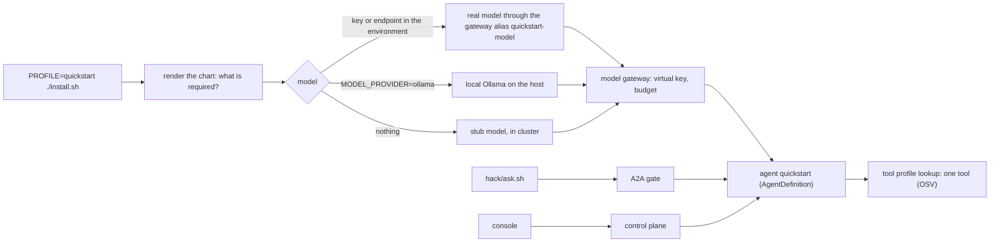

# Quick start

## What it is for

The first goal of the project is adoption (ADR 0013), and time to first working agent matters most. Before this, a first install needed `ANTHROPIC_API_KEY` and `TELEGRAM_BOT_TOKEN` and took about 23 minutes with every feature on. The quick start is one command, `PROFILE=quickstart ./install.sh`, that installs the smallest set that shows the project's point: a governed agent. The decision and its options are in ADR 0014.

## How it works



The profile is `components/quickstart/values.yaml`. It turns on the runtime, the model gateway, the tool gateway with one server and one profile, the control plane, the console and the A2A gate, and turns off the Telegram bridge, channels, schedules, notify, observability, the knowledge base and memory. The agent is not a chart agent: the installer applies `components/quickstart/agent.yaml`, an `AgentDefinition`, and the control plane builds the agent from it after checking it against the policy (one model alias, one profile, no egress).

**Which model.** The gateway alias is always `quickstart-model`. The installer picks, in order: a key in the environment (`ANTHROPIC_API_KEY`, `OPENAI_API_KEY`, `GOOGLE_API_KEY`) or an OpenAI-compatible endpoint (`MODEL_BASE_URL`, `MODEL_NAME`, optional `MODEL_API_KEY`); a local Ollama when you ask (`MODEL_PROVIDER=ollama`); the stub. `MODEL_PROVIDER` forces one. The last lines of the install say which is active; the stub case says so loudly and prints the one-line command for a real model. The agent's description carries the model line too, so the console shows it.

**The stub.** `services/stub-model` is a small Go server (standard library only) behind the gateway like any provider, so keys, budgets and metrics work. It is deterministic. A question about vulnerabilities becomes a call of the OSV tool with the package, ecosystem and version read from the prompt; a "fetch https://..." prompt becomes a call of a fetch tool that the profile does not offer, so the platform refuses; after a tool result it reports the result. Every answer says it comes from the stub. It is for trying the platform, not for answers.

**Asking without a chat app.** `hack/ask.sh quickstart "..."` opens a port-forward to the A2A gate and signs in as the ServiceAccount `openagentix-system/quickstart-ask` with a 10-minute token. The profile's gate rule allows that caller to ask `kagent/quickstart` and nothing else.

**What the installer checks first.** Secrets are derived from what the chart renders: no bridge, no Telegram token; no gateway model that uses a provider Secret, no provider key. A skill left at the placeholder digest stops the install before anything changes.

## How to enable and configure

```sh
PROFILE=quickstart ./install.sh                                    # the stub
ANTHROPIC_API_KEY=sk-ant-... PROFILE=quickstart ./install.sh       # a real model (same for OPENAI_API_KEY, GOOGLE_API_KEY)
MODEL_BASE_URL=https://host/v1 MODEL_NAME=name MODEL_API_KEY=... PROFILE=quickstart ./install.sh
MODEL_PROVIDER=ollama MODEL_NAME=llama3.2 PROFILE=quickstart ./install.sh   # not tested yet
```

`BUILD_JOBS` (default 3) sets how many images build at once. A second cluster beside an existing one: `CLUSTER=<name> KUBECONFIG=<file> ./install.sh`.

To add the bundled observability (VictoriaMetrics and Jaeger) to the quick start: `VALUES_FILE=components/observability/demo-values.yaml PROFILE=quickstart ./install.sh`.

## How it was checked

- Chart tests (`charts/openagentix/tests/run.sh`): the stub renders only when asked, is hardened and closed, the profile renders what it should and nothing else.
- Offline tests (`components/quickstart/tests/run.sh`): model choice and values, the secret and skill preflight, and that `install.sh` stops early on each bad configuration.
- The stub's Go tests (`make test` in `services/stub-model`).
- The e2e job (`.github/workflows/e2e.yml`) on a hosted runner: install with no key and no token, then `hack/ci/smoke.sh`.

## What was measured

See the table at the end of this page, filled from the e2e job summary. Only numbers that were measured are listed.

## What is not covered

- The Ollama path is built from the documented host addresses and has not been run.
- The OpenAI and Gemini default model names are defaults; set `MODEL_NAME` if they are retired.
- The stub cannot answer anything beyond its two scripted prompts.
- The console does not yet show a banner when the stub is active; the agent description says it.
