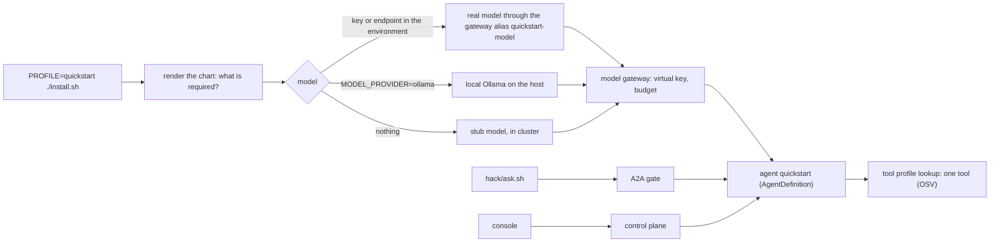

# Quick start

## What it is for

The first goal of the project is adoption (ADR 0013), and time to first working agent matters most. Before this, a first install needed `ANTHROPIC_API_KEY` and `TELEGRAM_BOT_TOKEN` and took about 23 minutes with every feature on. The quick start is one command, `PROFILE=quickstart ./install.sh`, that installs the smallest set that shows the project's point: a governed agent. The decision and its options are in ADR 0014.

## How it works



The profile is `components/quickstart/values.yaml`. It turns on the runtime, the model gateway, the tool gateway with one server and one profile, the control plane, the console, the A2A gate and the bundled observability (VictoriaMetrics and Jaeger, content capture off), and turns off the Telegram bridge, channels, schedules, notify, the knowledge base and memory. The agent is not a chart agent: the installer applies `components/quickstart/agent.yaml`, an `AgentDefinition`, and the control plane builds the agent from it after checking it against the policy (one model alias, one profile, no egress).

**Which model.** The gateway alias is always `quickstart-model`. The installer picks, in order: a key in the environment (`ANTHROPIC_API_KEY`, `OPENAI_API_KEY`, `GOOGLE_API_KEY`) or an OpenAI-compatible endpoint (`MODEL_BASE_URL`, `MODEL_NAME`, optional `MODEL_API_KEY`); a local Ollama when you ask (`MODEL_PROVIDER=ollama`); the stub. `MODEL_PROVIDER` forces one. The last lines of the install say which is active; the stub case says so loudly and prints the one-line command for a real model. The agent's description carries the model line too, so the console shows it.

**The stub.** `services/stub-model` is a small Go server (standard library only) behind the gateway like any provider, so keys, budgets and metrics work. It is deterministic. A question about vulnerabilities becomes a call of the OSV tool with the package, ecosystem and version read from the prompt; a "fetch https://..." prompt becomes a call of a fetch tool that the profile does not offer, so the platform refuses; after a tool result it reports the result. Every answer says it comes from the stub. It is for trying the platform, not for answers.

**Asking without a chat app.** `hack/ask.sh quickstart "..."` opens a port-forward to the A2A gate and signs in as the ServiceAccount `openagentix-system/quickstart-ask` with a 10-minute token. The profile's gate rule allows that caller to ask `kagent/quickstart` and nothing else.

**What the installer checks first.** Secrets are derived from what the chart renders: no bridge, no Telegram token; no gateway model that uses a provider Secret, no provider key. A skill left at the placeholder digest stops the install before anything changes.

## How to enable and configure

```sh
PROFILE=quickstart ./install.sh                                    # the stub
ANTHROPIC_API_KEY=sk-ant-... PROFILE=quickstart ./install.sh       # a real model (same for OPENAI_API_KEY, GOOGLE_API_KEY)
MODEL_BASE_URL=https://host/v1 MODEL_NAME=name MODEL_API_KEY=... PROFILE=quickstart ./install.sh
MODEL_PROVIDER=ollama MODEL_NAME=llama3.2 PROFILE=quickstart ./install.sh   # not tested yet
```

`BUILD_JOBS` (default 3) sets how many images build at once. A second cluster beside an existing one: `CLUSTER=<name> KUBECONFIG=<file> ./install.sh`.


## How it was checked

- Chart tests (`charts/openagentix/tests/run.sh`): the stub renders only when asked, is hardened and closed, the profile renders what it should and nothing else.
- Offline tests (`components/quickstart/tests/run.sh`): model choice and values, the secret and skill preflight, and that `install.sh` stops early on each bad configuration.
- The stub's Go tests (`make test` in `services/stub-model`).
- The e2e job (`.github/workflows/e2e.yml`) on a hosted runner: install with no key and no token, then `hack/ci/smoke.sh`.

## What was measured

All numbers are from the e2e job on a GitHub-hosted `ubuntu-24.04` runner (4 vCPU, about 16 GB), cold: nothing cached, every image pulled or built. A laptop and a warm re-run were not timed; the local proof was not run because the only machine available was in use for another demo.

| What | Measured |
|---|---|
| `./install.sh` start to the agent Ready (stub, no key, final profile with observability) | 394 s (6 min 34 s) |
| the same with observability off | 366 s; with it on 390 s and 394 s in two runs (about +25 s), so the profile keeps it on |
| node memory after the install and the smoke test | 2.326 GiB without observability, 2.361 to 2.366 GiB with it |
| the smoke test (10 checks) | passed, 5 s |

Where the 366 s of the run without observability go (cumulative from the start): kind, Substrate and kagent with their PostgreSQL 128 s; agentgateway 183 s; the four image builds (3 at a time) 289 s; `helm upgrade` 296 s; the tool profile vMCP 355 s; the agent Ready 366 s. Before this work the same install with every feature took about 23 minutes (README, 2026-11-25). The Substrate gVisor sandbox works on the hosted runner without any special setting.

## Time to first working agent, by phase

Issue #35 asks where the time goes. Each `e2e` and `e2e-k3s` job now prints a table of phases in its job summary and log, with the same numbers as a small JSON file (`hack/ci/phases.sh`, tested by `hack/ci/phases-test.sh`). The phases are seconds from the start of `./install.sh`:

| Phase | What marks it |
|---|---|
| cluster ready | the cluster exists; the `prerequisites` step starts |
| install done | the chart and the tool profile are installed; the wait for agents starts |
| first agent Ready | the `quickstart` AgentDefinition is Ready (the installer logs `quick start agent Ready`) |
| first answer | the first answer came back through the A2A gate; `hack/ci/smoke.sh` prints the time |
| install.sh finished | the install printed its summary |

The table below comes from real runs that were made before the markers existed, so it is rebuilt from their logs. The step lines of `install.sh` give the first, second and last rows. "First agent Ready" is not logged in these runs: the step for the sample container agent starts right after the quick start agent is Ready, so that line is an upper bound. "First answer" is the time of the first `answer:` line of the smoke test minus the time of the first `=== cluster` line, from the log timestamps, so it is good to about 2 s. All runs had the sample container agent on (`QUICKSTART_BYO=1`), the stub model and no key.

| Runner and cluster | Run | cluster ready | install done | Ready by | first answer | install.sh finished |
|---|---|---|---|---|---|---|
| kind | 45637714320 | 25 s | 314 s | 350 s | 362 s | 361 s |
| kind | 45641330819 | 24 s | 358 s | 379 s | 392 s | 390 s |
| kind | 45645087219 | 23 s | 343 s | 385 s | 397 s | 396 s |
| kind | 45660557986 | 25 s | 377 s | 397 s | 410 s | 408 s |
| k3s (k3d) | 45637714303 | 14 s | 301 s | 334 s | 346 s | 345 s |
| k3s (k3d) | 45641331356 | 15 s | 332 s | 353 s | 366 s | 364 s |
| k3s (k3d) | 45641483961 | 14 s | 329 s | 340 s | 353 s | 351 s |

The first runs of the new script are below. They have the exact marker for "first agent Ready", so this column is not an upper bound.

| Runner and cluster | Run | cluster ready | install done | first agent Ready | first answer | install.sh finished |
|---|---|---|---|---|---|---|
| kind | 45663797281 | 26 s | 341 s | 372 s | 385 s | 383 s |
| k3s (k3d) | 45663797407 | 14 s | 315 s | 326 s | 339 s | 337 s |

Reading it: on a hosted runner with nothing cached, before the faster install below, a first working agent took 6 to 7 minutes on kind (362 to 410 s) and about 6 minutes on k3s (346 to 366 s). After it, about 5 minutes on kind (301 to 320 s, next section). The question itself takes under a second with the stub. The time is the install: building the images, the tool profile and the runtime. The cluster is ready in about 25 s.

Limits. This is a hosted `ubuntu-24.04` runner (4 vCPU, 16 GB), a cold image cache every time, and the stub model, so no model call and no key. `git clone` and the tool installs are not in the numbers (the clock starts at `./install.sh`). A laptop was not timed, nor a warm re-install, nor a slow network. The runs spread by about 50 s, so read the numbers as a range. They are not a promise for your machine. The two rows of the second table are one run each.

## A faster install (issue #29)

Where the time went. The install log of an earlier run (run 45666154694, kind, the quick start with the sample container agent) gives these steps, in seconds from the start of `./install.sh`: kind, Substrate, kagent and their PostgreSQL ready at 153; agentgateway and ToolHive at 214; kagent telemetry settings (a second Helm upgrade) at 232; five image builds, three at a time, 233 to 329 (96 s); `helm upgrade` 13 s; the tool profile vMCP 85 s; the agent 51 s; the sample container agent 12 s. Almost all of it ran one step after the other, although the image builds and the three prerequisite installs do not depend on each other.

Three changes, for every profile:

- `install.sh` starts the image builds in the background before the cluster exists (a build needs Docker, not the cluster) and waits for them just before the chart is installed. `BUILD_JOBS` still sets how many build at once.
- agentgateway and ToolHive are installed while kagent and Substrate are installed (`PREREQS_PARALLEL=0` goes back to one after the other). Each background install gets its own copy of the kubeconfig and its own log, which is printed when it ends.
- The wait at the end now covers only the RemoteMCPServers that the chart renders. It used to cover all of them, including kagent's built-in `kagent-api`, and in one CI run that held the install for the full 120 s.

One new profile: `PROFILE=minimal ./install.sh` (or `./install.sh --minimal`) is the quick start without the console and without the bundled observability (`components/quickstart/minimal-values.yaml`). The gate and its audit lines, the model gateway with its virtual key and token budget, the tool profile and the stub model stay, because they are the governed agent. The tool layer cannot go: the quick start agent calls a tool through a tool profile, and the smoke test checks that. No skill is needed. The stub model sits behind the gateway and gets a virtual key like any other model. `hack/ci/smoke.sh` takes `SMOKE_CONSOLE=0` and `hack/demo.sh` takes `DEMO_CONSOLE=0` for a profile without a console.

What was measured. The `e2e` job now runs both profiles in one matrix, on the same kind of runner as before. "First answer" is the phases table value (seconds from the start of `./install.sh`). The `quickstart` rows include the sample container agent (`QUICKSTART_BYO=1`), the `minimal` rows do not.

| Run (commit with all three changes) | quickstart first answer | minimal first answer |
|---|---|---|
| 45671938772 | 306 s | 316 s |
| 45673237057 | 301 s | 312 s |
| 45674477495 | 320 s | 277 s |

| Before the change | first answer |
|---|---|
| quickstart on kind, five runs listed above | 362, 385, 392, 397, 410 s |

| Runner memory in use after install, smoke test and demo (`free -m`, "used") | quickstart | minimal |
|---|---|---|
| the three runs above | 3435, 3381, 3422 MB | 3276, 3220, 3214 MB |

Reading it. The quick start went from 362 to 410 s to 301 to 320 s (three runs after, five before). The gain comes from overlapping the steps: the builds, which took 96 s in a row, now finish while the prerequisites install, and the install waits only 3 to 10 s for them. The minimal profile did not show a gain in time that these runs can tell apart from the spread (277 to 316 s against 301 to 320 s). With the builds hidden behind the prerequisites, dropping the console image no longer shortens the critical path. What the minimal profile does give is no console and no metrics or tracing store, and about 100 to 220 MB less memory in use on the runner. What is left on the critical path in the minimal runs: the runtime and the other prerequisites (about 160 to 200 s until all of them are done), the tool profile vMCP (about 55 to 60 s) and the first start of the agent (about 40 to 50 s).

Limits. Three runs per profile, one runner type, a cold cache, the stub model, no clone time. The runs spread by about 20 to 40 s, so a difference of 10 s between the two profiles means nothing. The runs before the change are the ones listed above, from other days and other commits. An earlier run, before the end wait was fixed, spent 120 s in the end wait (run 45670114474, quickstart: 432 s), because kagent's built-in `kagent-api` server logged connection errors in that job; that wait is fixed. The `kagent-api` errors appeared again in the quickstart jobs (the controller log in the job's diagnostics step) and were not seen in the controller log of the earlier run 45666154694. They are not explained yet. The first run of `minimal` failed after the install with an unbound variable in the closing summary of `install.sh`, which is fixed and has a test. Memory is the runner total, not the node, so it also holds the runner's own processes.

## What is not covered

- The Ollama path is built from the documented host addresses and has not been run.
- The OpenAI and Gemini default model names are defaults; set `MODEL_NAME` if they are retired.
- The stub cannot answer anything beyond its two scripted prompts.
- The console does not yet show a banner when the stub is active; the agent description says it.
