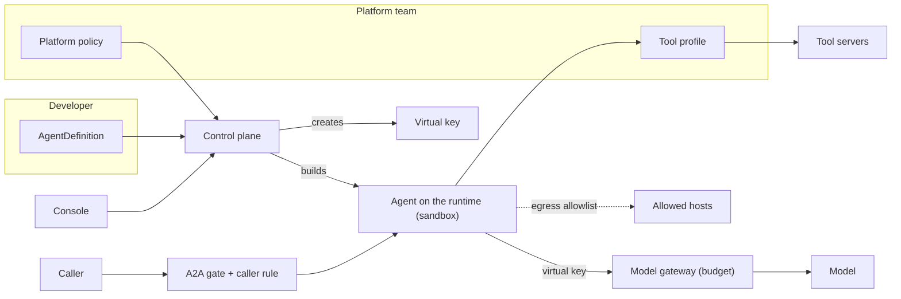

# Concepts

This page explains the words used in the rest of the documentation. Each entry is one or two sentences. The [feature diary](../index.md) has the details and the proof for each part.

## Agent definition

An `AgentDefinition` (API group `openagentix.io/v1alpha1`, short name `oad`) is a Kubernetes resource that says what an agent should do: its model, instructions, tool profile and tools, and a few switches. It has no field for an image, a key, a tool server address or a budget. Those come from the platform. See [Control plane](../features/control-plane.md).

## Control plane

The control plane is a controller in the cluster. It reads each `AgentDefinition`, checks it against the platform policy, and then creates the runtime agent, its gateway key and a status. If the definition breaks a rule, it creates nothing and writes the reason in the status.

## Platform policy

The platform policy is what the platform team allows: for example which models, which tool profiles, which outside hosts, and how many agents. It is set in the chart values (`controlPlane.policy`). The console shows it read-only.

## Runtime

The runtime runs the agent. Today this is kagent on Agent Substrate: each conversation runs in its own gVisor sandbox. The control plane talks to the runtime through an adapter. A plain adapter for any agent that speaks A2A is planned for release 0.3.

## Model gateway and virtual key

The model gateway (agentgateway) is the only way an agent reaches a model. Each agent holds its own **virtual key** for the gateway, never the provider's key. The gateway uses the virtual key to apply a token budget per agent (by default 1,000,000 tokens per hour) and to record tokens and cost per agent.

## Tool gateway and tool profile

Tools are MCP servers behind a tool gateway (ToolHive virtual MCP server). A **tool profile** is a named list of approved tools with its own endpoint. An agent with a profile sees only those tools. A tool outside the profile is not found, even from code the agent runs.

## Egress allowlist

Each agent sandbox can reach only what its model and tools need, plus the hosts listed for that agent (`https://host[:port]`). Everything else is refused by the sandbox's egress proxy. Rules match host and port, not paths.

## A2A and the A2A gate

A2A (Agent2Agent) is an open protocol for calling an agent. The **A2A gate** is a small proxy in front of the agents. Every caller must prove who it is (a Kubernetes ServiceAccount token or a key). A **caller rule** says which agents that caller may call and which user ids it may use. The gate writes one audit line per request.

## Audit record

Two records exist today: the A2A gate's audit line for each request (the user id is stored as a hash, never the message text), and the tool gateway's `AUDIT` line for each tool call (tool, outcome, session, duration, no arguments). Both are pod logs, not a tamper-evident store.

## Console

The console is a web page for the platform. It lists agents, builds new ones within the policy, shows the YAML, pauses and deletes. It shows models, tools, the policy and, with observability on, spend and traces, read-only. It has no ingress: you open it with `kubectl port-forward` and a token.

## Adapter

OpenAgentix does not rebuild what other open-source projects already do. It uses them behind adapters: kagent and Agent Substrate (runtime), agentgateway (models), ToolHive (tools), VictoriaMetrics and Jaeger (telemetry, through OpenTelemetry). The aim of this design is that replacing one needs a new adapter, not a change to the `AgentDefinition`. Today each part has one adapter.
