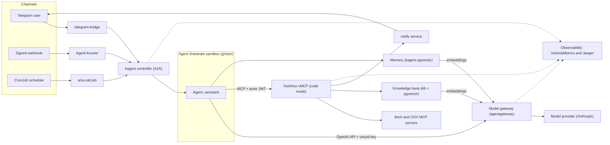

# OpenAgentix

OpenAgentix is an open-source control plane for running AI agents on Kubernetes under the rules your platform team sets.


*Console in demo mode.*

## What you get

- **No provider keys in agent pods, and cost per agent.** Each agent gets its own key for a model gateway, with a token budget. The gateway records tokens and cost per agent and refuses calls when the budget is used up.
- **Tools and network closed by default.** An agent sees only the tools in the tool profile you approved. Its sandbox reaches only what its model and tools need, plus hosts you list.
- **Known callers and a record.** A gate checks who calls an agent and which user they may speak for, and writes one audit line per request. Tool calls are audited too.
- **Agents as Kubernetes resources.** A short `AgentDefinition` is checked against a platform policy. If it breaks a rule, it is refused with a reason and nothing is created. Keep it in Git and apply it like any manifest.
- **One shared stack instead of one per team.** Runtime, gateways, telemetry and a web console come from one install. They are existing open-source projects behind adapters, on open standards (MCP, A2A, OpenTelemetry).

Built with Agent Substrate, kagent, agentgateway, MCP and ToolHive, A2A, OpenTelemetry, VictoriaMetrics, Jaeger, Gateway API, PostgreSQL with pgvector and Agent Kourier: see [Built with](/guide/built-with).

Read more: [Why OpenAgentix](/guide/why), [Concepts](/guide/concepts), [Use cases](/guide/use-cases), [FAQ](/guide/faq).

## Try it

You need `docker`, `kind`, `kubectl`, `helm`, `jq`, the Python `yq`, `openssl`, `curl` and `python3`, and Docker with 4 CPU and 8 GB. No model key is needed to start.

```sh
git clone https://github.com/openagentix/openagentix && cd openagentix
PROFILE=quickstart ./install.sh                     # no key: a scripted stub model answers
hack/ask.sh quickstart "Look up known vulnerabilities of lodash 4.17.20 (npm)"
```

The installer ends with a summary: how long it took, which model is active, and the commands to ask the agent and open the console. For real answers, run it again with your key, for example `ANTHROPIC_API_KEY=sk-ant-... PROFILE=quickstart ./install.sh`, or with any OpenAI-compatible endpoint. Details: [Quick start](./features/quick-start.md).

## Status

- Early project with one maintainer. Last release `v0.2.0` (2026-11-25). The control plane, the console and the quick start came after it and are not yet in a release.
- Proven on one single-node kind cluster, and the keyless quick start in CI on a hosted runner (6 min 34 s). The same quick start and smoke test also passed on k3s (k3d, v1.37.2) in a CI job that is not a required check ([Install on k3s](./guide/install-k3s.md)). Not yet tried on a managed cloud, OpenShift, several nodes or under load.
- Agents run on kagent with Agent Substrate. Bringing your own A2A agent is planned for 0.3.
- Not built yet: human approval, identity per agent, budgets in money, a Slack channel proven on a real workspace.

## About this diary

This diary records what was built, how each part was proven, and what is still missing. Read [what works](./what-works.md) before you rely on anything.

## Component map

An agent never holds a provider key. It holds one virtual key for the model gateway, so cost and budgets are per agent.



Namespaces: `kagent` (controller and agents), `ate-system` (Substrate), `agentgateway-system`, `mcp-tools`, `toolhive-system`, `openagentix-gateway` (bridge), `openagentix-knowledge`, `openagentix-memory`, `openagentix-notify`, `openagentix-channels` and `agent-kourier`, `openagentix-schedules`, `openagentix-observability`, `openagentix-system` (Helm release).

## How it is packaged

Two layers. `install.sh` creates the kind cluster, installs the upstream releases at pinned versions (kagent and Substrate 1.0.1, Gateway API CRDs 1.6.3, agentgateway v1.7.0, ToolHive 0.67.1), makes Secrets from your environment and builds images. The chart `charts/openagentix` then renders only our own resources from values. See [install](./features/install.md).

## Pages

| Page | What it covers |
|---|---|
| [What works](./what-works.md) | One table: every capability, its state, proof, location and main gap |
| [Timeline](./timeline.md) | Dated diary of milestones, oldest first |
| [Quick start](./features/quick-start.md) | One command, no key and no chat token: a governed agent in minutes |
| [Runtime](./features/runtime.md) | kagent on Agent Substrate, A2A, why not Google AX |
| [Model gateway](./features/model-gateway.md) | agentgateway, virtual keys, budgets, cost, embedding aliases |
| [Tools](./features/tools.md) | ToolHive vMCP, code mode, skills, tool-layer identity |
| [Knowledge base](./features/knowledge-base.md) | Hybrid search service |
| [Knowledge graph](./features/knowledge-graph.md) | Entities and relations for questions that need several documents |
| [Memory](./features/memory.md) | kagent long-term memory per agent and user |
| [Channels](./features/channels.md) | Telegram bridge, Agent Kourier, webhooks, bindings |
| [Schedules](./features/schedules.md) | CronJobs that call an agent over A2A |
| [Notify](./features/notify.md) | Agents deliver a result to a named chat |
| [Observability](./features/observability.md) | Cost per agent, one trace per turn, audit |
| [Security](./features/security.md) | Identity, network policies, what is not protected |
| [Control plane](./features/control-plane.md) | `AgentDefinition`, the controller, policy and the admission guard |
| [Console](./features/console.md) | The web console and the agent builder |
| [Reference](./reference/index.md) | Exact fields, limits and APIs: `AgentDefinition`, policy, catalog, console API, A2A gate, admission guard |
| [Install](./features/install.md) | install.sh, values files, uninstall, demo values |
| [Maintainer notes](https://github.com/openagentix/openagentix/blob/main/docs/diary/README.md) | How to keep this diary current |

Decision records are in `docs/decisions/`: ADR 0001 (runtime), ADR 0002 (schedules and delivery), ADR 0003 (observability), ADR 0004 (knowledge graph), ADR 0005 (runtime speed), ADR 0006 (governance), ADR 0007 (control plane and console), ADR 0008 to 0013 (routing, FinOps, project structure, foundation readiness, platform primitives, focus).
