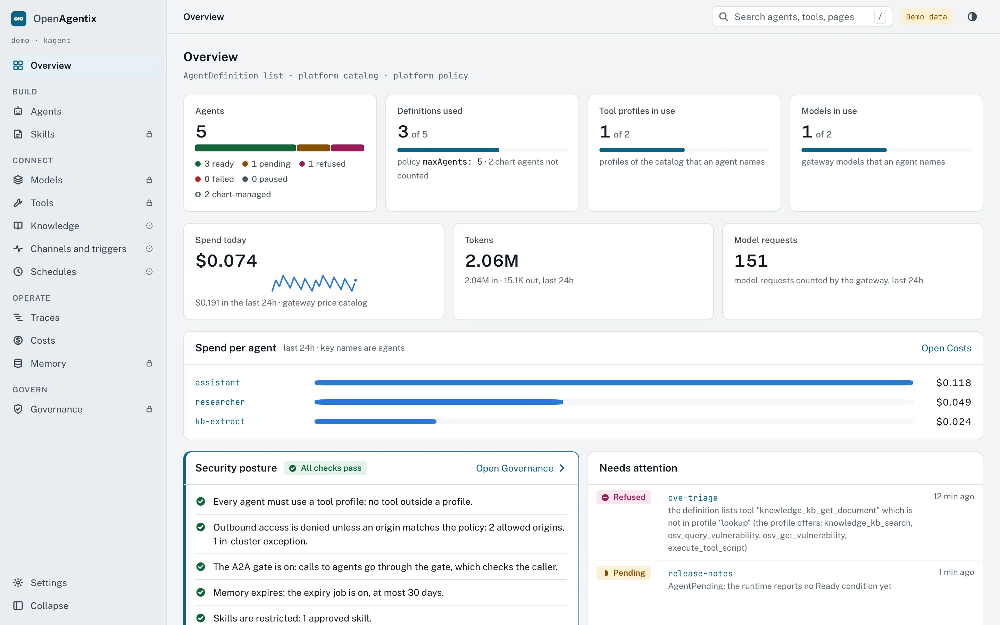
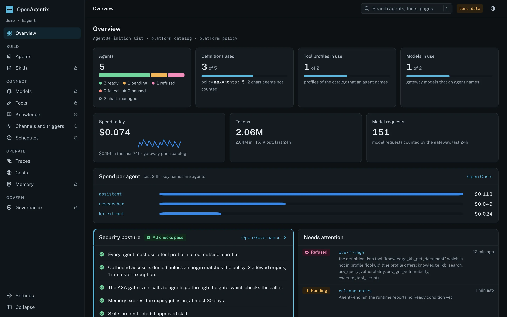
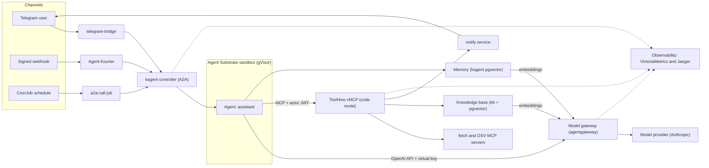

# OpenAgentix

OpenAgentix is an open-source (Apache-2.0), Kubernetes-native control plane for running AI agents under the rules your platform team sets.

- **Who it is for:** platform teams whose developers have started to run AI agents, and who need agent governance before those agents touch real tools and data.
- **The problem:** each team wires its own stack. Provider keys sit in agent pods, nobody knows what each agent costs, tools and the network are wide open, and there is no audit trail of who called which agent.
- **What you get in about 5 minutes:** one command, no model key, no chat token. A governed agent on a local kind cluster, with its own gateway key and token budget, one approved MCP tool, callers checked at an A2A gate, and a web console.
- **What is proven and what is not:** [what works today, and what does not yet](./what-works.md). The short version is under [Status](#status) below.




*Console in demo mode.*

## What you get

- **No provider keys in agent pods, and cost per agent.** Each agent gets its own key for a model gateway, with a token budget. The gateway records tokens and cost per agent and refuses calls when the budget is used up.
- **Least privilege for tools and network.** An agent sees only the MCP (Model Context Protocol) tools in the tool profile you approved. Egress control: its sandbox reaches only what its model and tools need, plus hosts you list.
- **Known callers and an audit trail.** A gate checks who calls an agent over the A2A protocol and which user they may speak for, and writes one audit line per request. Tool calls are audited too.
- **Agents as Kubernetes resources.** A short `AgentDefinition` is checked against a platform policy. If it breaks a rule, it is refused with a reason and nothing is created. Keep it in Git and apply it like any manifest.
- **Bring your own agent.** Run your own container that speaks A2A 1.0, built with any framework, under the same key, budget, gate and tool profile (opt-in; proven in CI on kind). See [Bring your own agent](./guide/bring-your-own-agent.md).
- **One shared stack instead of one per team.** Runtime, model gateway, MCP gateway, telemetry and a web console come from one install. They are existing open-source projects behind adapters, on open standards (MCP, A2A, OpenTelemetry).

Built with Agent Substrate, kagent, agentgateway, MCP and ToolHive, A2A, OpenTelemetry, VictoriaMetrics, Jaeger, Gateway API, PostgreSQL with pgvector and Agent Kourier: see [Built with](/guide/built-with).

Read more: [Why OpenAgentix](/guide/why), [Concepts](/guide/concepts), [Use cases](/guide/use-cases), [FAQ](/guide/faq).

## Try it

You need `docker`, `kind`, `kubectl`, `helm`, `jq`, the Python `yq`, `openssl`, `curl` and `python3`, and Docker with 4 CPU and 8 GB. No model key is needed to start.

```sh
git clone https://github.com/openagentix/openagentix && cd openagentix
PROFILE=quickstart ./install.sh                     # no key: a scripted stub model answers
hack/ask.sh quickstart "Look up known vulnerabilities of lodash 4.17.20 (npm)"
```

The installer ends with a summary: how long it took, which model is active, and the commands to ask the agent and open the console. For real answers, run it again with your key, for example `ANTHROPIC_API_KEY=sk-ant-... PROFILE=quickstart ./install.sh`, or with any OpenAI-compatible endpoint. Details: [Quick start](./features/quick-start.md).

## Status

- Early project with one maintainer. Not production ready. Last release `v0.2.0` (2026-11-25). The control plane, the console, the quick start and bring your own agent came after it and are not yet in a release.
- Proven on one single-node kind cluster, and the keyless quick start in CI on hosted runners: first answer about 5 minutes after the start of `./install.sh` on kind (301 to 320 s in three runs, empty cache, stub model). The same quick start and smoke test also passed on k3s (k3d) in CI ([Install on k3s](./guide/install-k3s.md)). A laptop was not timed.
- Not run yet: a managed cloud (GKE, EKS, AKS), OpenShift, several nodes, load. The remote-cluster installer and the OpenShift manifests are tested offline only.
- Agents run on kagent with Agent Substrate. Bring your own A2A agent is proven in CI on kind only, off by default.
- Release signing, SBOM and provenance are built but unproven until a real tag runs.
- Not built yet: human approval, one identity per agent for every call, budgets in money, a Slack channel proven on a real workspace.

## Get involved

- [Your first contribution in an hour](./guide/first-contribution.md), with no cluster and no key.
- [Good first issues](https://github.com/openagentix/openagentix/labels/good%20first%20issue).
- Questions and ideas: [GitHub Discussions](https://github.com/openagentix/openagentix/discussions).
- Using or evaluating OpenAgentix? Add a row to [ADOPTERS.md](https://github.com/openagentix/openagentix/blob/main/ADOPTERS.md) ("evaluating" counts), or post in [Show and tell](https://github.com/openagentix/openagentix/discussions/categories/show-and-tell). If you want to shape the 0.3 release with your use case, say so there.

## About this diary

This diary records what was built, how each part was proven, and what is still missing. Read [what works](./what-works.md) before you rely on anything.

## Component map

An agent never holds a provider key. It holds one virtual key for the model gateway, so cost and budgets are per agent.



Namespaces: `kagent` (controller and agents), `ate-system` (Substrate), `agentgateway-system`, `mcp-tools`, `toolhive-system`, `openagentix-gateway` (bridge), `openagentix-knowledge`, `openagentix-memory`, `openagentix-notify`, `openagentix-channels` and `agent-kourier`, `openagentix-schedules`, `openagentix-observability`, `openagentix-system` (Helm release).

## How it is packaged

Two layers. `install.sh` creates the kind cluster, installs the upstream releases at pinned versions (kagent and Substrate 1.0.1, Gateway API CRDs 1.6.3, agentgateway v1.7.0, ToolHive 0.67.1), makes Secrets from your environment and builds images. The chart `charts/openagentix` then renders only our own resources from values. See [install](./features/install.md).

## Pages

| Page | What it covers |
|---|---|
| [What works](./what-works.md) | One table: every capability, its state, proof, location and main gap |
| [Timeline](./timeline.md) | Dated diary of milestones, oldest first |
| [Quick start](./features/quick-start.md) | One command, no key and no chat token: a governed agent in minutes |
| [Runtime](./features/runtime.md) | kagent on Agent Substrate, A2A, why not Google AX |
| [Model gateway](./features/model-gateway.md) | agentgateway, virtual keys, budgets, cost, embedding aliases |
| [Tools](./features/tools.md) | ToolHive vMCP, code mode, skills, tool-layer identity |
| [Knowledge base](./features/knowledge-base.md) | Hybrid search service |
| [Knowledge graph](./features/knowledge-graph.md) | Entities and relations for questions that need several documents |
| [Memory](./features/memory.md) | kagent long-term memory per agent and user |
| [Channels](./features/channels.md) | Telegram bridge, Agent Kourier, webhooks, bindings |
| [Schedules](./features/schedules.md) | CronJobs that call an agent over A2A |
| [Notify](./features/notify.md) | Agents deliver a result to a named chat |
| [Observability](./features/observability.md) | Cost per agent, one trace per turn, audit |
| [Security](./features/security.md) | Identity, network policies, what is not protected |
| [Control plane](./features/control-plane.md) | `AgentDefinition`, the controller, policy and the admission guard |
| [Console](./features/console.md) | The web console and the agent builder |
| [Reference](./reference/index.md) | Exact fields, limits and APIs: `AgentDefinition`, policy, catalog, console API, A2A gate, admission guard |
| [Install](./features/install.md) | install.sh, values files, uninstall, demo values |
| [Maintainer notes](https://github.com/openagentix/openagentix/blob/main/docs/diary/README.md) | How to keep this diary current |

Decision records are in `docs/decisions/`: ADR 0001 (runtime), ADR 0002 (schedules and delivery), ADR 0003 (observability), ADR 0004 (knowledge graph), ADR 0005 (runtime speed), ADR 0006 (governance), ADR 0007 (control plane and console), ADR 0008 to 0013 (routing, FinOps, project structure, foundation readiness, platform primitives, focus).
